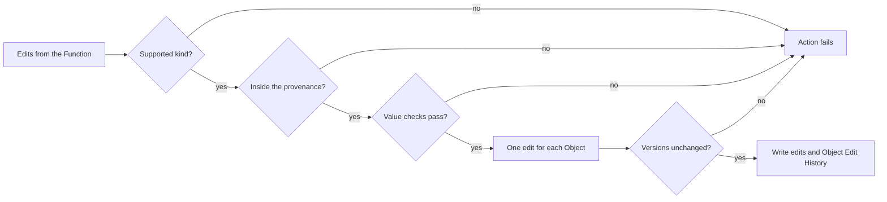

# Edit Functions

An edit Function is a [Function](./functions.md) that returns edits to Objects and Links. A function-backed Action applies the edits. Source: TypeScript v2 Ontology edits ("For the edits created in a function to actually be applied, Ontology edit functions _must be configured as a function-backed Action_"). An edit Function returns a list of edits, and that output makes it an edit Function, as [Code](./query-functions.md#code) of Query Functions specifies. Our rule.

## Contract

### Provenance

- An edit Function declares the Object Types and Link Types that it edits with the `Edits` type of `@osdk/functions`. Source: TypeScript v2 Ontology edits ("Functions that edit the Ontology must explicitly declare the entities that will be edited using the `Edits` type").
- These types are the provenance of the function-backed Action. Source: Function-backed actions: getting started.
- A one-to-many Link changes through an update of its foreign key Property, so the Function declares only the Object Type that holds the key. Source: TypeScript v2 Ontology edits ("For one-to-one and one-to-many links, use the `update` method available on the created batch to modify the foreign key property").

### Edits

- A Function collects its edits with `createEditBatch` and returns them with `getEdits()`. Source: `EditBatch.ts`.
- These are the supported edit kinds. Source: `types.ts`, `types.ts`.

| `type`         | Does                                                                       |
| -------------- | -------------------------------------------------------------------------- |
| `createObject` | Creates an Object with the given Property values, the primary key included |
| `updateObject` | Changes the given Property values of an Object                             |
| `deleteObject` | Deletes an Object                                                          |
| `addLink`      | Adds a Link of a many-to-many Link Type                                    |
| `removeLink`   | Removes a Link of a many-to-many Link Type                                 |

- An interface edit fails the Action. Our rule.

### Apply

- From each Object reference, the Ontology service reads only `$apiName` and `$primaryKey`. It ignores each key in `properties` that starts with `$`. Source: `createEditBatch.ts` (an update stores the whole Object).
- Each edit must be on an Object Type or Link Type of the provenance. Otherwise the Action fails. Source: Function-backed actions: getting started ("If a newer release of the function returns edits outside of this provenance (for example, an additional object type), action execution will fail").
- Each edit passes the value checks of a rule edit. [Properties](../object-link-types/properties.md#value-rules-on-write) specifies them. A value that fails a check fails the Action with 400 `ApplyActionFailed`, as [HTTP API](../../service/http-api.md#errors) specifies.
- A create with the primary key of an existing Object fails. An update cannot change a primary key. Source: TypeScript v2 Ontology edits ("The primary key property value of an existing object cannot be updated").
- A Link edit whose source or target Object does not exist fails the Action with 404 `ObjectNotFound`, as an update of a missing Object fails. An Object that a create of the same Function makes exists for this check. Our rule.
- A delete edit of an Object that the snapshot of the run did not see succeeds. A `VALIDATE_ONLY` apply gives `VALID`. An apply lists the delete in the edits of `ALL_V2_WITH_DELETIONS`, and counts it in `deletedObjectsCount`, also when it is the only edit. The Action writes nothing for it, and makes no Object Edit History entry. Our rule.
- After the run, the Ontology service reads the key of such a delete again, as the caller. When an Object with that key exists then, another Action created it during the run, and the apply gets 409 `ObjectChanged`. The write takes no lock, runs no statement, and makes no entry for such a delete. So an Object that another Action creates after that read stays. Our rule: the write acts only on what the snapshot of the run saw.
- A delete edit of an Object that the snapshot saw keeps its lock and its version check, as [Storage](../../service/storage.md#writes) specifies. When that Object is gone or changed before the lock, the apply gets 409 `ObjectChanged`. Our rule.
- A delete of an Object that the snapshot did not see counts as 1 edited Object for the limit of [Action Types](../action-types/action-types.md#apply). Our rule.
- When another Action deletes the source or target Object of an `addLink` edit after the run's snapshot and before the write locks it, the Action fails with 409 `ObjectChanged`. [Storage](../../service/storage.md#writes) specifies the lock. Our rule.
- The edits compile to one edit for each Object. For the same Property of the same Object, a later edit wins. [Rules](../action-types/rules.md#compile) compile in the same way. Our rule.
- These sequences of edits on 1 Object compile to 1 edit. 2 updates give 1 update, and a later value of a Property wins. A create and then an update give 1 create with the values of the update. An update and then a delete give 1 delete. A create and then a delete give no edit. Our rule.
- 4 sequences on 1 Object fail the Action with 400 `ApplyActionFailed`, and the Action writes nothing. They are 2 creates, a delete and then an update, a delete and then a create, and an update and then a create. The `parameters` are `originalErrorName: "Ontos:UnsupportedEditSequence"`, `userErrorMessage: "The Action could not apply because of an unsupported edit sequence."`, and `builderErrorMessage: "The Action produced more than one conflicting edit for the same Object. Change the Action rules or Function to emit a single edit sequence per Object."`. The error has no `functionRid`.
- A `VALIDATE_ONLY` apply gives the same 400, because it runs the Function and compiles its edits, as [Functions](./functions.md#function-backed-actions) specifies.
- Each other sequence that the compile refuses keeps 400 `FunctionExecutionFailed`, with a `message` that names the Object. Examples are a delete and then a delete of 1 Object, and an edit of an Object that the run created and then deleted. A Link edit after the delete of an existing Object keeps 400 `ApplyActionFailed` with `parameters: {}`. Our rule.
- The Ontology service writes the edits in the write transaction of the Action, with one [Object Edit History](../object-edits/edit-history.md) entry for each Object edit. A delete of an Object that the snapshot of the run did not see writes nothing, and makes no entry. [Storage](../../service/storage.md#writes) specifies the transaction.

### Version check

- The Ontology service opens the run's snapshot before it reads the Objects of the [Submission criteria](../action-types/submission-criteria.md). It checks the criteria in that snapshot, and then runs the Function in the same snapshot. So the criteria, the Function, and the version check read 1 snapshot, and the write does not re-evaluate the criteria. Our rule.
- The write transaction checks the version of each Object that an edit updates or deletes, also when the Function never read it. It compares each version with the version in the run's snapshot. Source: Consistency and isolation ("a property is written when the function sets it through an Ontology edit").
- The check does not cover an Object that the Function only reads, or an Object parameter that the Function does not edit. This holds also when the Function copies a value from that Object into an edit. Our rule.
- When a checked version changed, the Action fails with 409 `ObjectChanged` and writes nothing. The Ontology service does not run the Function again. Source: [Storage](../../service/storage.md#writes).

### Bulk writes

- A bulk write of Objects, such as the sync of an outside system, is 1 function-backed Action with 1 struct list input, such as `rows: Row[]`. The caller applies it 1 time for each chunk of rows, as [Design rules](../design-rules.md#actions) state.
- The Function reads the Objects of the keys of its rows. It returns a create for each key with no Object, and an update for each Object that differs from its row. It returns no edit for a row that changes nothing. Each update edit adds 1 Object Edit History entry, also when it changes no value. Our rule.
- A row carries its primary key as a String field, and each money amount as a `Decimal` field, as [Discovery](./functions.md#discovery) specifies. The Function gets the amount as its plain exact string, and writes it to a Decimal Property or a Decimal struct field. Our rule.
- Start with 1,000 rows for each call. This number is an estimate. Send a smaller list when a call fails because of its time limit. Our rule.
- Keep the list of a `VALIDATE_ONLY` call under about 5,000 rows. Its answer holds 1 entry for each row, and the service does not stream it, so buffered response size limits ([HTTP API](../../service/http-api.md#requests)) apply. An `INVALID` answer of either mode has the same size. Our rule.
- Name no field of a row `type`. The stock `@osdk/client` 2.92.0 reads a struct value whose `type` names a wire Object Set kind as an Object Set. For `filter`, `intersect`, `searchAround`, `subtract`, and `union`, it throws before it sends the request. For `base`, `reference`, `static`, and `interfaceBase`, it sends the row unchanged. Source: `util/toDataValue.js` of `@osdk/client` 2.92.0 (`isWireObjectSet`).
- The Ontology SDK type of a struct list also takes `null`. Leave the list out, or send `[]`, because `null` gets 400, as [Action Types](../action-types/action-types.md#parameters) specifies. Our rule.
- An `active` Action Type keeps the type of each parameter, as [Action Types](../action-types/action-types.md#statuses) specifies. A changed field of the row type changes the parameter type. So keep the Action Type `experimental` until its row type is stable, or add a new Action Type for a new row type. Our rule.

## Diagram

## Out of scope

- Staged writes with a `WriteableClient`. Source: TypeScript v2 staged writes.
- Interface edits: `createObjectForInterface`, `updateObjectForInterface`, and `deleteObjectForInterface`. Source: `types.ts`.
- Notifications from a Function. Source: `Notification.ts`.

## Related

- [Functions](./functions.md)
- [Rules](../action-types/rules.md)
- [Object Edit History](../object-edits/edit-history.md)
- [Storage](../../service/storage.md)
