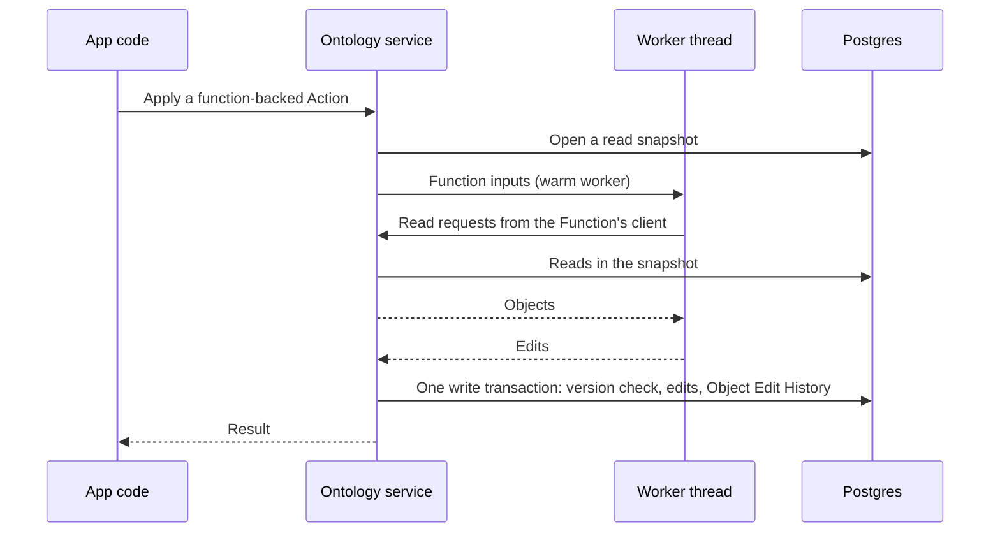

# Functions

A Function is TypeScript code that an app writes. A Function reads Objects and returns edits or a value. An [edit Function](./edit-functions.md) returns edits, and a function-backed Action runs it. A [Query Function](./query-functions.md) returns a value, and an app runs it through the Execute Query route. Source: TypeScript v2 Ontology edits ("For the edits created in a function to actually be applied, Ontology edit functions _must be configured as a function-backed Action_").

## Contract

### Code

- A Function is a TypeScript v2 Function: the default export of one file. Source: Getting started with TypeScript v2.
- The file is `functions/typescript-functions/src/functions/<name>.ts` in the app's Ontology deployment repository. Each file exports one Function. Sources: SuperRepo tutorial, Migrate from TypeScript v1 to TypeScript v2 ("Each file can export a single function").
- The API name of a Function is its file name without `.ts`. Source: Getting started with TypeScript v2 ("The name of your file must match the name of your function"). Deviation: if a `config` `apiName` does not match the file name, `ontos validate` and `ontos publish` stop with an error naming the file and both names.
- The first parameter is a `Client` from `@osdk/client`, and the Ontology service gives it to the Function. Source: Migrate from TypeScript v1 to TypeScript v2 ("you must access an Ontology SDK client by specifying it as the first argument in the function signature").
- Each other parameter is an input. An input has a supported [Action parameter type](../action-types/action-types.md#parameters). Our rule.
- A Decimal input has the type `Decimal`, a branded string that the app declares 1 time: `type Decimal<T extends string = string> = T & { __decimalBrand?: void };`. It has the shape of `Long` in `@osdk/functions`, which has no `Decimal` type. [Discovery](#discovery) maps the type name `Decimal` to a `decimal` parameter. Sources: `PrimitiveTypes.d.ts` of `@osdk/functions` 1.30.0, [OSDK workarounds](../../service/osdk-workarounds.md). Our rule.
- A Function does its Decimal math with the app's own `big.js`. It rounds a result 1 time to the scale of the Property that it writes, as [Value rules on write](../object-link-types/properties.md#value-rules-on-write) specifies, because the Ontology service never rounds a write. Our rule. For example:

```ts
import Big from 'big.js';

type Decimal<T extends string = string> = T & { __decimalBrand?: void };

// rate is "0.0825" and the 2 unit prices are "12.5000" and "0.3333": the total is 13.89204725, written as "13.89".
const total = unitPrices.reduce((sum, price) => sum.plus(price), new Big(0)).times(new Big(rate).plus(1));
batch.update(invoice, { total: total.round(2, 1).toFixed(2) }); // rounding mode 1 is roundHalfUp
```

- An edit Function returns the edits of an edit batch. [Edit Functions](./edit-functions.md) specifies them. A Query Function returns a value. [Query Functions](./query-functions.md#code) specifies how the output decides the kind.
- A Function is trusted code. It runs with the access of the Ontology service. Our rule.
- The Ontology service removes `fetch` before it runs a Function, so a Function that calls `fetch` fails. The service blocks no other network call, such as one through `node:http`, because a Function is trusted code. Our rule. Source: Make API calls from functions ("By default, functions are not allowed to call external APIs").

### Function-backed Actions

- The app defines a function-backed Action with `defineFunctionBackedAction` of `@osdk/maker-experimental`, and names the Function's API name. Source: `defineFunctionBackedAction.ts`.
- `defineFunctionBackedAction` writes a placeholder Function rule with no parameters into the IR. Source: same file ("delegate this to conversion step").
- At publish, the Ontology service fills the placeholder. It adds one Action parameter for each Function input, and sets the provenance from the Function's `Edits` type. Sources: Function-backed actions: getting started ("all inputs of the function will automatically be created as parameters"), `convertFunctionBackedAction`.
- The display name of each of these parameters is the input name with its first letter in upper case. So `customerId` becomes `CustomerId`. Sources: `convertFunctionBackedAction`, `uppercaseFirstLetter`.
- A function-backed Action runs an edit Function. A Function rule that names a Query Function gets `CompileError`, whose text says that a function-backed Action runs an edit Function. `ontos validate` and `ontos publish` stop with that text. Our rule.
- A publish fails when a placeholder names no Function, or when a Function input has a type out of scope. [Publish](../../service/publish.md#route) specifies one exception for `validateOnly`. Our rule.
- In the [Ontology SDK](../ontology-sdk/ontology-sdk.md), a function-backed Action is an Action with one parameter for each Function input. Our rule.
- A Function input can have a union of string literals as its type, such as `"lead" | "won"`, or a list of one. Its parameter then gets the `oneOf` [allowed values](../action-types/action-types.md#parameters) of those literals, with no other value allowed. `VALIDATE_ONLY` and apply check them, as for a rule-backed Action. Each other input has the default allowed values of its type. Deviation: `defineFunctionBackedAction` of `@osdk/maker-experimental` 0.87.0 takes no `parameterConfiguration`, so Ontos reads allowed string-literal unions from the Function signature. Source: `defineFunctionBackedAction.d.ts` of `@osdk/maker-experimental` 0.87.0.
- A `VALIDATE_ONLY` apply of a function-backed Action runs steps 1 and 2, and then runs the Function and the value check of its edits. It writes no edit, makes no Edit History entry, and returns no `operationId`. A Function error gives the HTTP error of [Errors](#errors). Deviation: `VALIDATE_ONLY` runs the Function and compiles its edits so dry runs validate Function logic and target Object existence alongside parameter types.
- A `VALIDATE_ONLY` apply of a function-backed Action also compiles the edits of its Function and checks each Object that an edit changes, returning the same errors as an apply (such as 404 `ObjectNotFound` for an update of a missing Object, or 400 `ApplyActionFailed` for conflicting edits on 1 Object). Our rule.
- The Function gets a struct list as an array of plain objects, in list order. Each object holds the fields that the call sent, with no key for a field whose value is `null`. Each field value is the JSON value of the request. So an Integer and a Double are numbers, and a Boolean is a boolean. A String, a Date, and a Timestamp are strings. A Decimal is its plain exact string, as for a Decimal input below. Our rule.
- The Function gets each Decimal input as its plain exact string, the [plain form](../object-link-types/properties.md#base-types). So an input `rate: Decimal` sent as the number `0.0825` reaches the Function as `"0.0825"`, and the string `"1.50"` reaches it as `"1.5"`. Each element of a `Decimal[]` input reaches it as its plain exact string too. A value that is not a Decimal gets 400 `InvalidParameterValue`, as [Action Types](../action-types/action-types.md#parameters) specifies, and the Function does not run. Our rule.
- A Function edit sets a Decimal Property, an element of a Decimal array, or a Decimal struct field to a string or a number. The value gets the fit check of [Value rules on write](../object-link-types/properties.md#value-rules-on-write), and is never rounded. The Ontology service stores the padded text, and the Object Edit History entry gives the same text. So the number `1299.9` on scale 2 gives `"1299.90"`. The number `0.1 + 0.2` on scale 2 does not fit, and gets the 400 of that section. Our rule.
- A Function edit of a [derived property](../object-link-types/derived-properties.md#publish) gets 400 `FunctionExecutionFailed`, and the Ontology service writes nothing. Its `message` names the Object Type and the Property, and says that the Property is derived. Source: Derived properties ("They cannot be edited by actions or functions"). Our rule for the error.
- A `VALIDATE_ONLY` apply whose Function creates an Object with a primary key that exists gives `VALID`, because only the write finds the key. The apply in `VALIDATE_AND_EXECUTE` gets 409 `ObjectAlreadyExists`. Our rule.

### Ontology metadata

- The Ontology metadata of a function-backed Action has `operations: []`. So its `modifiedEntities` in the Ontology SDK is empty, and the provenance is not in the Ontology metadata. Source: `wireActionTypeV2ToSdkActionMetadata.ts`.
- The Ontology metadata lists only Query Functions under `queryTypes`, as [Ontology metadata](./query-functions.md#ontology-metadata) of Query Functions specifies. It lists no edit Function, because apps run an edit Function only through its Action. Our rule.

### Discovery

- The [CLI](../../service/cli.md) reads each Function with the TypeScript compiler. It finds the API name, each input with its type and whether it is optional, and the `Edits` type. Our rule.
- The CLI reads the `@param <input> - <text>` tag of each input in the doc comment of the Function. It removes the leading `- `, and writes the text as the description of the discovered input. At publish, the Ontology service gives it as the description of the Action parameter of that input. A `@param` tag is the one way to describe an input. Our rule.
- The doc comment of a Function does not give the description of its Action Type. That description stays on `defineFunctionBackedAction`. Our rule.
- A list input is never required, as [Action Types](../action-types/action-types.md#parameters) specifies.
- The CLI keeps the literals of an input typed as a union of string literals, or a list of them. It writes them in the `allowedValues` of the discovered input, in the order of the source. A single string literal is a union of 1. A string enum is not a union of string literals. Our rule.
- The CLI maps the type name `Decimal` to the `decimal` data type, as it maps `Long` to `long`. So a `Decimal` input, a `Decimal[]` input, and an optional `Decimal` input each discover as `decimal`, with no precision and no scale. [Code](#code) gives the declaration of `Decimal`. Deviation: `@osdk/functions` has no `Decimal` type. Ontos accepts a branded `Decimal` string input so apps can pass exact monetary amounts.
- A field of a struct list row can have the type `Decimal`, and discovers as `decimal`. Deviation: `@osdk/functions` has no `Decimal` type; Ontos accepts a `Decimal` field in struct list rows so [bulk writes](./edit-functions.md#bulk-writes) can carry exact monetary amounts.
- A function-backed Action with these inputs publishes. Its Ontology metadata gives each one as a `decimal` parameter, or a `decimal` field of the struct list. The Function gets a struct list row field sent as `12.5` as `"12.5"`, as [Function-backed Actions](#function-backed-actions) specifies. Our rule.
- The compiler uses the `tsconfig.json` of the Functions folder, or else the `tsconfig.json` of its parent folder. Source: `discoverComponentRoot` ("try functionsDir first, then parent directory").
- The CLI reads each `.ts` file under the Functions folder that this `tsconfig.json` includes. It has no filter for test files, so a test file with a default export is discovered as a Function unless excluded by `tsconfig.json`. Our rule.
- When the default export is a named function, its name must match the file name with no extension, as [Code](#code) states. Otherwise the CLI stops with a non-zero exit, and the error names the file and this rule. Our rule.
- An interface that refers to itself stops discovery with an error that names the interface and its file. A Function input or output cannot hold a recursive type. Our rule.
- The CLI writes discovered Functions in the shape consumed by `OntologyIrToFullMetadataConverter.ts`.
- Deviation: the CLI keys each `editedLinks` entry by the Link Type API name rather than by RID, because only the Ontology service reads the discovered Functions payload. Our rule.
- The CLI bundles all Functions of the app into one JavaScript module, the Function bundle. The bundle holds the packages that the Functions import, and holds no native module. Our rule.
- The Function bundle exports two names: `functions`, a map from each API name to its Function, and `createClient` from the app's own `@osdk/client`. So a Function name never conflicts with an export name. So each Function runs on the `@osdk/client` version of the app's [OSDK set](../../service/releases.md#osdk-sets). Our rule.
- Each [publish](../../service/publish.md) sends the discovered Functions and the Function bundle. The Ontology version stores the Function bundle, so a Function changes only with a publish. Our rule.

### Runtime

- TypeScript v2 Functions run in Node.js. Source: Feature support by language ("TypeScript v2 functions run in a Node.js environment").
- Each Function call runs in a Node.js worker thread of the Ontology service. The worker has an empty environment. Our rule.
- A Function call has a time limit of 60 seconds, and its worker has a JavaScript heap limit of 1024 MiB. Source: Manage published functions ("Functions are limited to **60 seconds** of elapsed run time by default", "Serverless functions have **1024 Mebibytes** of memory usage by default").
- At the time limit, the Ontology service stops the worker. Our rule.
- The heap limit does not cover memory outside the JavaScript heap, such as `Buffer` and `ArrayBuffer` data. A Function that allocates too much of that memory can stop the instance, and the other requests on the instance then fail. Source: [Worker threads](https://nodejs.org/api/worker_threads.html) ("These limits only affect the JS engine, and no external data, including no `ArrayBuffer`s").
- A worker stops a Function's loops, heap overruns, and thrown errors from affecting other requests. It does not stop a Function that tries to read the secrets of the Ontology service. Our rule.
- The Ontology service keeps warm workers and reuses them. A worker runs one call at a time. The number of workers on each instance is an engine internal. Our rule.
- When a call leaves a timer or a client request open, the Ontology service stops its worker. Other work that a Function leaves running after it returns can stop its warm worker during a later call. That later call then fails. An example is a handler on a `BroadcastChannel` that the Function opens. This leftover work is a known limit of warm workers. A fresh worker for each call would remove the limit, at the cost of a cold start for each call. Our rule.
- A worker runs the Function calls of 1 [installation](../../../GLOSSARY.md). Each other installation gets other workers. So a call never reads the module state, `globalThis`, or builtin prototypes that the calls of another installation left. Our rule.
- A channel that a Function opens on purpose is not isolated between installations. Examples are a `BroadcastChannel`, `node:worker_threads`, the file system, and the network. A Function is trusted code. Our rule.
- Calls on 1 installation share module state, also between the people of its Organization. So a Function does not keep the data of 1 person for another person.
- A worker loads the Function bundle of its installation once. The module-level code of each Function in the bundle runs then, and later calls reuse it. Source: Migrate from TypeScript v1 to TypeScript v2 ("all module-level code is evaluated once during initialization and then reused across subsequent invocations").
- When a Function throws, or runs over its time limit or its heap limit, the Action fails and writes nothing. Our rule.
- A dropped connection during a read of the Function's client gives 500 `Default:Internal`, and the Action writes nothing, as [Errors](#errors) specifies.

### Errors

- Each error of a Function has the parameters `functionRid` and `functionVersion`. Our rule.
- `functionRid` is the RID of the Function. [HTTP API](../../service/http-api.md#rids) specifies its form.
- `functionVersion` is `"<Ontology version>.0.0"`, for example `"3.0.0"`, because a Function has no version apart from the Ontology version. Source: `FunctionVersion` ("written `<major>.<minor>.<patch>-<tag>`, where `-<tag>` is optional").
- When a Function throws a `UserFacingError` of `@osdk/functions`, the app gets 400 `FunctionEncounteredUserFacingError`, with the error's `message`. Source: User-facing errors ("throw a `UserFacingError`").
- When the `UserFacingError` has an own string property `parameterId` that names a parameter of the Action, the error also has `parameterId` in `parameters`. Another value of `parameterId` adds nothing. Deviation: OSDK `FunctionEncounteredUserFacingError` has only `functionRid`, `functionVersion`, and `message`. We add `parameterId` so that a form shows the refusal beside its field.
- The Ontology service finds a `UserFacingError` by its `name`, `"UserFacingError"`. A check with `instanceof` fails, because the Function bundle holds its own copy of `@osdk/functions`. Source: `UserFacingError.ts` (`this.name = "UserFacingError"`). The check by `name` is our rule.
- When a Function throws any other value, the app gets 400 `FunctionExecutionFailed`. Its `message` is the `message` of a thrown `Error`, or else the thrown value as a string. Our rule.
- A Function error holds no `stacktrace`. The Ontology service logs the stack trace in the [request log](../../service/observability.md#logs). We send no `stacktrace` to clients because the Function frame points into the Function bundle and callers cannot act on service internals. OSDK platform SDKs mark `stacktrace` as optional. Our rule.
- When the Object of an Object parameter does not exist, the app gets 400 `FunctionExecutionFailed` with `message: "Object not found"`, and the Function does not run. A rule-backed Action gets 404 `ObjectNotFound` instead.
- An Object parameter whose Object the person cannot view gets the same 400 `FunctionExecutionFailed`, and the Function does not run. Our rule.
- At the time limit, the app gets 400 `FunctionExecutionTimedOut`. Source: Errors ("The function failed to execute due to a timeout.").
- At the heap limit, the app gets 400 `FunctionExecutionFailed` with `message: "The Function ran over its heap limit."`. OSDK documents no error for this case. Our rule.
- When a request of the Function's client gets a 5xx, the app gets 500 `Default:Internal`, whatever the Function then throws or returns. So a fault of the Ontology service, such as a database error, is never an error of the app, and it can fire the [5xx alert](../../service/observability.md#alerts), subject to Vercel's thresholds. OSDK documents no error for this case. Our rule.
- When a request of the Function's client answers after the run ended, the Ontology service drops the answer, so it reaches neither the Function nor the app. A 5xx of such a request does not change the result of the Action. A run ends when the Function returns or throws, at the time limit, or when its worker stops. Our rule.

### Reads

- The Function's client is a stock `@osdk/client`. The worker makes it with the `createClient` of the Function bundle. [Code layout](../../service/code-layout.md#seams) specifies how its requests reach the Ontology service.
- The Ontology service serves each request of the Function's client as it serves app code. It serves the request as the person who applies the Action or runs the Query Function, on the Ontology version of that request. Source: Functions permissions ("the permissions of the end user running the function determine which objects are loaded").
- A read of a type that the [permissions](../../../GLOSSARY.md) of that caller do not open gets the same 404 as an unknown API name. Our rule.
- A read of the Function's client passes through the [security policies](../object-security-policies.md) of that person, so it sees the Objects and Property values that the person sees. Source: Functions permissions.
- A read of the Function's client uses the Person attributes that its Action read. Our rule.
- The Ontology service serves a Function's client only the metadata and read routes of the Function's own Ontology. Each other route gets 403 `Default:PermissionDenied`. Examples are an Action apply, the run route of a Query Function, a batch Action apply, a publish, List Ontologies, an install, or a Users route. A read route on another Ontology gets 404 `OntologyNotFound`. Source: Functions permissions.
- All reads in one run see one snapshot. [Storage](../../service/storage.md#writes) specifies it. Source: Manage published functions ("Function-backed actions automatically use one ontology snapshot for all read requests in a single run").
- The reads do not see the edits of the same run. Source: TypeScript v2 Ontology edits ("will _not_ reflect the changes that you make when calling `update` on the edit batch").

## Diagram



## Out of scope

- Staged writes, which are out of scope in V1. Source: TypeScript v2 staged writes.
- External calls through Data Connection sources. Source: Make API calls from functions.
- Webhook Functions. Source: Feature support by language.
- Interface edits. The Ontology service has no Interfaces. Source: TypeScript v2 Ontology edits.
- Function versions apart from the Ontology version, and auto upgrades. Source: Function-backed actions: getting started.
- Other settings on the parameters of a function-backed Action: a `required` override, a list length, and allowed values other than the literals of the input type. Source: Function-backed actions: getting started ("The parameter can now be customized further if needed").
- Batched execution of function-backed Actions. Source: [Action Types](../action-types/action-types.md#out-of-scope).
- Python and TypeScript v1 Functions. Source: Feature support by language.
- Time and memory limits other than the defaults. Source: Manage published functions.
- Function metrics, and monitors on them in monitoring views. [Observability](../../service/observability.md#scope) specifies the deviation. Source: Function metrics.

## Related

- [Edit Functions](./edit-functions.md)
- [Query Functions](./query-functions.md)
- [Action Types](../action-types/action-types.md)
- [Rules](../action-types/rules.md)
- [Publish](../../service/publish.md)
- [Storage](../../service/storage.md)
- [Observability](../../service/observability.md)
