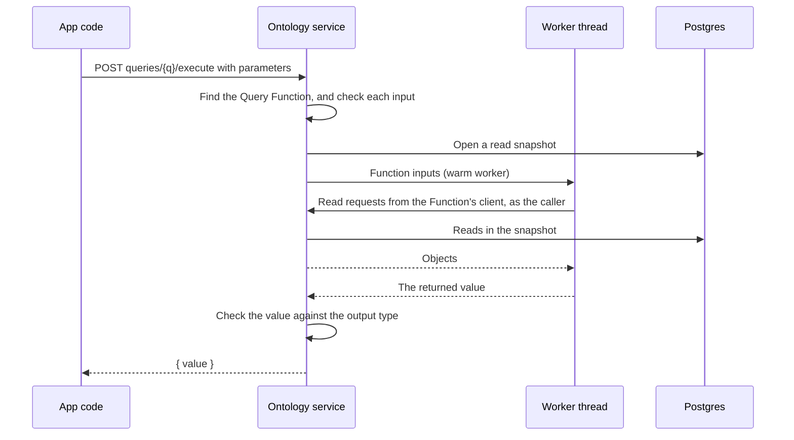

# Query Functions

A Query Function is a [Function](./functions.md) that returns a value and makes no edits. An app runs it through the Execute Query route, with the stock `client(query).executeFunction(...)`. Source: Query functions ("Queries are the read-only subsets of functions").

## Contract

### Code

- A Query Function is written as each Function is written, as [Code](./functions.md#code) specifies. It is the default export of 1 file, with a `Client` as the first parameter, and the same inputs. Our rule.
- The output type decides the kind of a Function. A Function whose output is a list of edits is an [edit Function](./edit-functions.md). Each other Function is a Query Function. The discovered Functions have no kind field, so the compile step reads the kind from the discovered output. A list of `ontologyEdit` compiles as an edit Function, and each other output compiles as a Query Function. Our rule.
- A Query Function returns a value of its output type, as [Outputs](#outputs) specifies. It makes no edits. Source: Query functions ("They cannot have any side effects, such as modifying the Ontology or altering external systems").
- The Ontology service serves each Query Function by its API name, the file name, with no `config` export. Deviation: OSDK defines a TypeScript v2 query through a `config` object with an `apiName`. Source: Query functions ("Export a config object with an apiName parameter from the file containing the function"). We need no `config`, because [Code](./functions.md#code) already makes the file name the API name.
- The doc comment of a Query Function is its description. The text of each `@param` tag is the description of its input, as [Discovery](./functions.md#discovery) specifies. Our rule.
- Publish fails for a Query Function with no doc comment, or with an empty first line. The first line describes the Function to an agent. The problem of the [grants check](../../service/publish.md#grants-check) names the Function. A load of a stored version does not run this check, so a stored version still loads. Our rule.
- A Query Function with a Decimal output says "Decimal" in its doc comment, because its Ontology metadata gives `string`, as [OSDK workarounds](../../service/osdk-workarounds.md) records. Publish does not check this text. Our rule.

```ts
// functions/typescript-functions/src/functions/amountLeft.ts
import type { Client, Osdk } from '@osdk/client';
import type { Plan } from '@ontology/sdk';

type Decimal<T extends string = string> = T & { __decimalBrand?: void };

/**
 * The amount left on a plan, as a Decimal.
 * @param plan - The plan to read.
 */
export default async function amountLeft(client: Client, plan: Osdk.Instance<Plan>): Promise<Decimal | undefined> {
  // Reads go through `client`, as the caller, in 1 snapshot.
}
```

### Discovery

- The [CLI](../../service/cli.md) discovers the output of a Query Function as it discovers an input, as [Discovery](./functions.md#discovery) specifies. Our rule.
- The CLI discovers `Promise<T | undefined>` as an optional output of the type `T`. Our rule.
- The CLI discovers an optional field of a struct output, such as `note?: string`, as an optional field. Our rule.

### Outputs

- The output of a Query Function is 1 of these types. Lists and structs can hold each other, at any depth. Our rule.

| Output    | TypeScript type                                              | Value in the answer                                                                              |
| --------- | ------------------------------------------------------------ | ------------------------------------------------------------------------------------------------ |
| String    | `string`                                                     | A JSON string                                                                                    |
| Boolean   | `boolean`                                                    | A JSON boolean                                                                                   |
| Integer   | `Integer` of `@osdk/functions` 1.30.0                        | A JSON number                                                                                    |
| Double    | `Double` of `@osdk/functions`                                | A JSON number                                                                                    |
| Date      | `DateISOString` of `@osdk/functions`                         | A JSON string, such as `"2026-11-19"`                                                            |
| Timestamp | `TimestampISOString` of `@osdk/functions`                    | A JSON string                                                                                    |
| Decimal   | `Decimal`, as [Code](./functions.md#code) declares it        | Its plain exact string, as [Properties](../object-link-types/properties.md#base-types) specifies |
| An Object | `Osdk.Instance<T>`                                           | The primary key of the Object                                                                    |
| A struct  | An interface or an object type, with optional fields allowed | A JSON object                                                                                    |
| A list    | `T[]`                                                        | A JSON array                                                                                     |

- Only the whole output can be `T | undefined`. A struct field can be optional. Our rule.
- An Object can be the whole output, or sit in a struct or a list. Our rule.
- These outputs get `CompileError`: `void`, an Object Set, a Map, a Set, a 2D or 3D aggregation, a Long, a Float, and an Interface. Each union other than `T | undefined` of the whole output gets it too. The text of the error names the type and the Function. `ontos validate` and `ontos publish` stop with that text. Our rule.
- Supported output combinations include lists of structs with Decimal and Date fields, nested structs and lists of structs, lists of structs with Object fields, structs with Decimals and lists, single Objects, and optional `Decimal | undefined`. Our rule.

### Ontology metadata

- The Ontology metadata lists each Query Function under `queryTypes`, keyed by its API name, as a `QueryTypeV2`. It lists no edit Function. [Ontology metadata](./functions.md#ontology-metadata) records the deviation. Our rule.
- A `QueryTypeV2` holds the API name, the `description`, the `rid`, `version`, `typeReferences: {}`, `parameters`, and `output`. It has no `displayName`. `version` is `"0.0.0"` in each environment, so the Ontology metadata of 1 app is the same across environments, and the [Ontology SDK package](../ontology-sdk/ontology-sdk.md#ontology-sdk-package) has 1 `ontologyHash`. `rid` has the form of [RIDs](../../service/http-api.md#rids). Our rule.
- Each entry of `parameters` holds `dataType`, `required`, and the `description` of the `@param` tag of the input, when it has one. Our rule.
- These are the data types of an input, the output, and a struct field. Our rule.
  - A Decimal has the data type `string`, as [OSDK workarounds](../../service/osdk-workarounds.md) records.
  - An Object has the data type `object`, with `objectApiName` and `objectTypeApiName`.
  - A list has the data type `array`, with its `subType`.
  - A struct has the data type `struct`, with the `name` and `fieldType` of each field.
  - An optional input, an optional output, and an optional struct field have the data type `union` of the type and `null`. The type is first, matching `@osdk/generator-converters`. Our rule.
- The Ontology metadata of a caller lists only the Query Functions that the caller can see, as [Access](../../service/authentication.md#access) specifies. Our rule.
- The [Ontology SDK](../ontology-sdk/ontology-sdk.md#contract) holds each Query Function of the Ontology metadata. Our rule.

### Run

- The route `POST /api/v2/ontologies/{ontology}/queries/{queryApiName}/execute` runs 1 Query Function. The body is `{ "parameters": { ... } }`, with 1 entry for each input. The answer is `{ "value": ... }`. Source: Execute Query (the request body `ExecuteQueryRequest` and the response body `ExecuteQueryResponse`).
- The route checks each input as an apply checks a parameter, as [Parameters](../action-types/action-types.md#parameters) specifies. A Decimal input must be a valid exact Decimal. A list input is never required. A `null` for a list input is an empty list, as an omitted list input is. The Function does not run when an input fails a check, and [Errors](#errors) gives the error. Our rule.
- Each input reaches the Function as an input of a function-backed Action does, as [Function-backed Actions](./functions.md#function-backed-actions) specifies. So a Decimal input is its plain exact string. Our rule.
- With no `version`, the route runs the caller's current Ontology version. A `version` other than the `version` of the `QueryTypeV2` gets the 404 of [Errors](#errors). The Ontology service never runs an old version. Deviation: Execute Query documents a semantic version range in `version`; Ontos serves 1 version per Ontology. Our rule.
- A run uses the [runtime](./functions.md#runtime) of an edit Function with no change. It has a warm worker of the installation, the time limit, the heap limit, and no `fetch`. Our rule.
- All reads of 1 run see 1 snapshot. The Function's client reads as the caller, through the caller's permissions and [security policies](../object-security-policies.md), as [Reads](./functions.md#reads) specifies. So a Property value that a policy hides from the caller reads as `null`, and an Object that a policy hides is not found. Our rule.
- A run writes nothing. Our rule.
- The Ontology service keeps no result of a run. Each call runs the Function. Our rule.
- The answer holds the value of [Outputs](#outputs). A Decimal is its plain exact string. An Object is its primary key. An optional struct field with no value has no key. A `T | undefined` output that returns `undefined` gives `{ "value": null }`. Source: Execute Query (the Decimal is a "string", and an "Ontology Object Reference" is the "JSON encoding of the object's primary key"). Our rule for the missing key and for `null`.
- The answer holds only the fields of the output type. A field that the Function returns and the type does not have is not in the answer. Our rule.
- The Ontology service does not stream the answer, so the 4.5 MB limit of [Requests](../../service/http-api.md#requests) applies. Our rule.
- The stock `client(query).executeFunction(...)` of each [OSDK set](../../service/releases.md#osdk-sets) gives a Decimal as a string, an Object as an Object reference with `$apiName` and `$primaryKey`. It gives `undefined` for a `null` value. Our rule.

### Errors

- A run gives these errors. Sources: Errors (the status codes), `_errors.d.ts` of `@osdk/foundry.ontologies` 2.87.0 (the parameters). Our rule for each case.

| Case                                                                                                       | Status | `errorName`                       | `parameters`                                              |
| ---------------------------------------------------------------------------------------------------------- | ------ | --------------------------------- | --------------------------------------------------------- |
| An unknown name, a Query Function that the caller cannot see, or an edit Function                          | 404    | `QueryNotFound`                   | `query`                                                   |
| A `version` that is not the `version` of the `QueryTypeV2`                                                 | 404    | `QueryVersionNotFound`            | `apiName`, `version`                                      |
| A body with no `parameters` object                                                                         | 400    | `Default:InvalidArgument`         | `{}`                                                      |
| An unknown input                                                                                           | 400    | `UnknownParameter`                | `unknownParameters`, `expectedParameters`                 |
| A required input with no value, or with `null`                                                             | 400    | `MissingParameter`                | `parameters`                                              |
| A value of the wrong type, a bad Decimal string, a bad primary key, or a value outside the string literals | 400    | `InvalidQueryParameterValue`      | `parameterDataType`, `parameterId`, `parameterValue`      |
| An Object input whose Object does not exist, or that the caller cannot see                                 | 400    | `InvalidQueryParameterValue`      | `parameterDataType`, `parameterId`, `parameterValue`      |
| The Function throws a `UserFacingError`                                                                    | 409    | `QueryEncounteredUserFacingError` | `functionRid`, `functionVersion`, `message`               |
| The Function throws another value                                                                          | 400    | `QueryRuntimeError`               | `functionRid`, `functionVersion`, `message`, `parameters` |
| The time limit                                                                                             | 400    | `QueryTimeExceededLimit`          | `functionRid`, `functionVersion`                          |
| The heap limit                                                                                             | 400    | `QueryMemoryExceededLimit`        | `functionRid`, `functionVersion`                          |
| The returned value is not a value of the output type                                                       | 400    | `InvalidQueryOutputValue`         | `outputDataType`, `functionRid`, `functionVersion`        |
| A 5xx in a read of the Function's client                                                                   | 500    | `Default:Internal`                | `{}`                                                      |

- The route checks the name before the `version`. So an unknown name, a Query Function that the caller cannot see, and an edit Function get `QueryNotFound` also with a `version`, as on `queryTypes/{queryApiName}` of [Metadata routes](../../service/http-api.md#metadata-routes). Our rule.
- The `parameters` member of a `QueryRuntimeError` is always `{}`. Its `message` follows the rule of `FunctionExecutionFailed` in [Errors](./functions.md#errors). Our rule.
- An input error stops the run before the Function runs. An Object input error also stops it before the Function runs. Our rule.
- `parameterDataType` is the `dataType` of the input in the Ontology metadata. `parameterId` is the input name. Our rule.
- `functionRid` and `functionVersion` have the form of [Errors](./functions.md#errors). The Ontology service finds a `UserFacingError` by its `name`, as for an edit Function. Our rule.
- A `QueryRuntimeError` holds no `stacktrace`. The Ontology service logs the stack trace in the [request log](../../service/observability.md#logs). Deviation: OSDK error types list `stacktrace`, which Ontos omits as [Errors](./functions.md#errors) specifies.
- An `InvalidQueryOutputValue` holds no `outputValue`, because the value can be large and can hold a Property value that a policy hides. Deviation: `_errors.d.ts` of `@osdk/foundry.ontologies` 2.87.0 lists `outputValue`.
- A 5xx in a read of the Function's client gives 500 `Default:Internal`, whatever the Function then returns or throws, as [Errors](./functions.md#errors) specifies for an edit Function. Our rule.
- A body with no `parameters` object gets 400 `Default:InvalidArgument`. Our rule.

## Diagram



## Out of scope

- [Outputs](#outputs) refuses these outputs. They are an Object Set, a Map, a Set, a 2D or 3D aggregation, a Long, a Float, an Interface, and each other union. Source: Execute Query (the value table).
- A cache of query results, as [Run](#run) specifies. Our rule.
- Function versions apart from the Ontology version, and a run of an old version. Source: Execute Query (`version`).
- A run of an edit Function as a query. Our rule.
- The `branch`, `transactionId`, and `scenarioRid` query parameters, as [Requests](../../service/http-api.md#requests) specifies. Source: Execute Query.

## Related

- [Functions](./functions.md)
- [Edit Functions](./edit-functions.md)
- [HTTP API](../../service/http-api.md#metadata-routes)
- [Ontology MCP](../../service/ontology-mcp.md#tools)
