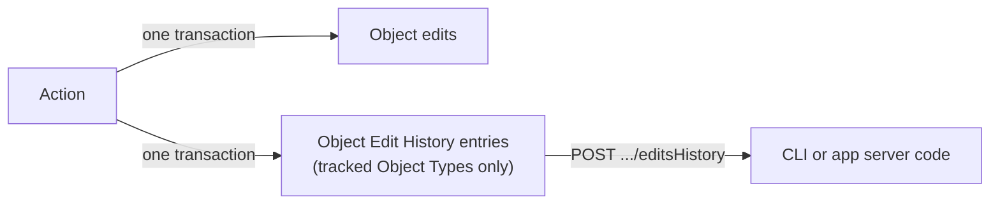

# Object Edit History

Object Edit History is the record of each create, modify, and delete of an Object that an Action applies. Source: Enable user edit history ("Edit history records every edit to an object, regardless of how the edit was made").

## Contract

### Turning it on

- Object Edit History is on or off for each Object Type. Source: Enable user edit history.
- The app turns it on in Ontology-as-code with `editsHistoryConfig: { enabled: true }` on `defineObject`. Source: `@osdk/maker` `EditsHistoryConfig.ts`.
- History starts at the publish that turns it on. Edits before that publish have no entries. Source: Enable user edit history ("Any changes prior to the activation of this feature will not be tracked").
- A publish that turns history off deletes all history of that Object Type. Source: Enable user edit history ("Disabling **Track user edit history** permanently deletes all existing edit histories for this object type").

### Entries

- Each create, modify, or delete of an Object of a tracked Object Type makes one entry. A function-backed delete of an Object that the snapshot of its run did not see makes none, as [Edit Functions](../functions/edit-functions.md#apply) specifies. Source: `ObjectEditHistoryEntry` ("Represents a single object edit operation in the history").
- An entry has these fields: the Object's primary key, the Action ID, the Action Type, the user ID, the time, and one edit. Source: `ObjectEditHistoryEntry`.
- The edit is one of three kinds. Source: `EditHistoryEdit`.
  - A create holds the new Property values.
  - A modify holds the new values and the previous values of the changed Properties.
  - A delete holds the previous Property values.
- In an answer of the route, the `properties` of a create entry have no key for the primary key Property. The entry gives the primary key in `objectPrimaryKey`. The stored entry keeps the key, so the route leaves it out when it reads each entry, old and new. Our rule.
- For both rule-backed creates and Function creates, a Property with no value has no key in the create entry. A reader treats a missing key as no value.
- A Decimal value of an entry is the padded text of a read, as [Value rules on write](../object-link-types/properties.md#value-rules-on-write) specifies. This holds for a Property, an array element, and a struct field. So a write of the number `1299.9` to a Decimal Property of scale 2 gives an entry with `"1299.90"`. An entry written before this rule keeps the value that it holds. Our rule.
- When the Object Type sets `storeAllPreviousProperties: true`, a modify holds the previous values of all Properties. Source: `@osdk/maker` `EditsHistoryConfig.ts`.
- [Authentication](../../service/authentication.md#user-ids) specifies the user ID.
- The user ID of an edit by a [service user](../../../GLOSSARY.md) is its client ID, with no special case. `Users.get` gives the `User` of that client ID while its application exists, and for up to 60 seconds after its delete, or 5 minutes while WorkOS fails, as [Authentication](../../service/authentication.md#user-ids) specifies. Our rule.
- The time of an entry is the UTC time at which the Action writes its edits. It can be later than the current time value of a rule. Source: Enable user edit history ("A timestamp property set by this rule can therefore have an earlier value than the edit history timestamp").
- A function-backed Action makes one entry for each Object edit after its Function's edits compile to one edit for each Object. A delete of an Object that the snapshot of the run did not see makes no entry. [Edit Functions](../functions/edit-functions.md#apply) specifies both. Our rule.
- Link edits make no entries. Source: `ObjectTypeEditsHistoryResponse` ("link edits are not included").
- A one-to-many Link changes through its foreign key Property. So its change is a modify of that Property, in the entry of the Object that holds the key. Source: TypeScript v2 Ontology edits ("For one-to-one and one-to-many links, use the `update` method available on the created batch to modify the foreign key property").
- An Action writes its edits and its entries in one transaction. A failed Action writes no entries. [Storage](../../service/storage.md#writes) specifies the transaction.

### Keeping

- An entry never changes. Source: Edit History widget (records "**cannot be deleted or modified** by end users").
- When an Object is deleted, its history stays readable. A new Object with the same primary key continues the same history. Source: Enable user edit history ("if an object is deleted and recreated, users can still see the history that occurred prior to the deletion action").

### Reading

- The Ontology service serves the OSDK HTTP API v2 route `POST /api/v2/ontologies/{ontology}/objectTypes/{objectType}/editsHistory`. It returns the entries of one Object, or of all Objects of the type. Source: `getEditsHistory`.
- The route returns the newest entries first by default. Source: `getEditsHistory` ("reverse chronological order (most recent first) by default").
- The request has these optional fields: `objectPrimaryKey`, `filters`, `sortOrder`, `includeAllPreviousProperties`, `pageSize`, and `pageToken`. With no `objectPrimaryKey`, the route returns the entries of all Objects of the type. Source: `ObjectTypeEditsHistoryRequest`.
- `objectPrimaryKey` maps the primary key Property API name to a `PrimaryKeyValueV2`, such as `{ "accountId": { "type": "stringValue", "value": "acc-1" } }`. A primary key is a String, so the value is a `stringValue`. A value of another `type` gets 400 `Default:InvalidArgument`. Source: `ObjectPrimaryKeyV2` and `PrimaryKeyValueV2` of `@osdk/foundry.ontologies` 2.87.0. Our rule for the 400.
- The request also takes the plain value, such as `{ "accountId": "acc-1" }`. Our rule: earlier releases of the CLI send it.
- Each entry of the response gives `objectPrimaryKey` in the tagged form. Source: `ObjectEditHistoryEntry` of `@osdk/foundry.ontologies` 2.87.0.
- `filters` is one filter: `timestampFilter` with an optional `startTime` and `endTime`, or `operationIdsFilter` with a list of Action IDs in `operationIds`. Source: `EditsHistoryFilter`.
- `sortOrder` is `newest_first` or `oldest_first`. Source: `EditsHistorySortOrder`.
- The route sorts the entries by their time, then by primary key, then by Action ID. `sortOrder` gives the direction. Our rule.
- The page token holds the time, the primary key, and the Action ID of the last entry of its page. An entry never changes, so the token does not expire. A token that the Ontology service cannot read gets 400 `InvalidPageToken`. Source: Errors (`InvalidPageToken`, 400). Our rule for the token.
- The default `pageSize` is 100. The maximum is 100, and a larger `pageSize` is reduced to 100. Sources: Get Object Type Edits History ("Defaults to 100"), Paging ("Unless otherwise noted, the default page size is also the maximum page size"). The route's page does not give a maximum, so the maximum is an inference from the Paging rule.
- The response has `data`, the list of entries, `totalCount`, and `nextPageToken`. `totalCount` counts the entries of this page only. Sources: `ObjectTypeEditsHistoryResponse`, Get Object Type Edits History ("Count of items in the data array above").
- The Ontology service streams each response of this route, so an entry of any size fits on a page, as [HTTP API](../../service/http-api.md#requests) specifies.
- With `includeAllPreviousProperties: true`, a modify holds the previous values of all Properties when the Object Type sets `storeAllPreviousProperties: true`, and sets `includesAllPreviousValues: true`. Otherwise a modify holds the previous values of the changed Properties only, and sets `includesAllPreviousValues: false`. Source: `ModifyEdit`. Our rule.
- A person who can view the Object as it is now can read its whole history, as [Security](#security) specifies. Source: Enable user edit history ("Users who have access to the current state of an object (object with the same primary key) can access the entire history of the object").
- The stock `@osdk/client` does not call this route. The [CLI](../../service/cli.md) calls it through `@osdk/foundry.ontologies`. Our rule.
- App server code calls it the same way: `ObjectTypesV2.getEditsHistory(client, ontologyRid, <Object Type API name>, { objectPrimaryKey })`, with the Ontology RID that List Ontologies gives, the client of `createClient`, and the `@osdk/foundry.ontologies` version of its [OSDK set](../../service/releases.md#osdk-sets). Our rule.
- Each entry names its Action Type by `actionTypeRid`. To show the Action Type, read `$actionTypesByRid[actionTypeRid]` of the Ontology SDK module `ontology-service`. Our rule.
- To name the Link of a foreign key Property in an entry, read the Link sides of the Object Type with `ObjectTypesV2.getFullMetadata(client, ontologyRid, <Object Type API name>)`. The side whose `foreignKeyPropertyApiName` is that Property gives the Link's `displayName` and its target `objectTypeApiName`. Our rule.

### Security

- The Object as it is now decides which entries of the Object a person sees, and which Property values of each entry are hidden. So a reassignment moves the whole history to the new assignee, and a change of a policy shows or hides past values. Our rule.
- With no `objectPrimaryKey`, the route returns only the entries of the Objects that the person can view now. Our rule.
- With an `objectPrimaryKey` of an Object that the person cannot view now, the route returns no entry, the same answer as for a key that has no history. Our rule.
- For a deleted Object, "now" is its latest delete entry, which holds each Property value from before the delete. When an Object with the same primary key is created again, its current row decides. Our rule.
- A Property value that a property security policy hides from the person is cut from `properties` and from `previousProperties` of each entry. The client reads it as null. Our rule.
- This rule applies to an Object Type with an object security policy, a property security policy, or both. On such a type, `properties` and `previousProperties` of each entry keep only the current Properties that the person can view. So after a publish moves or drops a Property, history hides its old values from each person, `admin` included. An old entry does not show them under the old key, and the values do not move to the new key. On an Object Type with no policy, each entry keeps the old keys, and each person reads them. Our rule.
- With `includeAllPreviousProperties: true`, the route cuts the same hidden Properties. Our rule.
- A foreign key Property in an entry follows its own property security policy. The route does not check the linked Object, the same as a load does. Our rule.
- An entry always shows the `userId` of the editor. It is not a Property. Our rule.
- The route removes each hidden entry and cuts each hidden Property in its SQL, so each page stays full, and the page token does not change. Our rule.
- The `get_edit_history` tool of the Ontology MCP and the `history` command of the CLI call this route as the person, so they show the same entries. Our rule.

## Diagram

## Out of scope

- Edit history for edits that do not come from an Action, such as pipeline updates. The Ontology service changes Objects only through Actions. Source: Edit History widget.
- History on Ontology branches and Scenarios. Source: `getEditsHistory` (the `branch` and `scenarioRid` query parameters).

## Related

- [Action Types](../action-types/action-types.md)
- [Storage](../../service/storage.md#object-edit-history)
- [Authentication](../../service/authentication.md)
- [Design rules: History](../design-rules.md#history)
