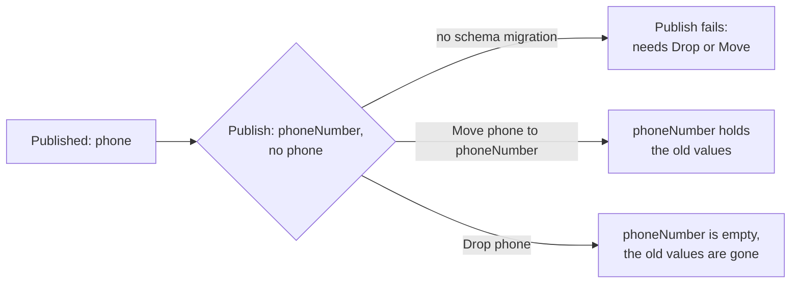

# Schema migrations

A schema migration is an instruction that says what to do with stored values when a change to the Ontology would break them. Source: Manage schema changes ("a list of predefined migrations that can be applied to existing user edits after a breaking schema change").

## Contract

### Changes that need no schema migration

- A [publish](../../service/publish.md) applies these changes directly. Source: Manage schema changes ("Deleting properties or making schema changes to properties that have never received user edits" is not breaking).
  - A new Object Type, Property, Link Type, or Action Type.
  - A new display name, description, title key, or status.
  - Any change to a Property that holds no values, an Object Type that has no Objects, or a Link Type that has no Links.

### Changes that need a schema migration

- These changes need a schema migration. Source: Manage schema changes (the list of breaking schema changes).
  - Delete or rename a Property that holds values.
  - Change the base type of a Property that holds values. A change of the precision or the scale of a Decimal Property is a change of its base type.
  - Delete a struct field that holds values, or change its base type. A change of the precision or the scale of a Decimal struct field is a change of its base type.
  - Change the primary key of an Object Type that has Objects.
  - Delete an Object Type that has Objects, or a Link Type that has Links.
- Turning off [Object Edit History](./edit-history.md) for an Object Type that has history also needs a schema migration. Source: Enable user edit history ("users will receive a warning and must confirm an acknowledgment that edit history will be deleted").
- Without the schema migration it needs, a publish fails. The error names the change and the schema migration that it needs. Source: Manage schema changes ("Ontology Manager will block the user from saving changes until they define a migration for the breaking change").
- A one-to-many Link Type has no Link records of its own: its Links are the values of a foreign key Property. So its delete needs no schema migration. The Property keeps its values, and a delete of that Property needs its own Drop. Our rule.

### The schema migrations file

- The app keeps its schema migrations in `.ontology/schema-migrations.json` at the root of its repository, because `@osdk/maker` cannot hold them, and a SuperRepo has no such file. Our rule.
- Each publish sends the whole file. The Ontology service applies each schema migration that matches a change in that publish, and ignores the others. So the same file serves the staging publish and the later production publish. Our rule.
- Each step of an [upgrade](../../service/publish.md#upgrade) uses the stored file of its own product version, not the file of a later version. Our rule.

### Schema migrations

| Schema migration  | OSDK migration                             | What it does                                                                                                                                                                                                                                                                                        |
| ----------------- | ------------------------------------------ | --------------------------------------------------------------------------------------------------------------------------------------------------------------------------------------------------------------------------------------------------------------------------------------------------- |
| Drop              | Drop all property edits, Drop all edits    | Deletes the values of one Property, all Objects of one Object Type, or all Links of one Link Type. Then the change applies.                                                                                                                                                                         |
| Move              | Move edits                                 | Copies the values of one Property to a new Property on the same Object Type, then deletes the old Property. The new Property has the same base type, the same array flag, for Decimal the same precision and scale, and for Struct the same fields, so each value copies exactly. A rename uses it. |
| Drop edit history | The confirmation before history is deleted | Allows a publish to turn off Object Edit History for one Object Type, and to delete its history                                                                                                                                                                                                     |

- Source of OSDK migrations: Manage schema changes (the list of supported schema migrations).
- In the planned changes, a Move is one change. It takes the place of the delete of the old Property and of the create of the new Property. Our rule.

### Edge rules

- To change the base type of a Property that holds values, add a new Property, fill it with an Action, and Drop the old Property. Our rule.
- To delete a struct field that holds values, or to change its base type, add a new struct Property, fill it with an Action, and Drop the old struct Property. Our rule.
- A new struct field needs no schema migration. Source: Manage schema changes (the list of breaking schema changes does not name it).
- A primary key change on an Object Type that has Objects needs a Drop of all its Objects. Source: Manage schema changes ("does not support applying migration instructions on the primary key property").
- A Move cannot have the primary key Property as its source. Source: Manage schema changes ("does not support applying migration instructions on the primary key property").
- 2 Moves cannot fill 1 Property. A publish with 2 Moves to the same new Property fails. The error names the Move of the later old Property in the Object Type, and the new Property. Our rule.
- After a Move or a primary key change, a column is `not null` only when its Property is required or is the primary key. So a Move to an optional Property makes the column optional, and a Move to a required Property keeps it required. The old key column drops its `not null` after the key change. Source: Required properties ("Required properties are object type properties that must have a value").
- An `active` Object Type, Property, or Link Type cannot be deleted or renamed. Set it to `deprecated` first. Source: Statuses ("A resource's status must be `experimental` or `deprecated` before it can be deleted").
- The base type of an `active` Property cannot change, also with a Drop. Set it to `deprecated` first. Our rule. It follows the rule that an `active` resource gets no major breaking change. Source: Statuses ("major breaking changes will not be made in the Ontology Manager").
- The API name of a side of an `active` Link Type cannot change. Set the Link Type to `deprecated` first. Source: Statuses ("The API name of an active resource cannot be changed").
- A new required Property on an Object Type that has Objects fails, because those Objects have no value for it. Add it as optional, fill it with an Action, then make it required. A publish that makes a Property required fails while any Object has no value for it. [Stored-data checks](#stored-data-checks) gives the error. Our rule.
- A later publish cannot use an API name that an earlier publish deleted. The Ontology service finds deleted names in its kept Ontology versions. Source: [Design rules](../design-rules.md#schema-evolution) ("A retired name stays reserved").

### Stored-data checks

- A stored-data check is a rule that each stored Object of 1 Object Type must pass before a change of a publish applies. Required Properties, [value types](../object-link-types/value-types.md#check-at-publish), and Uniqueness constraints use it. A publish runs the stored-data checks in the order of its planned changes, and the first change with a bad Object fails it. Our rule.
- These changes run the required check. An Object breaks it when it has no value for the Property. Our rule.
  - `Make Property <property> required of Object Type <objectType>`.
  - `Create Property <property> of Object Type <objectType>`, for a required Property. Each Object breaks it.
  - `Change the base type of Property <property> of Object Type <objectType>`, for a required Property. Each Object breaks it, also with a Drop of the old values.
  - `Move Property <old> to <property> of Object Type <objectType>`, for a required Property whose old Property is not required. Each Object with no value in the old Property breaks it.
- A change that a stored Object breaks fails the publish with 400 `Default:InvalidArgument`, with `parameters: { change, objectType, property, badObjects, primaryKeys }`. A value type check also gives `valueType`. Each error of a publish also has `ontologyRid`, as [Applying](../../service/publish.md#applying) specifies. Our rule.
  - `change` is the text of the change.
  - `objectType` is the API name of the Object Type.
  - `property` is the API name of the Property that the change checks: a required Property, a Property with a value type, or the Property of a Uniqueness constraint on 1 Property. For a Move, it is the old Property, which holds the stored values.
  - `badObjects` is the count of Objects that break the rule.
  - `primaryKeys` holds the primary keys of the first 10 of them, in the order of the primary key column. So 12 bad Objects give `badObjects: 12` and 10 keys.
- An example for a Property that a publish makes required:

```json
{
  "errorCode": "INVALID_ARGUMENT",
  "errorName": "Default:InvalidArgument",
  "parameters": {
    "change": "Make Property phone required of Object Type Person",
    "objectType": "Person",
    "property": "phone",
    "badObjects": 12,
    "primaryKeys": ["p-01", "p-02", "p-03", "p-04", "p-05", "p-06", "p-07", "p-08", "p-09", "p-10"],
    "ontologyRid": "ri.ontology.main.ontology.<UUID>"
  }
}
```

- A [Uniqueness constraint](../object-link-types/properties.md#uniqueness-constraints) that a publish adds on Properties with stored values runs 2 checks. Its change is `Create Uniqueness constraint <constraint> of Object Type <objectType>`. Our rule.
  - The "too long" check, when a Property of the rule is a String. An Object breaks it when a stored String in a Property of the rule has more than 500 UTF-8 bytes. Only those Objects count.
  - The clash check, after the "too long" check passes. An Object breaks it when another Object has the same values in each Property of the rule. Each Object in a group of 2 or more counts. An Object with no value in 1 Property of the rule never counts.
- The error of a Uniqueness constraint has `property` only for a rule on 1 Property. 12 clashing Objects give `badObjects: 12` and the first 10 primary keys. With no bad Object, the publish adds the constraint. Our rule.

```json
{
  "errorCode": "INVALID_ARGUMENT",
  "errorName": "Default:InvalidArgument",
  "parameters": {
    "change": "Create Uniqueness constraint invoiceNumber of Object Type Invoice",
    "objectType": "Invoice",
    "property": "number",
    "badObjects": 4,
    "primaryKeys": ["inv-1", "inv-2", "inv-7", "inv-9"],
    "ontologyRid": "ri.ontology.main.ontology.<UUID>"
  }
}
```

- A publish that removes a Uniqueness constraint always passes, and drops its constraint. It runs no check. Our rule.
- A renamed rule drops the old constraint and adds the new one, with the checks of a new rule. A rule whose Properties change under 1 name does the same. Our rule.
- A Move of a Property of a rule, where the rule names the new Property, keeps the constraint and its name, with no check. A Move into a rule checks the values of the old Property. Our rule.
- A rule of 2 Properties can keep 1 Property after a Drop of the other. The publish then adds the rule again on the kept Property, with the checks. Our rule.
- These changes run no check of the rule, because no stored value is left to check: a new Property in a rule, a base type change of a Property in a rule, and a Drop of all Objects. Our rule.
- A rule of the stored version whose constraint is not in Postgres gets its constraint at the next publish, with the checks. [Applying](../../service/publish.md#applying) specifies how a publish finds it. Our rule.
- A Drop of all Objects of the Object Type runs no stored-data check, because the Drop deletes each Object first. Our rule.
- No schema migration turns a stored-data check off. To tighten a rule over bad data, publish a looser rule, fix the values with an Action, then publish the tight rule. Our rule.
- The check phase and the transaction of a publish run each stored-data check on each installation, as [Applying](../../service/publish.md#applying) specifies. A step of an [upgrade](../../service/publish.md#upgrade) checks the values that the steps before it left. Our rule.

## Diagram

A rename of `phone` to `phoneNumber` on an Object Type that has Objects:



## Out of scope

- Cast property to new type. Source: Manage schema changes.
- Revert migration. [Publish](../../service/publish.md#rollback) specifies what a rollback can and cannot undo. Source: Manage schema changes.
- Struct field migrations (Drop all struct field edits, Move struct field edits, and Cast struct field to new type): not implemented in v1.0; adding a new struct Property covers them. Source: Manage schema changes.
- Move edits to a new datasource: The Ontology service has no datasources. Source: Manage schema changes.

## Related

- [Publish](../../service/publish.md)
- [Storage](../../service/storage.md)
- [Object Types](../object-link-types/object-types.md#statuses)
- [Properties](../object-link-types/properties.md)
- [Object Edit History](./edit-history.md)
- [Design rules](../design-rules.md#schema-evolution)
