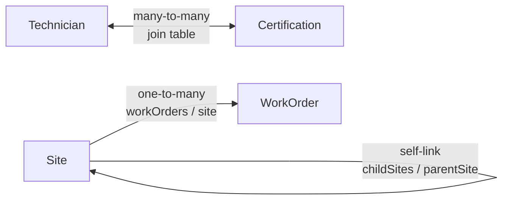

# Link Types

A Link Type is the schema definition of a relationship between two Object Types. A Link is one instance of that relationship between two Objects. Source: Link types.

## Contract

### Parts

- A Link Type has an API name and an optional description. Source: `@osdk/maker` `LinkType.ts`.
- The compiled Ontology keeps the description of each Link Type. The Ontology metadata has no field for it, because `LinkTypeSideV2` of `@osdk/foundry.ontologies` 2.87.0 has no `description`. So only the [Ontology MCP](../../service/ontology-mcp.md#tools) gives it. Our rule.
- A Link Type has two sides, one for each Object Type. Source: Link types.
- Each side has an API name, a display name, and a plural display name. Source: Link type metadata.
- A Link Type also has a cardinality and a status. The status values are in [Object Types](./object-types.md#statuses). Source: Link type metadata.
- One Link Type covers both directions. A second Link Type between the same two Object Types is a separate relationship. Source: Link types.
- A Link Type can join an Object Type to itself. Source: Link types.
- A Link Type has no [permission](../../../GLOSSARY.md) of its own. A Link Type is usable when both of its Object Types are usable. Our rule.
- The app defines each Link Type with `defineLink`, in its one-to-many shape or its many-to-many shape. Source: `@osdk/maker` `LinkType.ts`.

### API names

- A Link Type API name is camelCase, with the other rules of a Property API name in [Properties](./properties.md#api-names). It is unique across the Link Types of the Ontology. Our rule.
- A Link side API name is camelCase, with the other rules of a Property API name in [Properties](./properties.md#api-names). Source: Create a link type.
- A Link side API name is unique across the Link Types on the Object Type that it is on. Source: Create a link type.
- A Link side API name is also different from each Property API name on that Object Type. Our rule.
- In the IR, `linkType.id` holds the Link Type API name in kebab case. `@osdk/maker` makes it from the API name: `projectToTasks` becomes `project-to-tasks`. Source: `@osdk/maker`.

### Backing kinds

| Kind        | Cardinality  | Sample                                                      | Storage                                 |
| ----------- | ------------ | ----------------------------------------------------------- | --------------------------------------- |
| Foreign key | One-to-many  | One `Site` to many `WorkOrder`s, through `WorkOrder.siteId` | A foreign key Property on the many side |
| Join table  | Many-to-many | `Technician` to `Certification`                             | A generated join table                  |

- Source for the backing kinds: Create a link type.
- A foreign key Property has the base type of the primary key that it points to. Our rule.
- [Storage](../../service/storage.md#links) specifies the tables and columns of each backing kind.
- People and agents change Links only through Action Types. Source: Allow editing.
- [Object Sets](../ontology-sdk/object-sets.md) specifies how app code reads linked Objects.

### Security

- A Search Around leaves out each linked Object that the person cannot view, as [Object security policies](../object-security-policies.md#hidden-objects) specifies. Our rule.
- A Search Around through a foreign key Property that a property security policy hides from the person finds no linked Object. The foreign key is null for the person, so it matches no primary key. Our rule.
- A many-to-many Search Around reads each join row, and leaves out each linked Object that the person cannot view. Our rule.

## Diagram

## Out of scope

- One-to-one Link Types: not implemented in v1.0; a one-to-many Link Type covers them. Source: Create a link type.
- Object-backed Link Types, the `@osdk/maker` intermediary shape: not implemented in v1.0. Source: Create a link type.
- Visibility and type classes on Link Types. Source: Link type metadata.
- A Link Type ID that differs from the kebab case API name, and external platform Link Type RIDs. Source: Link type metadata.
- Join table datasets and writeback datasets: external storage layers that [Storage](../../service/storage.md) replaces with PostgreSQL tables. Source: Allow editing.

## Related

- [Object Types](./object-types.md)
- [Storage](../../service/storage.md#links)
