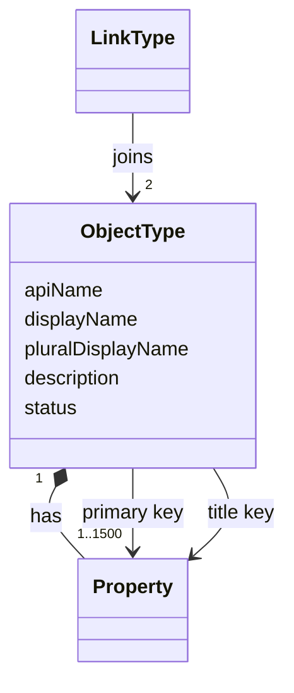

# Object Types

An Object Type is the schema definition of a real-world entity or event. An Object is one instance of an Object Type. Source: Object types overview.

## Contract

### Parts

- An Object Type has these parts: API name, display name, plural display name, description, primary key, title key, Properties, and status. Source: Object type metadata.
- The API name, display name, plural display name, primary key, title key, and at least one Property are required. Source: Create an object type.
- The description is the text that people and agents read. An Object Type has no separate agent description. Our rule.
- The primary key is the Property that identifies each Object. Each Object has a unique primary key value. Source: Create an object type.
- The title key is the Property that names one Object for display. Source: Create an object type.
- Each Object Type names 1 required [permission](../../../GLOSSARY.md) in the grants file. [Access](../../service/authentication.md#access) specifies what it does. Our rule.
- An Object Type can have 1 object security policy and property security policies, as [Object security policies](../object-security-policies.md) specifies.
- [Properties](./properties.md#keys) gives the base types that a primary key and a title key can use.
- An Action edits the Objects of an Object Type only when the app turns on edits with `editsEnabled: true` on `defineObject`. `@osdk/maker` writes `arePatchesEnabled: editsEnabled ?? false` into the IR. So the Ontology service refuses a rule, or a Function `Edits` type, that edits the Objects of an Object Type whose IR sets `arePatchesEnabled: false`. Source: `convertObject.ts` (`arePatchesEnabled`). Our rule.
- An Object Type also has an icon: a Blueprint icon name and a color. Publish accepts and stores the icon of each Object Type from the IR. When the author sets no icon, `@osdk/maker` writes the icon `cube` with the color `#2D72D2`. Source: `@osdk/maker` `convertObject.ts` (the default icon).
- The Ontology metadata returns the icon of each Object Type as `type`, `name`, and `color`, such as `{ "type": "blueprint", "color": "#2D72D2", "name": "cube" }`. Source: `ObjectTypeV2` in `@osdk/foundry.ontologies`.
- An Object Type has at most 1,500 Properties. The Ontology service refuses an Object Type with more. Deviation: OSDK allows 2,000 Properties for each Object Type (Ontology architecture). We allow 1,500 because a Postgres table holds at most 1,600 columns, and dropped columns count toward that limit ([PostgreSQL limits](https://www.postgresql.org/docs/17/limits.html): "Columns that have been dropped from the table also contribute to the maximum column limit").
- At publish, the Ontology service also refuses a change that gives a table more than 1,600 columns, when it counts the live columns, the dropped columns, and the version column. The error names the Object Type. [Storage](../../service/storage.md#table-changes) specifies which changes leave a dropped column. Our rule.

### API names

- An Object Type API name is the fully qualified API name: the [API namespace](../../service/ontology-as-code.md), then the part that the app writes, such as `com.example.crm.Account`. Each OSDK HTTP API v2 route returns and accepts this full name. Source: Marketplace installation ("Fully qualified API names include a namespace prefix").
- The part after the API namespace is PascalCase. It starts with an uppercase letter and has only letters and digits. Source: Create an object type ("Begin with an uppercase character and consist of only alphanumeric characters").
- The Ontology service splits each Object Type and Action Type API name at its last dot, as `extractNamespace` of `@osdk/generator` does. The API namespace is the text before the last dot, with the dot. The part is the text after the last dot. The API namespace matches the `@osdk/maker` namespace pattern `^[a-z0-9-]+(\.[a-z0-9-]+)*\.$`. Sources: `EnhancedBase.ts` (`fqApiName.slice(0, last)`), `@osdk/maker` CLI (`apiNamespaceRegex`).
- The Ontology service refuses an Object Type API name whose API namespace does not match this pattern, or whose part does not start with an uppercase letter. The error gives the rule. So it refuses `com.example.crm.Work.Order`. Deviation: `@osdk/maker` 0.91.0 accepts a dot and a lowercase first letter in the part (`OBJECT_API_NAME_PATTERN` in `build/esm/util/ApiNameValidator.js`). We follow the OSDK naming guidelines, so each Ontology that we accept also passes in the HTTP API.
- The full API name, with the API namespace, has 1 to 100 characters. Our rule. OSDK naming guidelines give 1 to 100 characters, and `@osdk/maker` counts only the part after the API namespace, so Ontos checks the full name.
- An Object Type API name is unique across the Object Types of the Ontology. Source: Create an object type.
- An API name is never one of these reserved words: `ontology`, `object`, `property`, `link`, `relation`, `rid`, `primaryKey`, `typeId`, `ontologyObject`. The check ignores case. For an Object Type or Action Type API name, it checks the part after the API namespace. Sources: Create an object type, `ApiNameValidator.ts` (`apiName.toLowerCase()`).
- An API name is never the name of the hidden version column that [Storage](../../service/storage.md#objects) reserves. Our rule.
- These name rules apply to every API name in the Ontology. Each concept file gives the case for its own names. Our rule.

### Statuses

- An Object Type, Property, and Link Type each have a status. Source: Statuses.
- The status values are `experimental`, `active`, and `deprecated`. The default is `experimental`. Source: Statuses.
- A `deprecated` status has a reason, a deletion deadline, and an optional replacement. Source: Statuses.
- The Ontology SDK marks each `deprecated` Property with a `@deprecated` JSDoc tag. The tag gives the reason, the deadline, and the replacement. The Ontology metadata gives no reason for a `deprecated` Object Type or Link Type, so the Ontology SDK has no tag for them. Sources: `PropertyV2`, `ObjectTypeV2`, and `LinkTypeSideV2` in `@osdk/foundry.ontologies` 2.87.0 (only a Property status holds `message`, `deadline`, and `replacedBy`), `propertyJsdoc.js` in `@osdk/generator` 2.92.0.
- [Schema migrations](../object-edits/schema-migrations.md) specifies what an `active` status blocks.

## Diagram

## Out of scope

- Groups, aliases, and visibility (`prominent`, `normal`, `hidden`): display metadata for OSDK apps. Publish accepts and ignores each of them, with any value. `@osdk/maker` writes `visibility: "NORMAL"` and `aliases: []` when the author sets none. [Parts](#parts) specifies the icon, which the Ontology service has. Source: Object type metadata.
- External Object Type ID and RID values: the API name is the only identifier that the app sets. Publish ignores an Object Type ID or RID in the IR. The Ontology service derives its own deterministic RIDs, as [HTTP API](../../service/http-api.md#rids) specifies. A RID is the same in the Ontology metadata and in the compiled Ontology. Source: Object type metadata.
- The `example` and `promoted` statuses. Source: Statuses.
- Interfaces: not implemented in v1.0. Source: Interfaces.
- Backing datasources, index status, and writeback datasets: external storage layers that [Storage](../../service/storage.md) replaces with PostgreSQL tables. Source: Create an object type.

## Related

- [Properties](./properties.md)
- [Link Types](./link-types.md)
- [Storage](../../service/storage.md)
- [Ontology-as-code](../../service/ontology-as-code.md)
