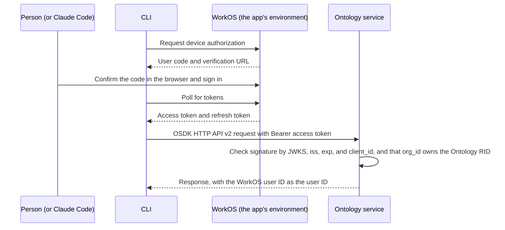

# Authentication

Authentication is how the [Ontology service](./ontology-service.md) knows who sends each request, which Organization it acts in, and what that caller can do. Ontos supports three pluggable identity provider modes configured through `ONTOS_AUTH_MODE`: `dev` for local development, `oidc` for any standard OIDC/JWKS issuer, and `workos` (default when unset) for WorkOS AuthKit and Organizations.

## Contract

### Authentication modes

- `ONTOS_AUTH_MODE` selects the identity provider: `dev`, `oidc`, or `workos` (default when unset). Any other value causes `inputFromEnv` to refuse startup with `OntologyService:SettingMissing`. Our rule.
- **`dev` mode (`ONTOS_AUTH_MODE=dev`):** Accepts a static bearer token (`ONTOS_DEV_TOKEN`, default `ontos-dev-token`) as a local admin caller (`user_dev` in `org_dev`) with all permissions of the installed Ontology plus `ontology:install` and publish authorization. `dev` mode enables the [Ontology MCP](./ontology-mcp.md) by default unless `ONTOLOGY_MCP=false`, and defaults `PRODUCT_RID`, `ONTOLOGY_ENVIRONMENT=development`, and `ONTOLOGY_BASE_URL=http://localhost:<PORT>`. Our rule.
- **`dev` mode production guard:** The service refuses `ONTOS_AUTH_MODE=dev` whenever `ONTOLOGY_ENVIRONMENT`, `NODE_ENV`, or `VERCEL_ENV` is `production` or `prod` (case-insensitive). Our rule.
- **`oidc` mode (`ONTOS_AUTH_MODE=oidc`):** Verifies bearer JWTs against any standard OIDC issuer (`ONTOS_OIDC_ISSUER`) using JWKS discovery (`<issuer>/.well-known/openid-configuration`, or an explicit `ONTOS_OIDC_JWKS_URI`). Optional variables configure audience checks (`ONTOS_OIDC_AUDIENCE`, `ONTOS_OIDC_MCP_AUDIENCE`), Organization claim mapping (`ONTOS_OIDC_ORG_CLAIM`, `ONTOS_OIDC_DEFAULT_ORG`), and permission claim mapping (`ONTOS_OIDC_PERMISSIONS_CLAIM`). Publish authorization accepts a static secret (`ONTOS_PUBLISH_TOKEN`), a custom OIDC issuer and subject (`ONTOS_PUBLISH_OIDC_ISSUER`, `ONTOS_PUBLISH_OIDC_SUB`, optional `ONTOS_PUBLISH_OIDC_JWKS_URI` and `ONTOS_PUBLISH_OIDC_AUDIENCE`), or a trusted GitHub Actions repository and environment (`TRUSTED_GITHUB_REPOSITORY`, `TRUSTED_GITHUB_ENVIRONMENT`). Our rule.
- **`workos` mode (`ONTOS_AUTH_MODE=workos` or unset):** Uses WorkOS AuthKit for people, WorkOS M2M applications for [service users](../../GLOSSARY.md), WorkOS Organizations for tenant boundaries and permissions, and GitHub Actions OIDC tokens for CI publishing. The decisions are in [ADR 0012](../adr/0012-people-sign-in-with-workos-authkit-in-an-organization-and-ci-only-publishes.md) and [ADR 0014](../adr/0014-workos-holds-the-permissions-of-each-caller-and-a-service-user-reads-and-writes-data.md). Our rule.

### Tokens

- Each request sends a bearer token in the `Authorization` header. Source: API authentication ("The token should be passed as an "Authorization" header using the "Bearer" authentication scheme").
- The stock `@osdk/client` gets the token from the token getter that the caller passes to `createClient`. Source: `@osdk/client` `createClient.ts`.
- Token verification delegates to the configured `IdentityProvider` (`dev`, `oidc`, or `workos`). In `dev` mode, the provider accepts the static `ONTOS_DEV_TOKEN`. In `oidc` mode, it verifies JWTs against `ONTOS_OIDC_ISSUER` (and optional publish token or OIDC issuer). In `workos` mode, it accepts tokens from 3 issuers: the WorkOS environment of its app for a person, the AuthKit domain of that WorkOS environment for a service user and for the Ontology MCP, and GitHub Actions. Our rule.
- The 2 adapters, `api/index.ts` and `src/node.ts`, construct their `IdentityProvider` through `inputFromEnv`, which reads only the settings of [Deployment files](./deployment.md#deployment-files). In `workos` mode, `AUTHKIT_DOMAIN` names the host of the AuthKit issuer and of its JWKS, and `WORKOS_CLIENT_ID` names the path of the WorkOS issuer and of its JWKS on `api.workos.com`. Only the test entry of the service package swaps the key sets for a test issuer, in code, as [Local service](./testing.md#local-service) specifies. Our rule.
- In `workos` mode, the MCP route is the one exception: it accepts tokens only from the AuthKit domain of the environment, as [Ontology MCP tokens](#ontology-mcp-tokens) specifies. In `oidc` mode, the MCP route enforces `ONTOS_OIDC_MCP_AUDIENCE` when configured. Our rule.
- In `oidc` and `workos` modes, the Ontology service checks the signature of each token with the JWKS of its issuer, and checks `iss` and `exp`. It stores no secret for these checks. Our rule.
- Each environment of an [Ontology service deployment](./deployment.md) holds its own identity provider settings in environment variables or its [deployment file](./deployment.md#deployment-files). Our rule.

### People

- A person signs in through the [CLI](./cli.md) with WorkOS CLI Auth, which is the OAuth 2.0 device authorization flow. After a `slow_down` answer, the CLI adds 5 seconds to the polling interval, for that poll and each later poll. Sources: [CLI Auth](https://workos.com/docs/authkit/cli-auth), [RFC 8628, section 3.5](https://www.rfc-editor.org/rfc/rfc8628#section-3.5) ("the interval MUST be increased by 5 seconds for this and all subsequent requests").
- The CLI stores the refresh token, and replaces it after each refresh. [CLI](./cli.md#sign-in) specifies where. Source: [CLI Auth](https://workos.com/docs/authkit/cli-auth) ("Replace the stored refresh token after every successful exchange").
- An agent that runs the CLI acts as the person who signed in. Source: AI FDE security and governance ("All actions are logged under your identity").
- Sign-up is off in each WorkOS environment. Only invited people can sign in. Source: [Invite-only signup](https://workos.com/docs/authkit/invite-only-signup) ("It can be disabled per environment by toggling the "Sign up" setting").
- The people of an app are the people in its WorkOS environment. The Ontology service keeps no list of people. Our rule.
- Each WorkOS environment turns on Google and password sign-in, and turns off each other sign-in method, unless the [deployment file](./deployment.md#deployment-files) gives other sign-in methods for it. Our rule.
- WorkOS gives its own Google credentials only in staging, so a production WorkOS environment uses its own Google OAuth client. Source: [Google OAuth](https://workos.com/docs/integrations/google-oauth) ("The default credentials are only intended for testing and therefore only available in the Staging environment").
- The staging tests of the Ontology deployment repository and the CI of a consumer repository, such as the integration tests of a web app, sign in to staging as the test user. They share the test Organization, and each test reads and writes only the Objects that it creates. A person or an agent that signs in to the web app can also use the test user. Our rule.
- The test user signs in with a password. WorkOS's password sign-in sends the API key of the WorkOS environment as the client secret, so a sign-in as the test user needs that API key and the test user's email and password. Sources: [`authenticateWithPassword`](https://github.com/workos/workos-node/blob/967464cb393fcffdc23447ac4bbc9a9a094853d1/src/user-management/user-management.ts#L382-L397) (`clientSecret: this.workos.key`), [its serializer](https://github.com/workos/workos-node/blob/967464cb393fcffdc23447ac4bbc9a9a094853d1/src/user-management/serializers/authenticate-with-password-options.serializer.ts) (`grant_type: 'password'`, `client_secret: options.clientSecret`).
- The staging WorkOS environment of each app can have 1 test user, `ci+<app>@example.com`, with a verified email. The production WorkOS environment of an app has no test user. Our rule.
- The GitHub environment `ontology-staging` of the Ontology deployment repository, and the web app repository when the app has one, hold the email and the password of the test user, and the API key of the staging WorkOS environment, as the secrets `ONTOLOGY_TEST_USER_EMAIL`, `ONTOLOGY_TEST_USER_PASSWORD`, and `WORKOS_API_KEY`. Our rule.
- A secret manager field can also hold the password of the test user, so that a person or a local agent can sign in as the test user. It is optional. Our rule.
- A WorkOS token has `iss`, `sub`, and `client_id`, and no `aud`. The Ontology service accepts it only when `client_id` is the client ID of its app's WorkOS environment. Source: [Access token](https://workos.com/docs/reference/authkit/session-tokens/access-token) (the decoded sample token).
- The `sub` of a person's token, a WorkOS token or an MCP token, is a WorkOS user ID: `user_`, then 1 to 64 letters and digits. A token whose `sub` has another form does not name a person, so it gets 401 `Default:Unauthorized` in the token check, with no WorkOS read. Our rule.
- The OSDK HTTP API v2 routes and the publish route have no rule on `aud` in `workos` mode. So an `aud` that WorkOS adds to a CLI token or a web app token refuses no call. Our rule.
- In `workos` mode, the OSDK HTTP API v2 routes and the publish route refuse each token whose `iss` is the AuthKit issuer of the environment, except the token of a service user, as [Service users](#service-users) specifies. Our rule.
- The `iss` of a WorkOS token is `https://api.workos.com/user_management/<client ID>`, where the client ID is the client ID of the app's WorkOS environment. The `issuer` field of the discovery document `https://api.workos.com/user_management/<client ID>/.well-known/openid-configuration` gives this value. A custom sign-in domain changes it, and the Ontology service uses none, as [ADR 0012](../adr/0012-people-sign-in-with-workos-authkit-in-an-organization-and-ci-only-publishes.md) says. Sources: [workos-node#1694](https://github.com/workos/workos-node/pull/1694) ("`https://api.workos.com/user_management/<clientId>` for environments created since mid-2025"), [Access token](https://workos.com/docs/reference/authkit/session-tokens/access-token) ("The issuer of the JWT, will be your custom WorkOS auth domain if set").
- The JWKS of a WorkOS environment is `https://api.workos.com/sso/jwks/<client ID>`. Source: [Access token](https://workos.com/docs/reference/authkit/session-tokens/access-token).
- To remove a person, deactivate their membership of the Organization, or remove them from the WorkOS environment. When WorkOS answers, their permissions end after the background refresh that the first request past 60 seconds starts, and at most 5 minutes after the last WorkOS read. When WorkOS fails, their permissions end within 5 minutes, as [Permissions of a caller](#permissions-of-a-caller) specifies. The Ontology service keeps no list of revoked tokens. Our rule.
- The maximum session length is 7 days in each staging WorkOS environment so a session that leaks ends within 7 days. The production WorkOS environment keeps the WorkOS default. Our rule.

### Service users

- In `workos` mode, a service user is 1 WorkOS M2M application, which belongs to exactly 1 Organization. Its client ID has the form `client_` and 26 uppercase letters and digits. It has no role. Its permissions are the `scopes` of its application. Source: [M2M applications](https://workos.com/docs/authkit/connect/m2m) ("M2M applications are always associated with a specific [Organization]").
- A service user gets its token from WorkOS with the `client_credentials` grant, at the token route of the AuthKit domain. The token lasts 3,600 seconds. The Ontology service issues no token, and stores no secret. Our rule.
- The same AuthKit issuer signs MCP tokens, Connect user tokens, and agent tokens, and the same key signs a person's token. So the token check of a service user has 2 parts. Our rule.
- Part 1 checks the claims. The signature passes the check with the JWKS at the AuthKit issuer plus `/oauth2/jwks`. `iss` is the AuthKit issuer of the environment, and `exp` is in the future. `aud` is the client ID of the environment, as a string, or a list that holds it. `sub` equals `client_id`. The token has `org_id`, and has no `sid` and no `sub_profile`. Our rule.
- Part 2 reads the application of the `client_id` from WorkOS, with the kept answers of [Permissions of a caller](#permissions-of-a-caller). The token passes only when the application has `application_type` `m2m` and an `organization_id` equal to the `org_id` of the token. Our rule.
- A token of the AuthKit issuer that fails part 1, such as an MCP token, a Connect user token, an agent token, or a session token, gets 401 `Default:Unauthorized` on each route other than the MCP route. An application that WorkOS does not find, or that is not `m2m`, or that belongs to another Organization, also gets 401 `Default:Unauthorized`. Our rule.
- The permissions of a service user are the `scopes` of its application in the answer of part 2. The `scope` claim of the token does not narrow them. Our rule.
- A token that WorkOS issued stays valid until its `exp` after its application is deleted, its secret is deleted, or a scope is removed. When WorkOS answers, part 2 ends that access after the background refresh that the first request past 60 seconds starts, and at most 5 minutes after the last WorkOS read. When WorkOS fails, part 2 ends that access within 5 minutes. Our rule.
- A service user calls each route that a person calls, except the MCP route, and its permissions decide the result. It installs only when it holds `ontology:install`. It never has a `NoOrganization` error, because its token always has `org_id`. Our rule.
- A service user with no scope reads what a person with no permission reads: the members of its Organization with `Users.get` and `Users.getBatch`, the Ontologies of its Organization with List Ontologies, and the [permission catalog](./ontology-service.md#permission-catalog). It sees no type. Our rule.
- The app creates each service user through the WorkOS API or the WorkOS dashboard. The Ontology service has no route that creates or lists service users. Our rule.
- The app keeps each client secret under the ID of the Organization of its service user. To rotate a secret, create a second secret, move the job to it, and delete the first. To end a service user, delete its M2M application in WorkOS. Our rule.
- A staging reset copies no service user. An app that runs a job in staging creates a staging service user. Our rule.

### The token route

- The Ontology service serves the OSDK token compatibility route, `POST /multipass/api/oauth2/token`, the path that the stock `createConfidentialOauthClient` calls. A rewrite of `vercel.json` sends the path to the handler. Source: Writing OAuth2 clients.
- The route needs no bearer token. It has its own access kind, `token`. The handler gives the route the raw request before any read of the body. So no request log, span, or error report holds the client secret, also when the log of request bodies is on. Our rule.
- The route answers with no [cold start](./storage.md#engine-changes), and it does not wait for the database, because it uses none. So a failed cold start or a database that is down does not change its answer. Our rule.
- The route reads a form body. It refuses each `grant_type` other than `client_credentials` with 400 and the OAuth error `{"error": "unsupported_grant_type"}`, and sends no request to WorkOS. Source: [RFC 6749, section 5.2](https://www.rfc-editor.org/rfc/rfc6749#section-5.2).
- The route removes each scope with the prefix `api:` from `scope`, and keeps each other scope in its order. When no scope is left, it sends no `scope`, so WorkOS gives each scope of the application. The 4 default scopes of the stock client all have the prefix `api:`, and WorkOS refuses each of them with 400 `invalid_scope`. Our rule.
- The route reads at most 4096 bytes of the body. A larger body, a body that it cannot read, or a body that holds a parameter more than once gets 400 with the OAuth error `{"error": "invalid_request"}`, and the route sends no request to WorkOS. Source: [RFC 6749, section 3.2](https://www.rfc-editor.org/rfc/rfc6749#section-3.2) ("Request and response parameters MUST NOT be included more than once").
- The client has 5 seconds to send the whole body. At the deadline, the route cancels the read and answers 400 with the OAuth error `{"error": "invalid_request"}`, and sends no request to WorkOS. It is not a fault, so it gets no error report. The 5 second limit of the WorkOS call has its own clock, which starts after the body read. Our rule.
- The route sends the request to `https://<AuthKit domain>/oauth2/token`, with the `Authorization` header and only the form fields `grant_type`, `scope`, `client_id`, and `client_secret`, with these exact names. It drops each other field, and gives no error for it. Source: [RFC 6749, section 3.2](https://www.rfc-editor.org/rfc/rfc6749#section-3.2) ("The authorization server MUST ignore unrecognized request parameters").
- The route returns the status and the body of the WorkOS answer, and stores nothing. Our rule.
- Each answer of the route has the headers `Cache-Control: no-store` and `Pragma: no-cache`. Of the headers of the WorkOS answer, the route keeps only `Content-Type`, and on a 429 also `Retry-After`, as the next rule specifies. Source: [RFC 6749, section 5.1](https://www.rfc-editor.org/rfc/rfc6749#section-5.1).
- On a 429 of WorkOS, the route also keeps `Retry-After`, so the client knows how long to wait. It keeps only a value of 1 to 10 digits, or an HTTP date in the IMF-fixdate form, such as `Sun, 06 Nov 1994 08:49:37 GMT`, and drops each other value. It does not check the range of the value, such as a date in the past. So the route returns no other text of WorkOS in a header. Source: [RFC 9110, section 10.2.3](https://www.rfc-editor.org/rfc/rfc9110#section-10.2.3) ("Retry-After = HTTP-date / delay-seconds").
- A 429 of WorkOS is not a fault, so it gets no error report and no log field of its own. Operators see its status 429 in runtime logs, the root span, and the `workos token` span. Our rule.
- When WorkOS gives a network error, or no answer in 5 seconds, the route answers 503 with the OAuth error `{"error": "temporarily_unavailable"}`, not an OSDK error envelope. Our rule.
- The route follows no redirect, because a redirect would send the client secret to another URL. A 3xx of WorkOS gets the same 503 as a network error. Our rule.
- A network error, a timeout, or a 3xx of WorkOS is the fault `OntologyService:WorkosUnavailable`. A missing AuthKit domain is the fault `OntologyService:SettingMissing`. Each other error of the route is a fault that gets 500 with the OAuth error `{"error": "server_error"}`. Each fault writes the error fields of the request log and gets 1 [error report](./observability.md#error-reports). The client gets only the OAuth error, with no `Retry-After`. Our rule.
- When a variable of [Deployment files](./deployment.md#deployment-files) is missing or empty, such as `AUTHKIT_DOMAIN`, the route answers 503 with the OAuth error `{"error": "temporarily_unavailable"}`. It is the fault `OntologyService:SettingMissing`. Our rule.
- When the client stops the request, and the platform passes a disconnect signal, the route stops its WorkOS call and answers 400 with the OAuth error `{"error": "invalid_request"}`. It is not a fault, so it gets no error report. No adapter passes that signal in v1.0, as [HTTP entry](./code-layout.md#http-entry) says. So in v1.0, a stopped request runs until WorkOS answers or the limit of 5 seconds. A network error, a 3xx, or the limit in that time is the fault `OntologyService:WorkosUnavailable`, with its log fields and its error report. Our rule.

### Organizations

- An Organization is 1 WorkOS Organization of the app's WorkOS environment, and the boundary of its data. Our rule.
- A person has 1 role in each Organization of which they are a member: a [default role](../../GLOSSARY.md) of the product. Our rule.
- Custom roles are out of scope. The Ontology service and web apps create no WorkOS custom role, so an Organization has no role of its own. A custom role created in WorkOS by hand is not supported, as [ADR 0014](../adr/0014-workos-holds-the-permissions-of-each-caller-and-a-service-user-reads-and-writes-data.md) records.
- Multiple roles is off by default in WorkOS AuthKit: a membership with 2 roles gets 422 `multiple_roles_not_enabled`. The Ontology service still gives a person the permissions of each role of the membership. Our rule.
- A person's access token carries the active Organization as `org_id`, and the person's role in it as `role`. Source: [Access token](https://workos.com/docs/reference/authkit/session-tokens/access-token) (the decoded sample token).
- A WorkOS JWT template of each WorkOS environment adds the claim `role`, with the template `{ "role": {{ organization_membership.role }} }`. A token of an MCP client has `org_id`, and has no role without this template. One template serves the whole WorkOS environment. A token with no Organization has no `role` claim. Sources: [Access token claims](https://workos.com/docs/authkit/connect/token-claims), [JWT templates](https://workos.com/docs/authkit/jwt-templates).
- The `role` claim serves clients that display a caller's role. The Ontology service reads no `role` claim, as [Permissions of a caller](#permissions-of-a-caller) specifies. Our rule.
- A switch to another Organization is a token refresh with its `organization_id`. The CLI keeps 1 token for each app and environment, so it switches with `ontos login --org <id>`, as [CLI](./cli.md#sign-in) specifies. Source: [Sessions](https://workos.com/docs/authkit/sessions.md).
- Each Ontology has exactly 1 owner Organization: the `org_id` of the person who installed it. The Ontology service serves an Ontology RID only when its owner Organization is the token's `org_id`. Each other RID gets 404 `OntologyNotFound`, the same as an unknown RID. Our rule.
- A person's token with no `org_id` gets 403 `OntologyService:NoOrganization` on each route that reads or writes Ontology data, on install, on List Ontologies, and on `GET /api/v2/admin/users/{userId}` and `POST /api/v2/admin/users/getBatch`. `GET /api/v2/admin/users/getCurrent` and the Organizations route below need no Organization. The CLI then gives the next step, as [CLI](./cli.md#ontology) specifies. On the Ontology MCP, `initialize` and `tools/list` need no Organization. Each tool call with no `org_id` gets the error as a tool result, with `isError: true` and HTTP 200, and its text tells the person to join or create an Organization. Our rule.
- `GET /api/ontology-service/v1/organizations` gives the Organizations in which the person of the token has an active membership, as `{"data":[{"id":<ID>,"name":<name>}]}`, in the code point order of `name`. It needs the token of a person or of a service user. A person's token can have no `org_id`, because a person with no Organization in the token uses the route to get one. In `workos` mode, it reads each membership from WorkOS with the API key of the environment, keeps the answer per user by the rules of [Permissions of a caller](#permissions-of-a-caller) (fresh for 60 seconds, usable up to 300 seconds), and shows only the caller's. A GitHub token gets 403 `Default:PermissionDenied`. It is not an OSDK HTTP API v2 route. Our rule.
- That route keeps only the memberships whose `user_id` is the caller's user ID and whose `status` is `active`. It ignores each other item in the WorkOS answer. Our rule.
- That route reads at most 20 WorkOS pages of 100 memberships. A person with more memberships gets HTTP `500`, so a caller never gets a partial list. Our rule.
- For a service user, that route gives 1 item: its Organization, the `org_id` of its token, with the `name` from the WorkOS read of that Organization. Our rule.
- When WorkOS does not find the Organization of a service user, that route gets 500 `Default:Internal`. WorkOS then contradicts the token check, so it is a fault, and it gets an [error report](./observability.md#error-reports). Our rule.
- Only a caller that holds the permission `ontology:install` installs, as [Install](./publish.md#install) specifies. Each other caller gets 403 `Default:PermissionDenied`. Our rule.
- WorkOS holds each membership and each role. The Ontology service reads the Organization from the token, and the roles and the permissions from WorkOS, as [Permissions of a caller](#permissions-of-a-caller) specifies. It stores no copy of them. Our rule.
- The web app creates each Organization and adds each person to it, with the WorkOS API. The Ontology service has no route for that. Our rule.
- The staging WorkOS environment of each app can have 1 test Organization. The test user is its only member, with a default role that holds `ontology:install`, and it owns 1 Ontology of the app's product. Our rule.

### Permissions of a caller

- A caller that reads or writes data has a user ID, an Organization, a caller kind, and a set of [permissions](../../GLOSSARY.md). The caller kinds are `person` and `service`. Our rule.
- For a person in `workos` mode, the Ontology service reads the membership of the user in the token's Organization with `GET /user_management/organization_memberships?user_id=&organization_id=<org_id>`. It takes the `roles` slugs of the item whose `status` is `active`. Then it reads the permissions of each role with `GET /authorization/organizations/<org_id>/roles/<slug>`. The set of permissions is the union. Our rule.
- A person with no active membership in the Organization holds no permission, so that person sees no type. Our rule.
- A person with no active membership in the token's Organization gets 403 `Default:PermissionDenied` on each route that needs an Organization: each route that reads or writes Ontology data, install, List Ontologies, the [permission catalog](./ontology-service.md#permission-catalog), `Users.get`, `Users.getBatch`, and [publish](./publish.md#route) when the token names an Organization. The membership read of this section decides it, with the kept answers below. So a person whose membership is removed loses access after the background refresh that the first request past 60 seconds starts, or when the kept answer passes its 5-minute usable window, also when their token still names the Organization. Our rule.
- The Ontology service reads no `role`, `scope`, or `permissions` claim to decide what a caller can use. It always reads the permissions from WorkOS, with the kept answers below. Our rule.
- Each instance keeps each WorkOS answer of these reads in memory: a membership by user ID and Organization, a role by Organization and slug, and an application by client ID. It keeps a "not found" answer the same way. It keeps no answer in Postgres or in a shared store. Our rule.
- The age of a kept answer counts from the time that WorkOS answered. A kept membership or application whose age is less than 60 seconds is fresh, and a request uses it with no WorkOS read. A kept role whose age is less than 300 seconds is fresh, so a membership refresh does not block on a serial role read. Our rule.
- When a kept answer is past its fresh window and within its usable window (at most 300 seconds for a membership or application, and at most 600 seconds for a role), a request uses the kept answer at once and starts 1 shared background read of WorkOS. When WorkOS answers, the instance keeps the new answer for later requests. When WorkOS fails, the kept answer stays usable until its usable window ends. Our rule.
- An instance removes a kept answer when its age passes its usable window, because no request can use it then. Our rule.
- When a read is needed, WorkOS fails, and no usable kept answer exists, the request gets 503, as [Errors](#errors) specifies. A cold instance with WorkOS down has no kept answer, so it gives 503, never access. Our rule.
- Concurrent requests that need the same key share 1 WorkOS call. Each request keeps its own time limit of 5 seconds. Our rule.
- The time limit of 5 seconds covers all the WorkOS reads of permissions of 1 request: the membership read and the role reads together, or the read of the application. When the limit ends, the request gets the 503 of a WorkOS failure. A shared WorkOS call has its own time limit of 5 seconds, so it can keep an answer after a request stops its wait. Our rule.
- WorkOS fails when it gives a network error, a 5xx, a 429, or no answer in 5 seconds. Our rule.
- So a changed role assignment, a removed membership, a deleted application, and a removed scope each take effect after the background refresh that the first request past 60 seconds starts when WorkOS answers, and at most 5 minutes after the last WorkOS read (also when WorkOS fails). A changed role permission takes effect after the background refresh that the first request past 300 seconds starts when WorkOS answers, and at most 10 minutes after the last WorkOS read (also when WorkOS fails). Each instance keeps its own answers. While an instance serves a stale kept answer or during a WorkOS failure, 1 instance can allow a request that another instance already refuses.

### CI workflows

- Two kinds of CI job send a GitHub token: the publish job and the pull request validation job of the [Ontology deployment repository](../../GLOSSARY.md). Our rule.
- A GitHub token only publishes. It reads no Ontology data, applies no Action, installs nothing, and calls no user route. Each other route refuses it with 403 `Default:PermissionDenied`. Our rule.
- Each CI workflow sends a GitHub Actions OIDC token. The CLI asks GitHub for it, with the base URL of the environment as its audience, as [CLI](./cli.md#sign-in) specifies. Each workflow runs the CLI, and grants `id-token: write`. Source: [OpenID Connect](https://docs.github.com/en/actions/concepts/security/openid-connect) ("GitHub's OIDC provider auto-generates an OIDC token").
- The Ontology service accepts a GitHub token only when all of these are true. Source of the claims: [OpenID Connect](https://docs.github.com/en/actions/concepts/security/openid-connect) (the example token).
  - `iss` is `https://token.actions.githubusercontent.com`.
  - `aud` is the base URL of the environment in the deployment settings, also when the call reaches a preview or deployment URL.
  - `repository` and `environment` are a trusted pair of the environment in its deployment settings. A pull request check is the one exception.
- Each environment of an app trusts its Ontology deployment repository: with the GitHub environment `ontology-staging` in staging, and `ontology-production` in production. This is its 1 trusted pair. Our rule.
- A token of the trusted pair is the publish caller. Our rule.
- The Ontology service reads the trusted pair from its deployment settings (`TRUSTED_GITHUB_REPOSITORY` and `TRUSTED_GITHUB_ENVIRONMENT`). Its code holds no hardcoded repository name. Our rule.
- A pull request check is a token from the repository of the trusted pair with no GitHub environment. The Ontology service accepts it only on the [publish](./publish.md) route with `validateOnly`. Our rule.
- The protection rules of each GitHub environment decide which branches and tags can use it. Our rule.

### Ontology MCP tokens

- The AuthKit issuer of an environment is `https://` plus its AuthKit domain, from the variable `AUTHKIT_DOMAIN`. Our rule.
- The MCP route accepts a token only when all of these are true. It has no scope check and no client allowlist. Our rule.
  - `iss` is the AuthKit issuer of the environment.
  - The signature passes the check with the JWKS at the AuthKit issuer plus `/oauth2/jwks`.
  - `exp` is in the future, and the token has a `sub`.
  - `aud` is the MCP URL of the environment, as [Ontology MCP](./ontology-mcp.md#route) specifies. Source: [Authorization](https://modelcontextprotocol.io/specification/2025-06-18/basic/authorization) ("MCP servers **MUST** validate that access tokens were issued specifically for them as the intended audience").
- The MCP route refuses each other token, also a valid token of the CLI, of a web app, or of GitHub. Our rule.
- A request to the MCP route with no token, or with a refused token, gets `401` with the header `WWW-Authenticate: Bearer resource_metadata="<base URL>/api/oauth-protected-resource"`. Source: [Authorization](https://modelcontextprotocol.io/specification/2025-06-18/basic/authorization) ("MCP servers **MUST** use the HTTP header `WWW-Authenticate` when returning a _401 Unauthorized_ to indicate the location of the resource server metadata URL").
- `GET /api/oauth-protected-resource` needs no token. It gives the protected resource metadata: `resource` is the MCP URL, and `authorization_servers` is a list of 1 value, the configured OAuth issuer (AuthKit issuer in `workos` mode, `ONTOS_OIDC_ISSUER` in `oidc` mode). The path is under `/api/`, because Vercel blocks a rewrite to `/.well-known`. Source: [RFC 9728](https://www.rfc-editor.org/rfc/rfc9728) (`authorization_servers`).
- When hosting on Vercel with `ONTOLOGY_MCP=true`, serve the static file `public/.well-known/oauth-protected-resource/api/mcp` with the same JSON body as `GET /api/oauth-protected-resource` and `content-type: application/json`, because some MCP clients read protected resource metadata only at the `.well-known` path. Source: [RFC 9728](https://www.rfc-editor.org/rfc/rfc9728).
- The caller of an MCP request has the caller kind `person`, with the limits of a person. Our rule.
- An MCP caller gets its permissions as each person does, as [Permissions of a caller](#permissions-of-a-caller) specifies. An agent has the permissions of the person it acts for. Our rule.
- The MCP route refuses the token of a service user with the `401` below. Its `aud` is the client ID of the environment, not the MCP URL. Our rule.
- In each WorkOS environment with the MCP on, enable CIMD and DCR, and set the MCP URL as the only Resource Indicator and default. Our rule.
- The guard to the MCP is the person: an authenticated user of the identity provider who approves the client on the consent screen. The MCP route does not check `client_id`. Our rule.

### User IDs

- The user ID of a caller is the `sub` of its token. For a person, it is the identity provider user ID. For a service user, it is its client ID. For a CI workflow, it is the GitHub subject. Our rule.
- The "current user" rule value and [Object Edit History](../ontology/object-edits/edit-history.md) record the user ID. Our rule.
- The Ontology service serves the OSDK Admin `Users.get` and `Users.getBatch` routes only for the members and the former members of the caller's Organization. In `workos` mode, it answers from the member list of that Organization: `GET /user_management/organization_memberships?organization_id=<org_id>&statuses=active,inactive&order=asc`, 100 memberships at a time, with the API key of the WorkOS environment. Source: `PLATFORM_API_IR` of `@osdk/docs-spec-platform` 0.5.0. Our rule for WorkOS.
- Each membership of that list holds its `user`, with the `id`, `email`, `first_name`, and `last_name` that a `User` takes. Each application of the application list below holds `client_id`, `name`, `application_type`, and, for an M2M application, `organization_id`. So the lists give each field of the user routes, with no read of 1 ID. Sources: [List organization memberships](https://workos.com/docs/reference/authkit/organization-membership/list.md), [List Connect Applications](https://workos.com/docs/reference/workos-connect/applications/list.md).
- Each instance keeps the member list and the application list of each Organization by the rules of the kept answers in [Permissions of a caller](#permissions-of-a-caller). A list younger than 60 seconds is fresh. A list from 60 to 300 seconds answers at once while the first request past 60 seconds starts 1 shared background refresh, and answers when WorkOS fails. An older list is removed. So a change of a member or of an application shows in the user routes after that background refresh when WorkOS answers, and at most 5 minutes after the last WorkOS read. Our rule.
- The Ontology service does not trust the WorkOS filter alone. Of the items in a WorkOS list, it takes only the ones that match each part of its query. A membership must have the same ID in its `user_id` and in the `id` of its `user`. Its `organization_id` must be the caller's Organization, and its `status` must be `active` or `inactive`. An application must have the `application_type` `m2m` and the `organization_id` of the caller's Organization. The service ignores each other item. Our rule.
- Each route takes the OSDK `status` parameter. With no `status`, or with `ACTIVE`, it gives an active member, and a former member gets 400 `UserDeleted`. With `DELETED`, it gives a former member, and an active member gets 400 `UserIsActive`. In `Users.getBatch`, a refused element gets no entry. Deviation: here `DELETED` names a person who is no longer a member of the caller's Organization.
- A `User` has `id`, the identity provider user ID; `username` and `email`, the email; `givenName` and `familyName`, the first and last names. Deviation: Ontos returns the configured identity provider's user ID and email rather than a Foundry user UUID.
- A `User` also has the fields that `@osdk/foundry.admin` requires: `realm` is the provider realm (such as `workos`), `status` is `ACTIVE` for a member and `DELETED` for a former member, and `attributes` is empty. Our rule.
- An ID that is not a member or a former member of the caller's Organization, such as a GitHub subject, gets 404 `UserNotFound` from `Users.get`, and no entry from `Users.getBatch`. Our rule.
- The Ontology service serves the OSDK Admin `Users.getCurrent` route. It gives the `User` of the caller's user ID from the configured identity provider. A GitHub token gets 403 `Default:PermissionDenied`, as [CI workflows](#ci-workflows) specifies. Deviation: OSDK gives each caller a `User`. A GitHub CI caller gets none.
- `Users.getCurrent` gives `status` `ACTIVE` when the user of the token exists in the identity provider. It does not read the Organization membership, because the route needs no Organization. So a former member gets `ACTIVE` from it, and `DELETED` from `Users.get`. Our rule.
- The body of `Users.getBatch` is a list of 1 to 500 elements, each with a `userId`. Another body gets 400 `Default:InvalidArgument`. Source: `PLATFORM_API_IR` of `@osdk/docs-spec-platform` 0.5.0 (`minItems: 1`, `maxItems: 500`).
- The WorkOS reads of a request follow the size of the caller's Organization, not the count of its IDs. A request reads the member list only when it names an ID of the form `user_` and 1 to 64 letters and digits, and the application list only when it names a client ID. Each list costs 1 read for each 100 items, and no read while its kept list is fresh. So 500 made-up user IDs cost at most ceil(members / 100) membership reads and no application read. WorkOS allows 1,000 reads per 10 seconds for `/user_management/*`, for each environment. Source: [WorkOS rate limits](https://workos.com/docs/reference/rate-limits) (AuthKit: "Reads", "1,000 requests per 10 seconds"). Our rule.
- All the pages of 1 list must arrive within 1 time limit of 5 seconds, because the instance reads them as 1 shared read. A list with no answer in time keeps nothing, so the request gets 503 or an older kept list. Our rule.
- A list of more than 20 pages, so more than 2,000 memberships or applications, fails the request with 500 `Default:Internal`, never a partial list. The instance keeps that answer while it is fresh, as it keeps a list. So such an Organization costs at most 20 reads of each list for each instance each 60 seconds. When WorkOS fails, that answer is no fallback, so the request gets 503. Our rule.
- When WorkOS answers a read of the user routes with 429, and no kept list is at most 300 seconds old, the request gets 503 `OntologyService:WorkosRateLimited`, with the header `Retry-After`. Its value is the `Retry-After` of WorkOS when that is a whole number of seconds. Otherwise it is 10, our own default. A caller can then tell "retry soon" from "the service is broken". `Users.getBatch` never gives a partial answer. The 503 is a fault, so it gets an error report, as [Observability](./observability.md#error-reports) specifies, because an operator must see that the service reads more than WorkOS allows. Source: [WorkOS rate limits](https://workos.com/docs/reference/rate-limits) ("When a `429 Too Many Requests` response includes a `Retry-After` header, wait for the indicated delay before retrying."). Our rule.
- The stock `@osdk/client` retries a 503 at most 3 times, after about 1, 2, and 4 seconds, and it does not read `Retry-After`. So 1 call of `Users.getBatch` that WorkOS limits can send its reads up to 4 times in about 7 seconds, and get up to 4 error reports. Source: `createRetryingFetch` of `@osdk/shared.net.fetch` 1.13.0.
- Each WorkOS read of the user routes and the Organizations route has a 5 second time limit. A network error, a 5xx, or no answer in 5 seconds gives 503 `OntologyService:WorkosUnavailable` when no kept list is usable, as [Errors](#errors) specifies. Another failure, such as a refused API key or a malformed answer, gives 500 `Default:Internal`, as [HTTP API](./http-api.md#errors) and [Logs](./observability.md#logs) specify. `Users.getBatch` never gives a partial answer, so a member whose read failed never looks like a non-member. Our rule.
- When the caller stops the request, and the platform passes a disconnect signal, the Ontology service stops its wait for WorkOS at once. A read of 1 user stops with it. A list read stays open within its own time limit of 5 seconds, so that it can keep its answer for the next request. No adapter passes that signal in v1.0, as [HTTP entry](./code-layout.md#http-entry) says, so in v1.0 a stopped request runs to its end. Our rule.
- The Objects of a product that hold a User ID are its member directory. The Ontology service adds no member list, no search route, and no MCP tool for members. A generic tool, such as `ontos history`, names a User ID with `Users.getBatch`. Our rule.
- `Users.get`, `Users.getBatch`, and `Users.getCurrent` also give a service user of the caller's Organization. For a client ID, the Ontology service answers from the application list of the caller's Organization, `GET /connect/applications?organization_id=<org_id>&order=asc`, 100 applications at a time. With no `order`, this list is `normal`, where `after` gives newer items, so the read would stop at the newest page. Source: [List Connect Applications](https://workos.com/docs/reference/workos-connect/applications/list.md). It reads no application by its client ID. It gives a `User` only for an application with `application_type` `m2m` and the `organization_id` of the caller's Organization. Our rule.
- The `User` of a service user has `id` and `username`, the client ID; `givenName`, the `name` of the application; `realm` `workos`; `status` `ACTIVE`; and empty `attributes`. It has no `familyName` and no `email`. With `status` `DELETED`, a service user gets 400 `UserIsActive`, as an active member does.
- After its application is deleted, the client ID of a service user gets 404 `UserNotFound` from `Users.get`, and no entry from `Users.getBatch`, once the kept application list refreshes on the first request past 60 seconds or expires after 5 minutes. WorkOS keeps nothing about a deleted application: a read gets 404 `entity_not_found`. Our rule.

### Access

- The permission is the unit of access. The [grants file](./ontology-as-code.md#the-grants-file) names the 1 permission that each Object Type and Action Type needs. A caller that holds that permission can use the type. There is no permission hierarchy. [Design rules](../ontology/design-rules.md#permissions) states the deviation from OSDK. Our rule.
- A caller can see and apply an Action Type only when it holds the permission of the Action Type and the permission of each Object Type that the Action Type names, as [Action Types](../ontology/action-types/action-types.md#permissions) specifies. Our rule.
- A Link Type exists for a caller only when the caller can see both of its Object Types. Our rule.
- A caller can see and run a [Query Function](../ontology/functions/query-functions.md) only when it holds the permission of the Query Function and the permission of each Object Type that its inputs and its output name. Each other caller gets the answer of an unknown API name on each route and each tool of the [Ontology MCP](./ontology-mcp.md). Our rule.
- A product version whose grants file does not parse, such as a grants file of v2, gives each caller an Ontology with no type. Our rule.
- An Object Type, Link Type, or Action Type that the caller's permissions do not open does not exist for that caller. It is absent from the Ontology metadata, the business map, and the Ontology MCP. A call that names it gets the same answer as a call that names an unknown API name. The Ontology SDK package still contains it. Our rule.
- A caller of an Ontology's owner Organization can view each Object and Link of the types that its permissions open, that the [object security policies](../ontology/object-security-policies.md) let them view, and can apply each Action that its permissions open, whose submission criteria pass. Our rule.
- The object security policy and the property security policies of a type decide which of its Objects and Property values a person views, as [Object security policies](../ontology/object-security-policies.md) specifies. The Ontology service checks them after the Organization and the permission of the type, and before the submission criteria. Source: Object security policies ("Passing a granular policy, if configured").
- A foreign key Property of a visible Object Type stays visible when its Link Type is hidden. It holds only a primary key. Our rule.
- Object Edit History keeps the `actionTypeRid` of a hidden Action Type, because the Ontology SDK package holds that Action Type. Our rule.
- The Ontology service has no markings and no Mandatory control Properties. Our rule.

### Errors

- When WorkOS gives a network error, a 5xx, or no answer in 5 seconds, the request gets 503 `OntologyService:WorkosUnavailable` with `Retry-After: 10`. A usable kept answer still answers first. This covers every WorkOS read of a request: permissions, a member or application list, a user, an Organization, and a memberships page. It is a fault, so it gets an error report, as [Observability](./observability.md#error-reports) specifies. Our rule.
- When WorkOS answers such a read with 429, and no usable kept answer exists, the request gets 503 `OntologyService:WorkosRateLimited`. It carries the `Retry-After` of [User IDs](#user-ids), and it gets an error report as a fault. Our rule.
- A request with no token gets `MissingCredentials` (401). A token that fails a check gets `Default:Unauthorized` (401). Both use the OSDK error envelope. Source: Errors.
- The MCP route is the one exception: its `401` also has the `WWW-Authenticate` header that [Ontology MCP tokens](#ontology-mcp-tokens) specifies. Our rule.
- A caller that passes the token check, but that the route does not allow, gets `Default:PermissionDenied` (403), with `parameters: {}`. Such a caller is a GitHub token on any route other than publish, a pull request check on any request other than publish with `validateOnly`, a caller other than the app's publish workflow that applies a publish, or a caller without `ontology:install` who installs. Source: Errors ("You are missing permission to access information necessary to complete your request").

## Diagram

[Kept WorkOS answers](./diagrams/kept-answers-model.html) draws the model of the permission reads of 2 instances, and lists its bug paths.

A person signs in through the CLI, then the CLI calls the Ontology service:

[Ontology MCP](./ontology-mcp.md#diagram) draws the sign-in of an MCP client.

## Serves

- [Ontology SDK](../ontology/ontology-sdk/ontology-sdk.md)
- [Action Types](../ontology/action-types/action-types.md)
- [Rules](../ontology/action-types/rules.md)
- [Object Edit History](../ontology/object-edits/edit-history.md)

## Related

- [ADR 0012: People sign in with WorkOS AuthKit in an Organization, and CI only publishes](../adr/0012-people-sign-in-with-workos-authkit-in-an-organization-and-ci-only-publishes.md)
- [ADR 0011: the Ontology MCP accepts only AuthKit tokens for its own URL](../adr/0011-the-ontology-mcp-accepts-only-authkit-tokens-for-its-own-url.md)
- [Ontology MCP](./ontology-mcp.md)
- [Ontology service](./ontology-service.md)
- [CLI](./cli.md)
- [Ontology service deployment](./deployment.md)
