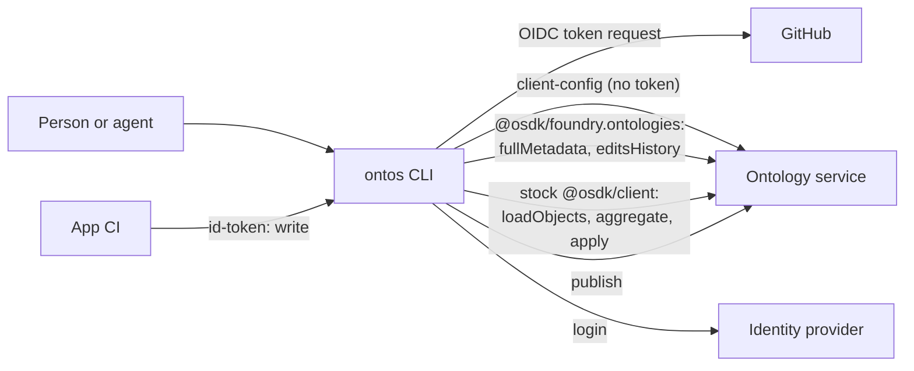

# CLI

The CLI is the command-line tool that people, agents, and CI use with an [Ontology service deployment](./deployment.md). People and agents scaffold projects, run a local service, read Objects, and apply Actions with it, and CI validates and publishes with it. An agent in Claude, ChatGPT, or Grok uses the [Ontology MCP](./ontology-mcp.md) in place of the CLI.

## Contract

### Package

- The CLI is the npm package `@ericbragas/ontos-cli`, and its command is `ontos`. [Releases](./releases.md#packages) specifies how it ships. Our rule.
- Running `ontos --help`, `ontos -h`, or `ontos <command> --help` prints usage and exits 0 without loading heavy build or service modules. Our rule.
- The CLI calls the HTTP API routes with the OSDK packages: the stock `@osdk/client` for `loadObjects`, `aggregate`, and `apply`, and `@osdk/foundry.ontologies` for `fullMetadata` and `editsHistory`. [HTTP API](./http-api.md#routes) lists the routes. Our rule.
- `describe`, `objects`, `aggregate`, `apply`, and `history` read the metadata that they need from the service, through the OSDK packages: the stock `@osdk/client`, and `@osdk/foundry.ontologies` for `fullMetadata` and `editsHistory`. They do not need an app's generated Ontology SDK, so they work in any folder. Our rule.
- The CLI keeps each `200` answer of `client-config` and of the metadata routes (`fullMetadata`, `objectTypes/{objectType}/fullMetadata`, and `actionTypes/{actionType}`) in memory for the life of its process, by the request URL. A later command in the same process, such as a second `run` call of the [library entry](#library-entry), uses the kept answer. It also keeps the answer of List Ontologies, by the service origin and the token of the call, because the service lists the Ontologies of the token's Organization. Each origin keeps the list of its latest token only, so another token asks again. Parallel commands share 1 pending request. It keeps no answer of `loadObjects`, `aggregate`, `apply`, or `editsHistory`. Our rule.
- `publish`, `validate`, and `install` drop the kept answers of their target. A publish by another process shows only in a new process. Our rule.
- `generate-osdk` makes the Ontology metadata of the local IR locally, with no network and no token, as [Ontology SDK](../ontology/ontology-sdk/ontology-sdk.md) specifies. `fullMetadata` cannot give it, because it returns only the published Ontology.

### Library entry

- `@ericbragas/ontos-cli` exports 1 function, `run(args, io?)`. It runs 1 command line in the caller's process, as the `ontos` command does, and gives the exit code. Our rule.
- `io` has 8 fields, each optional: `cwd`, `env`, `stdout`, `stderr`, `fetch`, `sleep`, `tokenStore`, and `isTty`. A missing field gets the value that the `ontos` command uses: the current folder, `process.env`, the process's stdout and stderr, the global `fetch`, the token files of [Sign-in](#sign-in), a timer, and `process.stdout.isTTY`. Our rule.
- A refresh calls `write` of `io.tokenStore` with a third argument: the refresh token that the refresh read. The store writes only when the key still holds that token, as [Sign-in](#sign-in) specifies. A store of the caller that ignores the argument writes each time. Our rule.
- `run` prints the same output on `io.stdout` and `io.stderr` as the command does, as [Output](#output) specifies. It never calls `process.exit`. Our rule.
- The package's `exports` map has only the package root and `./package.json`. A file under `dist/` is not part of the contract, and an import of it fails. Our rule.
- The package ships TypeScript declarations for `run` and its types. Our rule.

### Inputs

- `validate`, `publish`, and `generate-osdk` look for `ontos.yml` (falling back to `foundry.yml` for backwards compatibility) in the current folder, then in each parent folder, and use the first one that they find. The folder of that file is the root of the app. With no `ontos.yml` or `foundry.yml`, the command stops with an error that names both files. Our rule.
- They read only `apiNamespace`, `osdkOutput`, and the `path` of the `ONTOLOGY` and `TYPESCRIPT_FUNCTIONS` components. Our rule.
- The CLI ignores each other key of `ontos.yml` (or `foundry.yml`), so an app keeps 1 config file. It refuses a `products:` list and a `PYTHON_FUNCTIONS` component, because 1 app has 1 product and the supported Functions are TypeScript v2 Functions. The error names the key. Our rule.
- The CLI runs the app's installed `@osdk/maker` on `<ONTOLOGY path>/src/ontology.mts`, with the `apiNamespace` of `ontos.yml`, and sends the IR that it writes. The app commits no IR. The file name `src/ontology.mts` is fixed. Our rule.
- The CLI discovers and bundles the Functions of `<TYPESCRIPT_FUNCTIONS path>/src/functions/`, as [Functions](../ontology/functions/functions.md#discovery) specifies, and reads the [schema migrations file](../ontology/object-edits/schema-migrations.md#the-schema-migrations-file). Our rule.
- `validate` and `publish` read the [grants file](./ontology-as-code.md#the-grants-file), and send it in the publish body. With no file, the command stops with an error that names the path. `generate-osdk` does not read it, because the Ontology SDK package holds each type. Our rule.

### Targets

- Each remote command acts on 1 target URL. Pass `--url <url>` directly (works without `--app`), or pass `--app <name>` (or set `ONTOLOGY_APP`) with `--env staging` or `--env production` (default `staging`). When `--url` is passed without `--app`, the CLI derives the product key from the URL host (`host.toLowerCase().replace(/[^a-z0-9.-]+/g, '-')`) and sets `baseUrl` to the URL origin. No environment variable selects the environment, so a write to production always needs `--env production` on its own command line. Our rule.
- `init`, `dev`, and `generate-osdk` act locally and require no remote target (`generate-osdk` refuses `--app`, `--env`, and `--url`). Our rule.
- At start, the CLI looks for a `.env` file in the current folder, then in each parent folder. It reads the first one that it finds with `util.parseEnv()`, the parser of Node's `process.loadEnvFile()`. So an app commits a `.env` that sets `ONTOLOGY_APP`, and holds no secret. The CLI uses the values only for its own settings, and does not put them in `process.env`. So no child process, such as `@osdk/maker`, gets a value from `.env`, and no value from `.env` moves the token file. A cloned repository's `.env` with `NODE_OPTIONS` cannot run code in the CLI's child processes. Our rule. Source: [Node.js util](https://nodejs.org/api/util.html#utilparseenvcontent).
- A variable that the shell already sets keeps its value. Source: [Node.js CLI](https://nodejs.org/api/cli.html#--env-filefile).
- When `--app` is used without `--url`, the CLI builds the base URL from the app name, the environment, and `ONTOS_BASE_DOMAIN` (default `ontos.example`): `<app>.<domain>` or `<app>-staging.<domain>`. Our rule.
- The app name is 1 DNS label of lowercase letters, digits, and hyphens. Another value stops the command before any call. The app name becomes part of the host name, so a crafted `.env` could otherwise send the token to another host. Our rule.
- `--url <URL>` sends the calls to a specific deployment URL (such as a local server or preview URL) in place of the derived base URL. When paired with `--app`, the token audience stays the base URL of the environment. Our rule.
- The CLI gets the other settings from `GET /api/ontology-service/v1/client-config`. The route needs no token. It returns the product RID, the WorkOS client ID (when configured), and the environment name, from the [deployment file](./deployment.md#deployment-files). It returns no Ontology RID, as [Ontology](#ontology) specifies. It is not an OSDK HTTP API v2 route. Our rule.

### Sign-in

- `ontos login` signs a person in with WorkOS CLI Auth, as [Authentication](./authentication.md#people) specifies. `ontos logout` removes the stored token. Our rule.
- The WorkOS device flow shows no Organization picker, and it can return a token with an `org_id` or with none. When it selects an Organization, the CLI refreshes the token with `organization_id`, so the access token carries `org_id` and `role`. A later refresh sends no `organization_id` and keeps both claims. Source: [Sessions](https://workos.com/docs/authkit/sessions.md) ("by passing the `organization_id` parameter").
- `ontos login --org <id>` takes that Organization. When a token of the app and environment is stored, the CLI refreshes it with that `organization_id`, so the person signs in only once. When that refresh fails, the CLI signs the person in again. Our rule.
- The CLI keeps 1 token for each app and environment, so it acts in 1 Organization. To switch, the person runs `ontos login --org <id>` again. The Ontology service has no switch command. Our rule.
- With `--test-user`, the refresh of `--org` follows the password sign-in. Our rule.
- With no `--org`, the CLI keeps the token that the sign-in gives when that token has an `org_id`. When it has none, the CLI stores it, and reads [the Organizations of the person](./authentication.md#organizations). With 1 Organization, the CLI refreshes the token with its ID, with no second sign-in. With more, it prints each name and ID, and names `ontos login --org <id>` as the next step. With none, it says to join or create an Organization. The exit code is 0 in each case. Our rule.
- This rule covers each refresh into an Organization: for `--org`, and for the 1 Organization of the list. The CLI compares the `org_id` of the new access token with that Organization. When they differ, the CLI stores the new token, which is valid, and exits 1 with no new sign-in. The error names both Organizations, or says that the answer has none, and says to run `ontos login --org <id>` again. Our rule.
- `ontos login` reads the Organizations 1 time, with a limit of 10 seconds. With no answer, a network error, `429`, a `5xx`, or an answer that it cannot read, it prints a warning. The warning says what failed, and names `--org <id>` and the join or create step. The token stays stored, and the exit code is 0. With any other status, the error names the status and the next step. The token stays stored, and the exit code is 1. Our rule.
- When WorkOS refuses the Organization that the list named, the CLI shows the error of WorkOS. The token stays stored, and the exit code is 1. Our rule.
- A service with no route for the Organizations of a person answers 404. Then `ontos login` warns that the token has no Organization, and names `--org <id>`. The exit code is 0. Our rule.
- `ontos login` prints the Organization and the role that the access token carries. It reads them only to show them, and the Ontology service checks each token. Our rule.
- When WorkOS refuses the Organization of `--org`, the command shows the error of WorkOS, stores nothing, and the stored token does not change. Our rule.
- `ontos login --test-user` signs in as the test user of the staging WorkOS environment with WorkOS password sign-in, as [Authentication](./authentication.md#people) specifies. It reads the email, the password, and the API key of the staging WorkOS environment from the shell variables `ONTOLOGY_TEST_USER_EMAIL`, `ONTOLOGY_TEST_USER_PASSWORD`, and `WORKOS_API_KEY`, never from `.env`. Our rule.
- `ontos login --test-user` acts on staging only. Passing `--env production` stops before any call, because a production environment has no test user. Our rule.
- It stores the refresh token as `ontos login` does, so later commands refresh it with no new password sign-in. The refresh sends the client ID and no client secret. Our rule.
- The test user's token has its own file, `ontos/tokens/<app>/<environment>-test-user`, so it never replaces the token of a person. `login`, `logout`, `describe`, `objects`, `aggregate`, `apply`, `history`, `validate`, and `publish` take `--test-user`, and then use that token. The other commands refuse it. `ontos logout --test-user` removes it. Our rule.
- With `--test-user`, a command stops before any call when `ONTOLOGY_TOKEN`, `ACTIONS_ID_TOKEN_REQUEST_URL`, or `ACTIONS_ID_TOKEN_REQUEST_TOKEN` is set, in the shell or in `.env`. That token would replace the test user's token. The error names the variable. Our rule.
- The CLI stores 1 refresh token for each app and environment, each in its own file: `ontos/tokens/<app>/<environment>` in the user's config folder, which is `XDG_CONFIG_HOME`, else `~/.config`. The file is readable only by its owner (mode `0600`), and the CLI makes its folders with mode `0700`. This holds on every operating system. Our rule.
- A write of the token of 1 app and environment changes no file of another app or environment, so 2 commands for different environments can refresh at the same time. Our rule.
- 2 commands of 1 app and environment can write its token file at the same time: 2 refreshes, or a refresh and `login` or `logout`. A refresh writes the file only when the file still holds the refresh token that the refresh started from. When the file holds another token, the newer token stays for later commands, and the command finishes with its own access token. When the file is missing, such as after `logout`, the refresh writes nothing. `login` and `logout` always write. A short lock file, `<environment>.lock` next to the token file, makes each compare and write 1 step. A lock older than 10 seconds is from a stopped command, and the next write removes it. Our rule.
- When a refresh fails with a network error, HTTP `429`, or a `5xx` status, the CLI tries again with the same refresh token, at most 3 more times. Before each try, it waits 1, 2, then 4 seconds, or the `Retry-After` time when WorkOS sends one. It stops when the next wait would take the total past 20 seconds, because WorkOS returns the same new tokens for a replay only within 30 seconds. Source: [Session resilience](https://workos.com/docs/authkit/session-resilience.md) ("retry the same refresh token with a bounded number of attempts and exponential backoff", "The grace period is 30 seconds").
- When WorkOS answers `invalid_grant`, the CLI tells the person to run `ontos login`. For any other error, the CLI shows the WorkOS error and does not try again. Source: [Session resilience](https://workos.com/docs/authkit/session-resilience.md) ("Redirect to sign-in only on a terminal `invalid_grant`").
- In a GitHub Actions job, the CLI asks GitHub for an OIDC token. The token's audience is the base URL of the target environment. The job needs the permission `id-token: write`. Source: [OpenID Connect reference](https://docs.github.com/en/actions/reference/security/oidc).
- The CLI keeps each OIDC token in memory for the life of its process, by request URL and audience, and sends it again until 60 seconds before its `exp`. Then it asks for a new one. So 2 [local services](./testing.md#local-service) in 1 process never share a token. Our rule.
- The CLI keeps the access token of each stored token in memory for the life of its process, by the app, the environment, `--test-user`, the URL of the calls, and the WorkOS client ID. A later command sends it again until 120 seconds before its `exp`, which is longer than the tries of a read. Then the command refreshes the stored token. A token with no `exp` serves 1 command. Parallel commands share 1 pending refresh, and a failed refresh is not kept. `login` and `logout` drop the kept token of their app and environment. So a session that another process ends stays in use in this process until the `exp` of its access token. Our rule.
- Each token store has its own kept access tokens, so 2 token stores never share an access token. The token files of 1 config folder are 1 token store for the life of the process. Our rule.
- When the token request fails with a network error, HTTP `429`, or a `5xx` status, the CLI tries again, at most 6 more times. Before each try, it waits 1, 2, 4, 8, 16, then 32 seconds, or the `Retry-After` time when GitHub sends one. It stops when the next wait would take the total past 63 seconds. The request sends nothing to the service, so each command retries it, `apply` included. Our rule.
- When `ONTOLOGY_TOKEN` is set, the CLI sends that token, and skips the stored token and the GitHub request. Our rule.

### Ontology

- Each command that reads or writes Ontology data calls List Ontologies with its token. With 1 result, it uses that Ontology. With more, it needs `--ontology <apiName>`. Without it, the command stops before any call that writes, and lists the API names. With none, it says that an admin of the Organization must install one. Our rule.
- An `--ontology` value that the list does not hold stops the command before any call that writes, and lists the API names, also with 1 result. Our rule.
- A token with no Organization gets 403 `OntologyService:NoOrganization`, as [Organizations](./authentication.md#organizations) specifies. The CLI then prints the service's error with a `message`, which names `ontos login` with the `--app` and the `--env` of the command. For a person with no Organization, `ontos login` says to join or create one. Our rule.
- `.env` names no Ontology. Our rule.

### Commands

| Command                                                                                              | Does                                                                                                                                                                                                                                                                                                                                                                  | Route                                                                                     |
| ---------------------------------------------------------------------------------------------------- | --------------------------------------------------------------------------------------------------------------------------------------------------------------------------------------------------------------------------------------------------------------------------------------------------------------------------------------------------------------------- | ----------------------------------------------------------------------------------------- |
| `init [dir] [--force]`                                                                               | Scaffold a minimal Ontos Ontology project (`ontos.yml`, `package.json`, `ontology/src/ontology.mts`, `ontology/src/grants.json`, `.ontology/schema-migrations.json`, `.gitignore`). Refuses to overwrite existing files without `--force`.                                                                                                                            | None                                                                                      |
| `dev [--port <port>] [--host <host>] [--database-url <url>] [--token <token>] [--product-rid <rid>]` | Start a local PostgreSQL-backed Ontos service in `dev` mode (default `127.0.0.1:8080`, `DATABASE_URL`, `ONTOS_DEV_TOKEN` or `ontos-dev-token`). Dynamically loads `@ericbragas/ontos-service`.                                                                                                                                                                        | Local HTTP server (`/api/v2/*`, `/api/mcp`)                                               |
| `login [--org <id>]`, `logout`                                                                       | Sign in as a person in 1 Organization, or as the test user with `--test-user`, or remove the stored token                                                                                                                                                                                                                                                             | `client-config`, and [the Organizations of the person](./authentication.md#organizations) |
| `install <product> --api-name <name> --display-name <name>`                                          | Install a product into the signed-in Organization, for a caller that holds `ontology:install`. It prints the Ontology RID.                                                                                                                                                                                                                                            | [Install](./publish.md#install)                                                           |
| `describe [name] [--ontology <apiName>]`                                                             | With no name: list the Object Types, the Link sides, and the Action Types. With a name: show 1 of them in full, with its Properties, Links, or parameters                                                                                                                                                                                                             | `fullMetadata`                                                                            |
| `objects <ObjectType> [--ontology <apiName>]`                                                        | Load Objects                                                                                                                                                                                                                                                                                                                                                          | `loadObjects`                                                                             |
| `objects <ObjectType> <primary key> [--link <link>] [--ontology <apiName>]`                          | Load 1 Object, or the Objects of 1 of its Links                                                                                                                                                                                                                                                                                                                       | `loadObjects`                                                                             |
| `aggregate <ObjectType> [--ontology <apiName>]`                                                      | Compute metrics, with or without groups                                                                                                                                                                                                                                                                                                                               | `aggregate`                                                                               |
| `apply <ActionType> [--ontology <apiName>]`                                                          | Apply 1 Action. `--validate-only` sends `VALIDATE_ONLY`.                                                                                                                                                                                                                                                                                                              | `apply`                                                                                   |
| `history <ObjectType> [<primary key>] [--ontology <apiName>]`                                        | Read [Object Edit History](../ontology/object-edits/edit-history.md)                                                                                                                                                                                                                                                                                                  | `editsHistory`                                                                            |
| `validate [--local \| --base <ref>]`                                                                 | Run each check of a publish and plan each change, and apply nothing: the publish route with `validateOnly`. With `--local`, run against a [local service](./testing.md#local-service) of this CLI's release instead of the environment. With `--base <ref>`, compare the pinned CLI release and changed files against `<ref>`. People and pull request checks use it. | [Publish](./publish.md)                                                                   |
| `publish [--skip-sdk-package]`                                                                       | Publish, for the app's publish workflow or local development, as [Publish job](#publish-job) specifies. After 409 `PublishLockTimeout`, it tries again, up to 3 tries in total, 30 seconds apart. It prints the error body of each try.                                                                                                                               | [Publish](./publish.md)                                                                   |
| `generate-osdk`                                                                                      | Write the app's Ontology SDK locally                                                                                                                                                                                                                                                                                                                                  | [Ontology SDK](../ontology/ontology-sdk/ontology-sdk.md)                                  |
| `--version`, `-h`, `--help`                                                                          | Print the CLI version or usage help with fast lazy-loaded startup                                                                                                                                                                                                                                                                                                     | None                                                                                      |

- `describe` shows the `description` of each Object Type, Property, and Action Type, because agents read those fields. For a Link Type, it shows its display name, its target Object Type, and its cardinality, because OSDK Link Type metadata has no `description`. Our rule. Source: `LinkTypeSideV2`.
- `describe` lists each Link Type as its 2 sides, by the side API name, such as `parent` and `subsidiaries`, with the Link Type RID on each side. The 2 sides of 1 Link Type have the same RID. OSDK metadata has no Link Type API name, such as `companyToSubsidiaries`, so the list shows none. Source: `LinkTypeSideV2`.
- `describe <name>` also takes a Link Type API name. The CLI makes the Link Type RID from the name and the product RID of `client-config`, as [HTTP API](./http-api.md#rids) specifies the RIDs. Then it shows the Link Type: its API name, its RID, and its 2 sides. It does this only when no Object Type, Action Type, or Link side has that name. Our rule.
- `objects` and `aggregate` take `--where` in the OSDK syntax as JSON, such as `--where '{"status":{"$eq":"open"}}'`. `objects` also takes `--order-by` and `--select`. `aggregate` takes `--select` and `--group-by`. A metric key of `--select` is `<Property>:<metric>`, such as `--select '{"feeDollars:sum":"unordered","$count":"unordered"}'`. The stock client converts each one to the wire form. Source: TypeScript OSDK.
- In `--where`, `$startsWith` matches word prefixes, as [Text search](../ontology/ontology-sdk/object-sets.md#text-search) specifies.
- A metric key of `--select` that has no `:<metric>`, other than `$count`, stops the CLI before the request. The error names the key and the form `<Property>:<metric>`, and the exit code is not 0. Our rule.
- `history` adds `user`, with `name` and `email`, to each entry whose `userId` is a member or a former member of the Organization. It reads the users of each page with 2 `Users.getBatch` calls: with `status` `ACTIVE`, then with `DELETED` for the rest. `name` is the given name and the family name, or the email when the user has neither. Our rule.
- When a `Users.getBatch` call of `history` fails, `history` still prints the entries of the page, each with `userId` and no `user`. It writes 1 warning, `Could not read the names of the users: <reason>`, as [Output](#output) specifies. `<reason>` is the `errorName` of the OSDK error body, or the message of the error when the answer has no `errorName`. The exit code is 0. Our rule.
- `apply` takes `--parameters` as JSON in the OSDK form. An Object parameter is its primary key. Our rule.
- The stock client works with an Object Type that it knows only by its API name, and loads the metadata when it needs it. Our rule.

### Publish job

- `publish` runs 3 steps in order: the check of the branch head, 1 publish call, and then the Ontology SDK package. The job calls no other route of the service, and has no upgrade pass. Our rule.
- When the publish call fails, the job exits 1, prints the error body, and makes no Ontology SDK package. When the data of 1 installation blocks the publish, the body holds `ontologyRid`, `change`, and `transactionMs`, as [Applying](./publish.md#applying) specifies. Our rule.
- The job releases the Ontology SDK package of the version that the publish call answers. The commit of the publish transaction upgrades every installation, so the job makes no other check before the package. After a failure, it makes no package. Our rule.
- After a 503 of the publish call, the job exits 1, and releases no Ontology SDK package, also when the answer says that the version is stored, as [Reconcile](./publish.md#reconcile) specifies. A rerun of the job stores no new version, runs the reconcile again, and releases the Ontology SDK package of the newest version. Our rule.
- The output of `publish` on stdout holds `transactionMs` of the publish answer: the duration of the publish transaction in milliseconds. Our rule.
- 2 publish jobs of 1 environment do not overlap, as [Managed files](./deployment.md#managed-files) specifies.
- In GitHub Actions, where `GITHUB_ACTIONS` is `true`, `publish` first checks that the commit of the job is still the head of its branch on GitHub. It reads the head with `GET <GITHUB_API_URL>/repos/<GITHUB_REPOSITORY>/git/ref/heads/<GITHUB_REF_NAME>`, and compares it with `GITHUB_SHA`. It sends `NODE_AUTH_TOKEN`. `validate` runs no check. Sources: [Variables reference](https://docs.github.com/en/actions/reference/workflows-and-actions/variables), [Get a reference](https://docs.github.com/en/rest/git/refs#get-a-reference). Our rule.
- A re-run of a commit that is not the branch head publishes nothing: the job exits 1 before the publish call, makes no call to the package registry, and its error names both commits. A re-run uses the commit of its first run. So the check stops a re-run of an older job, which would store an older Ontology and move the `production` and `latest` tags back. Source: [Re-running workflows and jobs](https://docs.github.com/en/actions/how-tos/manage-workflow-runs/re-run-workflows-and-jobs).
- A missing variable of the check, or a GitHub answer other than 200, stops the job the same way. Its error names the variables or the status. A re-run of the head commit passes the check. So a re-run after a lost response still completes, as [Applying](./publish.md#applying) specifies. Our rule.
- A person cannot release a package by hand, because publish refuses an apply from a caller that is not the publish caller.
- `validate` runs only the publish call with `validateOnly`. With `--local`, it starts a [local service](./testing.md#local-service) of this CLI's release with the staging settings of `.ontology/deployment.json`. It publishes to that service, stops it, and prints `{ local: true, changes, metadata }` on stdout. It refuses `--local` with `--base`, `--url`, `--test-user`, or `--env production`. With `--base <ref>`, it runs remotely when the pinned `@ericbragas/ontos-cli` version did not change. When the pin changed with no Ontology schema change, it runs locally and refuses `--env production`. When both changed, it exits 1 and names each changed Ontology file. Our rule.
- `publish --skip-sdk-package` runs the job with no Ontology SDK package: it makes no call to the package registry, moves no tag, and its output has no `ontologySdk` field. Only `publish` takes the flag. Our rule.
- The flag skips only the last step of the job. The publish call, its output, and its exit code are the same as without it.

### Output

- Each command prints compact JSON on stdout when stdout is not a TTY or when `--json` is passed, and human-readable output in a TTY. Our rule.
- An error prints JSON on stderr (or human-readable `Error: ...` in a TTY without `--json`): the OSDK error body for an error from the service, as [HTTP API](./http-api.md#errors) specifies. Our rule.
- An unexpected error inside a step of a command adds `step` to the JSON error alongside `message`. When a child command prints output that is not JSON, the error also adds `command`. Its `message` quotes the start of the output, or says that the command printed nothing. Our rule.
- A warning prints 1 JSON line `{"warning":"<text>"}` on stderr. A warning does not change the exit code. Our rule.
- `validate` and `publish` print a warning for each Object Type, Property, Link Type, Action Type, and Action parameter that has no description. The warning names the element. Our rule.
- `objects <ObjectType> <primary key>` of a missing Object prints `{"errorCode":"NOT_FOUND","errorName":"ObjectNotFound","parameters":{"objectType":<ObjectType>,"primaryKey":<primary key>}}` on stderr, and exits 1. The CLI makes this body, because it reads the Object with `loadObjects`, which answers a missing Object with no Object. The body has no `errorInstanceId`, because the service gave no error. Source: `ObjectNotFound` in `@osdk/foundry.ontologies` 2.87.0. Our rule.
- When the first request of a command to the service gets no answer, the error names the URL of the service and the cause, such as `Cannot reach https://twin-staging.ontos.example: getaddrinfo ENOTFOUND twin-staging.ontos.example.` Our rule.
- When `client-config` gets HTTP `404` with a body that holds `DEPLOYMENT_NOT_FOUND`, the environment has no deployment yet. The error is `{"errorName":"EnvironmentNotDeployed","message":...,"url":...}`, with no `errorCode`. The message names the environment, the app, and the first deploy as the next step. Our rule.
- The CLI tries a read again when it fails with a network error or HTTP `502`, `503`, or `504`, at most 6 more times. Before each try, it waits 1, 2, 4, 8, 16, then 32 seconds, or the `Retry-After` time. The waits take at most 63 seconds in all. A read is each `GET`, and the `POST` of `loadObjects`, `aggregate`, and `editsHistory`. Our rule.
- The CLI never sends an `apply` or a `publish` request again after a network error or a `5xx`, because the service may have written. Our rule.
- When the last try of a read fails, the error is `{"errorName":"TransientFailure","message":...,"status":...,"url":...,"tries":...}`. It has no `errorCode`, so it is not an OSDK error. Our rule.
- The exit code is 0 on success. It is 1 on an error, and on an apply with `validation.result: "INVALID"`. Our rule.

### Limits

- `objects` returns 100 Objects by default. `--page-size` asks for up to 10,000. Our rule.
- The output holds `nextPageToken` when more Objects remain, and `--page-token` reads the next page. The CLI has no option that reads all pages, because the Ontology service ignores `snapshot`, as [Object Sets](../ontology/ontology-sdk/object-sets.md#paging) specifies. Our rule.

## Diagram

## Serves

- [Object Sets](../ontology/ontology-sdk/object-sets.md)
- [Aggregations](../ontology/ontology-sdk/aggregations.md)
- [Action Types](../ontology/action-types/action-types.md)
- [Object Edit History](../ontology/object-edits/edit-history.md)
- [Ontology SDK](../ontology/ontology-sdk/ontology-sdk.md)

## Related

- [Authentication](./authentication.md)
- [HTTP API](./http-api.md)
- [Publish](./publish.md)
- [Releases](./releases.md)
- [Code layout](./code-layout.md)
- [Ontology service deployment](./deployment.md)
