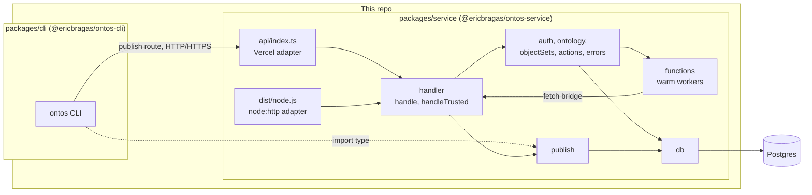

# Code layout

The code layout is how this repo holds the code of the [Ontology service](./ontology-service.md) and the [CLI](./cli.md): the packages, the modules and their seams, the libraries, and the OSDK code that they import.

## Contract

### Packages

- This repo is a Bun and npm workspace with two packages: `packages/service` (`@ericbragas/ontos-service`) and `packages/cli` (`@ericbragas/ontos-cli`). Our rule.
- `packages/service` holds the Ontology service. `packages/service/build.ts` compiles ESM bundles and TypeScript declarations into `packages/service/dist/` (`index.js`, `node.js`, `client-config.js`, `publish.js`, `convert.js`, `worker.js`, and `testing/index.js`) and copies root `LICENSE` and `NOTICE` for Apache-2.0 distribution. Our rule.
- `packages/service/testing/` holds the [test entry](./testing.md#local-service) and the test helpers that it uses: the test token issuer, the WorkOS stub, and the local listen. The tests of this repo import these helpers through the `.test-utils.ts` re-exports in `packages/service/src/`. No product file of `src/` or `api/` imports `testing/`, and a lint rule refuses such an import. Our rule.
- `packages/cli` holds the CLI (`ontos`). `packages/cli/build.ts` bundles `packages/cli/dist/ontos.js` with `dist/ontos.d.ts` and copies root `LICENSE` and `NOTICE`, as [Releases](./releases.md#packages) specifies.
- The CLI imports the types of the publish route from `packages/service` with `import type`. It imports values from `packages/service` only for the compile step, the converter (`@ericbragas/ontos-service/convert`), and the helper of [yielded failures](#errors), and esbuild bundles them into the CLI. So each CLI version holds the converter of its own release. Source: [Modules: TypeScript](https://nodejs.org/api/typescript.html#importing-types-without-type-keyword) ("the `type` keyword is necessary to correctly strip type imports").
- The compile step and the converter import no module that does input or output, such as `db`, so the CLI bundle holds no database driver. Our rule.
- The service package holds the remap entry `src/publish/remapEntry.ts`, which runs the remap of `publish/remap.ts`, as [Storage](./storage.md#remap) specifies. `publish/remap.ts` imports `lockProductVersions` from `publish/install.ts`. Our rule.
- `publish/remapEntry.ts` is an entry, as `src/node.ts` is, and it is a file of the `publish` module that does input and output. `publish/index.ts` exports no part of the remap, so no other module can import it. The entry imports values only from the `publish`, `db`, and `errors` modules. The route table has no route and no access kind for the remap, so no request can run it. Our rule.
- Repository tooling lives under `tools/` by ownership: `tools/fallible/` (`dropped-call.ts`), `tools/oxlint/` (custom Oxlint plugins and `anti-slop`), `tools/packaging/` (`service-package.ts` and `testService.ts`), `tools/ops/` (`restore-ontology.ts`), and `tools/docs/` (`spec-sections.ts`). `landmines/no-scripts-directory` forbids a root `scripts/` folder. Our rule.
- `packages/cli` declares `@ericbragas/ontos-service` as an optional dependency so `ontos dev` can load `@ericbragas/ontos-service` dynamically at runtime while `ontos --help`, `ontos --version`, and remote CLI commands stay free of database drivers. Our rule.

### Tests

- Each test sits beside the code file that it tests, as `<name>.test.ts` next to `<name>.ts`. A test that imports from more than 1 owner folder is split into 1 test for each owner. The `landmines/colocated-tests` rule checks this, as [Linting](../linting.md) and [Test rules](./testing.md#test-rules) list. Our rule.
- A test helper is `<subject>.test-utils.ts`, and a test data file is `<subject>.fixture.ts`, both beside their owner. No `.spec.ts`, `.helper.ts`, or `.mocks.ts` file and no `tests/` folder exists. The `landmines/test-file-names` rule checks this. Our rule.
- The package `src/` has no `test/` folder. The root `test/` folder holds only cross-functional harnesses (`test/sharedBuild.ts`, `test/sharedBuildClient.ts`, and `test/tempFolder.ts`), enforced by `landmines/test-dir-only-cross-functional`. Our rule.
- `packages/service/testing/` is the published test entry, not a test. It stays in place, and the tests reach it through the `.test-utils.ts` re-exports of `src/`. Our rule.
- `packages/service/twin/` is a test-support module holding test Ontology definitions, IRs, Function bundles, and seeds. Our rule.
- The Vitest project of a test comes from the suffix of its name, as `vitest.config.ts` sets. `<name>.sql.test.ts` runs in `sql` and `<name>.mcp.test.ts` runs in `mcp`. Any other `<name>.test.ts` under `packages/*/src/`, `packages/service/twin/`, or `tools/` runs in `unit`. Our rule.
- A change of the suffix of a test changes its project. So a test keeps its project when it moves, and a test that starts to need the test Postgres gets the `.sql` infix. Our rule.

### TypeScript

- All code is TypeScript in ES modules. Our rule.
- The code uses only erasable TypeScript syntax: no enums, no namespaces with runtime code, no parameter properties, and no import aliases. `tsconfig.base.json` sets `erasableSyntaxOnly` and `verbatimModuleSyntax`. Source: [Modules: TypeScript](https://nodejs.org/api/typescript.html#type-stripping) ("By default Node.js will execute TypeScript files that contains only erasable TypeScript syntax").
- Node.js 24+ runs TypeScript files directly in local development and tests. `bun run typecheck` runs `bun check --no-script` across the root, `packages/service`, and `packages/cli` projects. Our rule.
- `bun run build` runs `packages/service/build.ts` and `packages/cli/build.ts`, using `esbuild` for ESM bundles and `typescript` 6.0.3 (`ts.createProgram`) for `.d.ts` declarations. `bun run check:pkg` verifies both packages with `publint` and `attw --pack --profile esm-only`. Our rule.
- Vercel compiles the Vercel Function at deploy. Source: [Node.js runtime](https://vercel.com/docs/functions/runtimes/node-js#using-typescript-with-the-node.js-runtime) ("The Node.js runtime supports TypeScript files inside the `/api` directory").
- `packages/service/tsconfig.json` sets `target` and `module` itself, not only through `extends`, so Vercel's TypeScript loader keeps `strict: true` and the intended target. Our rule.
- The CLI pins exact versions of `typescript` and `esbuild` as runtime dependencies, lazy-loads them via dynamic `import()`, and does not bundle them. It discovers and bundles [Functions](../ontology/functions/functions.md#discovery) with them. Our rule.

### HTTP entry

- The Ontology service has one request handler with 2 entries. Each entry takes a Web `Request`, and returns a Web `Response`. The handler holds the route table of all routes. Our rule.
- The adapters call `handle(request, input)`. `input` holds the pooled database client, Neon's direct connection, the settings of the environment, and the reader of the WorkOS users. It holds no caller, so `handle` checks the token. `input` can also hold `reportFault` and `bodyPending`, which only the Vercel adapter gives. Our rule.
- Only the `functions` module calls `handleTrusted(request, input)`. `input` holds the read-only snapshot transaction of the Function run, the view of the Ontology of the Action, and the person who applies the Action. `handleTrusted` does no token check. Our rule.
- The Ontology service uses no HTTP framework. Our rule.
- `packages/service/api/index.ts` is the one Vercel Function. It exports a Web standard `fetch` handler that calls `handle`. Source: [Node.js runtime](https://vercel.com/docs/functions/runtimes/node-js#create-a-node.js-function-in-/api) ("define a single `fetch` handler that receives requests for all HTTP methods and routes them by URL pathname").
- A rewrite in `vercel.json` sends each path under `/api/` to that Vercel Function. Source: [Node.js runtime](https://vercel.com/docs/functions/runtimes/node-js#create-a-node.js-function-in-/api) ("configure rewrites to send related API paths to the same function").
- `includeFiles` in `vercel.json` adds the worker script of the `functions` module to the Vercel Function. Source: [vercel.json](https://vercel.com/docs/project-configuration/vercel-json#functions) ("A glob pattern to match files that should be included in your Vercel Function").
- `packages/service/public/` holds only `robots.txt`. The Vercel project has no framework preset, so Vercel serves only that folder as static files, and a deployment serves no source file. Source: [Configure a build](https://vercel.com/docs/builds/configure-a-build#output-directory) ("This sets the output directory as `public` if it exists or `.` (root directory of the project) otherwise").
- The Vercel adapter is the only code that imports `@vercel/functions`. It registers the `pg` pool with `attachDatabasePool`, as [Storage](./storage.md#connection) specifies. Our rule.
- The Vercel adapter is the only code that imports `@sentry/node`. Our rule.
- The Vercel adapter is the only code that imports the OpenTelemetry SDK and the OTLP exporters. It keeps them in `api/_tracing.ts`. Our rule.
- Vercel treats files in `api/` whose names start with `_` (such as `api/_tracing.ts`) as helper modules rather than separate serverless functions. Our rule.
- `packages/service/src/node.ts` (compiled to `packages/service/dist/node.js`) serves the same handler with `node:http`, for local runs, Docker containers, and tests. Our rule.
- Neither adapter passes a client disconnect signal in v1.0. `node.ts` builds each `Request` with no signal, and `vercel.json` does not set `supportsCancellation`. So `request.signal` never aborts, and a request that the client drops runs to its end. Our rule.
- `supportsCancellation` stays off because it ends every route of the one Vercel Function when its client leaves. A publish and an Action apply would then end in the middle. Source: [Functions API Reference](https://vercel.com/docs/functions/functions-api-reference#enable-cancellation) ("Termination on disconnect applies to every function matching the glob").
- The repository ships a multi-stage `Dockerfile` (Node 24 Alpine) and `docker-compose.yml` that run `node packages/service/dist/node.js` against PostgreSQL 17. Our rule.

### Modules

`packages/service/src/` holds these modules. Our rule.

| Module       | Job                                                                                                                                                                                                                                                                                                                                                         | Pure         |
| ------------ | ----------------------------------------------------------------------------------------------------------------------------------------------------------------------------------------------------------------------------------------------------------------------------------------------------------------------------------------------------------- | ------------ |
| `handler`    | The route table, the token check, the error envelope, and the request context                                                                                                                                                                                                                                                                               | No           |
| `mcp`        | The [Ontology MCP](./ontology-mcp.md): the MCP server, the 8 tools, their input schemas, the business map, the server instructions, and the page size clamp                                                                                                                                                                                                 | No           |
| `auth`       | Token checks, the 1 WorkOS client with its kept answers and its clock, the resolver that gives each caller its permissions, the token route, the user routes, and the WorkOS writes of publish, as [Authentication](./authentication.md) specifies                                                                                                          | No           |
| `ontology`   | Opens the view of 1 Ontology for a caller with `openOntology`: reads its registry row, compiles the IR of its Ontology version, parses its grants file into the index of the version, makes the view of the caller from its permissions, runs the cold-start checks, and holds the table and column names                                                   | Partly       |
| `publish`    | The publish route and the install route: IR checks, the grants check, the plan of the WorkOS steps and the port type that applies them, the converter to Ontology metadata, the table change plan, schema migrations, the new product version, the upgrade of each installation in the publish transaction, the reconcile of the default roles, and install | Partly       |
| `objectSets` | Object Sets and where clauses to SQL, `loadObjects`, and `aggregate`                                                                                                                                                                                                                                                                                        | The compiler |
| `actions`    | Parameter checks, rules to edits, value checks, the version check and its retry, the writer, Object Edit History, and the run of a Query Function                                                                                                                                                                                                           | The rules    |
| `functions`  | Warm workers, the worker script, and the `fetch` bridge from a Function's client to `handleTrusted`                                                                                                                                                                                                                                                         | No           |
| `db`         | Pool creation, the `Schemas` type, the engine tables, the [engine changes](./storage.md#engine-changes) in `engineChanges.ts`, and, in `baseTypes.ts`, the Postgres type of each [base type column](./storage.md#base-type-columns), the JSON values that it takes, and the SQL that reads it in its JSON form                                              | No           |
| `spans`      | The span catalog, `span`, `untraced`, the 3 brand makers, the attribute filter, the root span, and the trace ID of a request, as [Traces](./observability.md#traces) specifies                                                                                                                                                                              | No           |
| `errors`     | OSDK error envelope                                                                                                                                                                                                                                                                                                                                         | Yes          |
| `decimal`    | `parseDecimal` and `compareDecimal`, the exact Decimal work of the service, and the only importer of `big.js`                                                                                                                                                                                                                                               | Yes          |
| `valueTypes` | `valueTypeCheck`, `constraintText`, `compareScalar`, and `regexOf`: the order of 2 values, the 1 regex engine, and the check of a value against a [value type](../ontology/object-link-types/value-types.md#constraints)                                                                                                                                    | Yes          |

- `describe_object_type`, `describe_query`, and `describe_action` read the compiled Ontology of the view in `ctx.ontology`. Each other tool of the `mcp` module names its route with a `RouteCall`, and `ctx.runRoute` runs it, as [Seams](#seams) specifies. So `mcp` has no SQL and no engine code, and imports no engine module. Our rule.
- The pure file `ontology/derived.ts` parses and types each [derived property](../ontology/object-link-types/derived-properties.md) definition of both forms. Publish and the read compiler share it, and the CLI bundle holds it. The SQL of a derived value is in `objectSets/compile/`. Our rule.
- A pure module takes data and returns data or SQL. It does no input or output. Our rule.
- The pure module `decimal` exports `parseDecimal` and `compareDecimal`. It holds the 1 Decimal grammar, the 2 caps, the plain form, the fit, and the exact order, as [Properties](../ontology/object-link-types/properties.md#base-types) specifies. Strings go in and strings come out. Our rule.
- `src/decimal/index.ts` is the only file that imports `big.js`, at exactly 5.2.2. An import of `big.js` in any other file fails lint, with the message `Only src/decimal/index.ts imports big.js. Call parseDecimal or compareDecimal.` Only `db`, `actions`, `ontology`, and `valueTypes` import values from `decimal`. Our rule.
- The pure module `valueTypes` exports `valueTypeCheck`, `constraintText`, `compareScalar`, and `regexOf`. It decides if a value passes a [value type](../ontology/object-link-types/value-types.md#constraints), for the write check of `actions` and the stored-data check of `publish`. It holds the order of 2 values and the 1 regex engine. Its row joins the table above in the same pull request as the module. It imports values only from `decimal` and `errors`. Only `actions`, `publish`, `ontology`, and `mcp` import values from it. An import that breaks this fails lint. Our rule.
- The CLI bundle holds `big.js`, because the compile step parses each static Decimal of the IR with `parseDecimal`. The CLI bundle holds no `pg`, also when the compile step uses `valueTypes` or compiles a Uniqueness constraint. A test of the CLI bundle checks both. Our rule.
- `handler`, `auth`, `ontology`, `publish`, `actions`, `functions`, and `db` also import values from `spans`. No other module imports values from it. Our rule.
- A pure file imports no value of `spans`. Its caller adds the span. Our rule.
- No file that the CLI bundle holds imports `spans`. A test of the CLI bundle checks that it holds no `@opentelemetry` text. Our rule.
- [`oxlint.config.ts`](../../oxlint.config.ts) lists the import rules of each module, with the modules that each one imports values from in `runtimeImports`.
- A module imports another module only through its `index.ts`. It imports values only from the modules that `runtimeImports` lists for it. It can import types from any module. The 2 adapters import values only from `handler` and `db`. No module imports an adapter. Our rule.
- The Vercel adapter learns the end of each root span from a span processor that it registers in `api/_tracing.ts`. It gets the trace ID of a fault in the fields that `handle` gives to `reportFault`. So it imports no value of `spans`. Our rule.

### Seams

- The handler makes a new request context `ctx` for each request. It holds the database client in its Promise form and in its fallible form, the view of the request's Ontology, the caller, `handleTrusted`, and `log`. On the MCP route, the handler makes 1 for each tool call, which opens the view of its Ontology. A request with no tool call loads no Ontology. Our rule.
- `openOntology(db, rid, caller, compile)` gives the view of 1 Ontology: it reads the registry row with this RID and the caller's Organization as owner, and throws 404 `OntologyNotFound` otherwise. The optional `compile` runs the compile of a product version on a cache miss. The handler passes one that adds the `ontology compile` span. The view holds the compiled Ontology of its Ontology version cut by the permissions of the caller, its Ontology RID, and its 2 schema names. Each route reads the Ontology only through the view. Our rule.
- A pure function in the `ontology` module makes the view of 1 set of permissions: the Object Types whose permission the set holds, with only the Link sides whose target is kept, the Link Types with both Object Types kept, the Action Types whose permission and whose Object Type permissions the set holds, their Functions, their published names, the Query Functions by the same rule as the Action Types, and the same cuts in the Ontology metadata. Only `view.ts` imports it. Our rule.
- A route holds no Ontology except `ctx.ontology`, and that is always an output of the cut by permissions. A lint rule refuses a value import of `compileOntology` in the `handler` module. Our rule.
- Each compiled Object Type lists each join table that holds its primary key, as `joinTables`. The cut by permissions keeps it, so a delete clears the rows of a Link Type that the caller cannot see. Our rule.
- The access kinds of the route table are `ontology` (an OSDK HTTP API v2 route that names a RID), `organization` (List Ontologies, install, and the permission catalog), `publish`, `mcp`, `users`, `token` (the token route), and `public`. Our rule.
- The handler gives a route of access kind `token` the raw Web `Request` before any read of the body, and checks no bearer token for it. Our rule.
- The caller is a value of the `auth` module with a user ID, an Organization, a caller kind, and a set of permissions. No code outside the `auth` module reads a role. Our rule.
- 1 index of each product version gives the permission that each Object Type needs, and the full list that each Action Type and each Query Function needs: its own, and that of each Object Type that it names. The view, the grants check, and the permission catalog read this index. Our rule.
- The `publish` module owns the port type of the WorkOS writes of publish: the additions and the reconcile. The `auth` module implements it with its WorkOS client, and the handler joins them. So no lint border changes. Our rule.
- A route adds its own fields to the [request log](./observability.md#logs) through `ctx.log`, such as the `publish` field. The handler adds the other fields, and writes 1 line for each request that `handle` serves. A request of a Function's client writes no request log line. When it fails, it writes its error line, as [Logs](./observability.md#logs) specifies. Our rule.
- Each route of the route table has an access kind. The MCP route has its own kind: the handler checks its token as [Ontology MCP tokens](./authentication.md#ontology-mcp-tokens) specifies, gives its errors in the shape of [Ontology MCP](./ontology-mcp.md#errors), and passes it the Web `Request` and the parsed body. The handler read the body before the route runs, so the route does not read it again. Our rule.
- On the MCP route, `ctx` also holds `runRoute`. It takes a `RouteCall`: the key of 1 `ontology` route, such as `POST /api/v2/ontologies/{ontology}/actions/{action}/apply`, the path parameters of that key, and a body. The key type comes from the route table, so `tsc` refuses a key that is not an `ontology` route, and a missing path parameter. `runRoute` runs the route with the same `ctx`, and gives its JSON answer or its error body. For an error, it writes the error fields of the request log, and reports a fault, as `serve` does for an OSDK route. Our rule.
- `ctx` holds `checkWrite`, the check before the write that [Writes](./storage.md#writes) specifies. It returns the time that remains before the deadline, in milliseconds. The handler builds it from the abort signal of the request and the deadline of its route. A request of a Function's client has the `checkWrite` of its outer request. Our rule.
- `ctx` holds `traceDerived`. A read route gives it the [derived values](./observability.md#traces) of its read, and the handler records their spans, so the `objectSets` module records no span. Our rule.
- `ctx` holds `loadDerivedProperties`, with the value `true`, only when the deployment setting of that name is on. The input of `handleTrusted` holds it too, so that the client of a Function loads as its outer request does. `objectReader` is the one place that reads it, as [Derived properties](../ontology/object-link-types/derived-properties.md#reads) specifies. Our rule.
- `ctx` holds `handleTrusted` so that the `functions` module can send the requests of a Function's client to the handler, and does not import the handler. Our rule.
- The input of `handleTrusted` holds the snapshot of the run as the fallible `SnapshotDb`. So the run seam, `actions/apply.ts` and the `functions` module, takes the `Db` in its fallible form. Our rule.
- A route row that runs a Function has `runsFunction: true`. `handleTrusted` refuses such a route with 403 `Default:PermissionDenied`, as it refuses a route that writes. So a Function's client cannot start a run inside a run and wait for a worker that the outer run holds. Our rule.
- `runFunction` of the `functions` module runs both kinds of Function. It gives the edits of an edit Function, and the checked value of a [Query Function](../ontology/functions/query-functions.md). Our rule.
- `db/source.ts` is the only file that names an Object Type table, a join table, or `edit_history`. Our rule.
- `readSource`, `linkSource`, and `historySource` of `db/source.ts` give the rows of a table as the person sees them. Each takes a `Reader`. `writeTable`, `writeLinkTable`, and `writeHistoryTable` give the name of a table. Each takes a `Writer`. `Reader` and `Writer` are opaque types. Our rule.
- `ctx` and the input of `handleTrusted` hold the `Reader` of the request as the required field `reader`, and hold no schema name. Our rule.
- Only the context of an apply holds a `Writer`. `handleTrusted` never builds one, so a Function's client cannot write a table. Our rule.
- The handler binds the `Reader` with `openRequest` before any route code runs: it calls `openOntology`, then `openReader`. Our rule.
- A request from a Function's client gets the `Reader` of its Action. Our rule.
- The `ontology` module imports only types from `db`, so the CLI bundle holds no `db` file. Our rule.
- For an Object Type with no security policy, `readSource` gives the same table text as a read of the table. Our rule.
- Each request finds the names of the Person attributes that the policies of the types in its view read. The compiled Ontology cache holds no value from a token. Our rule.
- Only the route of access kind `publish`, the publish route, gets Neon's direct connection, as a third argument after `ctx`. No other route gets it. Our rule.
- `planStep(db, schemas, from, to, migrations, { standIns })` in `publish/upgrade.ts` is the one way to plan 1 step of a product version against 1 installation. The check of publish passes stand-in Functions, and each upgrade passes none. 1 reader reads product version k with its schema migrations. Our rule.
- 1 module of `publish` owns each write of a version: the insert of a product version, the move of each installation, the registry row of an install, and the switch of a restore. SQL derives the version in each write, and no exported function takes a version number. Our rule.
- Each write of that module takes a lock value as an argument, and only that module makes a lock value. A source test fails when another file writes a version. Our rule.
- The mode of a publish is a check with a scope, or an apply. The type of the mode refuses an apply that carries a scope. Our rule.
- No code names the column `held`, except the engine change `0006-installation-hold`. A source test fails when another file names it. Our rule.
- The restore script `tools/ops/restore-ontology.ts` imports values only from `packages/service/src/publish/`, `packages/service/src/db/`, `packages/service/src/errors/`, and `tools/ops/args.ts`. It holds only its arguments, the 2-flag rule, the copy, and its output. Our rule.
- The 4 user routes get no `ctx`, because they read no database and no Ontology. They get the reader of the WorkOS users from `input`, and the caller, after the token check and the limits of the caller. Our rule.
- Each adapter keeps one `pg` pool at module scope. No module keeps a database client, the current Ontology version, or the user in a module-level variable. The one exception is the compiled Ontology cache of the `ontology` module, which `code-layout#modules` specifies. It is keyed by the database name and the product version, and each request reads the Ontology version of its Ontology and the database name from the registry. So 2 [local services](./testing.md#local-service) of 1 app in 1 process never share a compiled Ontology. Our rule.
- A request from a Function's client gets a context that holds the read-only snapshot transaction of the run, and the view of the Ontology of the Action. [Functions](../ontology/functions/functions.md#reads) specifies the reads.
- The `ontology` module compiles the stored IR of a product version into the compiled Ontology. Each instance keeps the compiled Ontology of each product version that a request used in memory, and does not store it in Postgres. Each Ontology of a product version shares it, because each derived RID comes from the product RID. A load of a pinned earlier version, such as a Function run that started before a publish, compiles that version for its request only, and does not keep it. Our rule.
- The compiled Ontology cache keeps the compiled Ontology of each product version, and keeps no view. Each request makes the view of its caller from the caller's permissions. No cache key comes from a token. Our rule.
- The routes read only the compiled Ontology, and never the IR. Our rule.
- The compile step is also the cold-start check of the IR that [Releases](./releases.md#compatibility-with-earlier-releases) specifies. Our rule.
- The code takes the IR types from `@osdk/client.unstable` with `import type`, at one pinned version. The compile step checks each field that it reads, and refuses a shape that it does not know. Our rule.
- Action rules and Functions both produce a list of edits of one `Edit` type. One writer applies each list. Our rule.
- The kinds of `Edit` are OSDK API names: `addObject`, `modifyObject`, `deleteObject`, `addLink`, and `deleteLink`, because the apply response and [Object Edit History](../ontology/object-edits/edit-history.md) use them. The `functions` module maps the kinds of `@osdk/functions` (`createObject`, `updateObject`, and `removeLink`) to them. Sources: `ObjectEdit`, `types.ts`.
- A worker makes the Function's client with `createClient` from the [Function bundle](../ontology/functions/functions.md#discovery). It passes a `fetch` function that sends each request to `handleTrusted` in the main thread. Source: `createClient.ts` ("An optional `fetch` implementation to use for all requests").
- So the Ontology service has no `@osdk/client` dependency at run time. Our rule.

### Errors

- Production code in `packages/service/src/`, `packages/service/api/`, `packages/service/testing/`, `packages/cli/src/`, and `tools/{fallible,packaging,ops,docs}/` uses 1 error convention, yielded failures, from [`errors/fallible.ts`](../../packages/service/src/errors/fallible.ts). See [Linting and static checks](../linting.md#enforce-yielded-failures-with-fallible-and-dropped-call). Our rule.
- A function that can fail is a generator typed `Fallible<T, E>` or `AsyncFallible<T, E>`. It fails with `return yield failure`, and its caller passes the failure up with `yield*`. Our rule.
- A programmer defect throws only through `invariant`, and the border settles each yielded failure into an HTTP response or process exit code. Our rule.
- [`tools/oxlint/fallible.mjs`](../../tools/oxlint/fallible.mjs) and [`tools/fallible/dropped-call.ts`](../../tools/fallible/dropped-call.ts) enforce this convention across every production file in CI. Only `packages/service/src/errors/fallible/` may use `throw` or `try`/`catch`. Our rule.
- Outside calls that can throw or reject run inside `attempt` or `caught`, converting rejections into typed failures. Concurrent calls run through `all`. Our rule.
- A D1 boundary point is a line where an external runtime or caller requires a rejected Promise (such as the top-level await in `src/node.ts` or the Vercel request handler in `api/index.ts`). It carries an inline `// D1: <reason>` marker directly above the statement. Our rule.
- A rejection of an outside service becomes a failure through `attempt` with `outsideFailure` of [`errors/index.ts`](../../packages/service/src/errors/index.ts). An `ApiError` stays an `ApiError`, and each other value becomes a `Fault`, which carries the rejected value. Our rule.
- Each module takes the fallible `Db` of [`db/index.ts`](../../packages/service/src/db/index.ts), and `ctx.db` is the `Db` of the request in that form. A stream that returns its failure at its end has the type `FallibleStream`, as `Db.stream` does; callers consume it through `mapStream`, `step`, or `yield*`. Our rule.
- Two files stay on explicit throw-form exemptions in `tools/oxlint/borders.ts`: `packages/service/src/auth/workosCalls.ts` and `packages/service/src/functions/worker.ts` (isolated worker script). Our rule.

### Libraries

- The Ontology service connects to Postgres with `pg`, as [Storage](./storage.md#connection) specifies. Our rule.
- Each SQL statement takes its values as parameters. One helper quotes each table and column name. Our rule.
- The Ontology service uses no ORM and no query builder, because its tables come from each Ontology at run time. Our rule.
- The `auth` module checks tokens with `jose`. Our rule.
- The routes take their request, response, and error types from `@osdk/foundry.ontologies`, and the user routes from `@osdk/foundry.admin`. Our rule.
- The engine uses no schema validation library for an OSDK request shape. Each compiler checks each shape that it reads, and returns an OSDK error for a shape that it does not accept. Our rule.
- Each external identity provider answer that `auth` reads parses with `zod` where it enters, and the code behind that point takes the parsed type, not `unknown`. Our rule.
- The `spans` module is the only code in `src/` that imports `@opentelemetry/api`. Our rule.
- Each border of the OpenTelemetry packages is a lint rule in `oxlint.config.ts`, with a probe in `packages/service/src/border.test.ts`. Our rule.
- The packages of the trace export are `@opentelemetry/api` 1.10.x, `@opentelemetry/sdk-trace` 3.x, `@opentelemetry/context-async-hooks`, `@opentelemetry/resources`, and `@opentelemetry/exporter-trace-otlp-proto`. Our rule.
- The `mcp` module serves the Ontology MCP with `@modelcontextprotocol/server`, the stock MCP server SDK, and is the only code that imports it. The SDK holds the JSON-RPC methods and the protocol revisions. Our rule.
- Each tool gives its input schema as JSON Schema through `fromJsonSchema` of the SDK, with a validator that accepts each value. So the engine is the one check of a tool argument, and each refusal is an OSDK error. Our rule.

### OSDK code

- The code imports the OSDK packages and does not change them. The Ontology service forks no OSDK file. Our rule.
- The imported packages are `@osdk/foundry.ontologies` (route types), `@osdk/foundry.admin` (route types of the user routes), `@osdk/client.unstable` (IR types only), and `@osdk/functions` (edit types). Our rule.
- The Ontology service reuses no `@osdk/faux` code. The compiled Ontology replaces `FauxOntology`, and the `actions` module implements full parameter, rule, and submission criteria validation. Our rule.
- [OSDK workarounds](./osdk-workarounds.md) records each workaround for a stock OSDK package. Our rule.
- When a later release forks an OSDK file, the file keeps its Apache header, and gets a line under it that says we changed the file. The repo then records the source repo and commit of each forked file in `NOTICE`. Source: [Apache License 2.0](https://www.apache.org/licenses/LICENSE-2.0) ("You must cause any modified files to carry prominent notices stating that You changed the files").
- One test checks the method and path of each OSDK HTTP API v2 route in the route table against `PLATFORM_API_IR` from `@osdk/docs-spec-platform`. No other code uses that package. The publish route is not an OSDK HTTP API v2 route, so other tests check it against [Publish](./publish.md#route). Our rule.

## Diagram

## Serves

- [Ontology SDK](../ontology/ontology-sdk/ontology-sdk.md)
- [Object Sets](../ontology/ontology-sdk/object-sets.md)
- [Aggregations](../ontology/ontology-sdk/aggregations.md)
- [Action Types](../ontology/action-types/action-types.md)
- [Functions](../ontology/functions/functions.md)

## Related

- [Ontology service](./ontology-service.md)
- [CLI](./cli.md)
- [Releases](./releases.md)
- [Storage](./storage.md)
- [Publish](./publish.md)
- [Ontology service deployment](./deployment.md)
