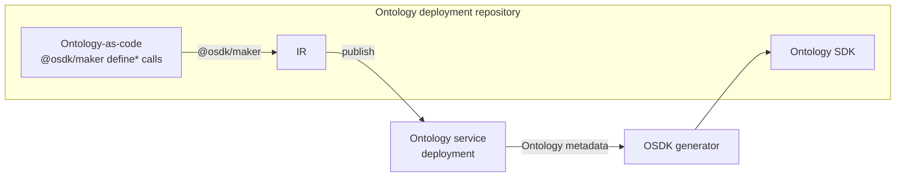

# Ontology-as-code

Ontology-as-code is the definition of an app's Ontology as TypeScript calls to the `define*` functions of `@osdk/maker`, in the app's Ontology deployment repository. It is the source of truth for the app's Ontology. Source: SuperRepo core concepts.

## Contract

- The app's developers write the app's Ontology with `@osdk/maker` in the app's Ontology deployment repository. Sources: SuperRepo core concepts, `@osdk/maker` README.
- The Ontology-as-code is the source of truth for the app's Ontology. Each change to an Ontology entity is a change to the Ontology-as-code. Source: SuperRepo core concepts.
- Each app holds its own Ontology. The Ontology service code holds no Ontology. Our rule.
- The app pins the exact `@osdk/maker` version of its [OSDK set](./releases.md#osdk-sets). Our rule.
- The app defines each function-backed Action with `defineFunctionBackedAction` of `@osdk/maker-experimental`, and writes its [Functions](../ontology/functions/functions.md) in `src/functions/` of its `TYPESCRIPT_FUNCTIONS` component, such as `functions/typescript-functions/src/functions/`. Source: SuperRepo tutorial.
- The [CLI](./cli.md#inputs) runs `@osdk/maker` on `src/ontology.mts` of the `ONTOLOGY` component, at each `publish` and `generate-osdk`, and `@osdk/maker` writes the IR (`OntologyIr`). The app commits no IR. Source: `@osdk/maker` CLI.
- The app sets its API namespace as `apiNamespace` in `ontos.yml` (or `foundry.yml` fallback) at the root of its repository. Source: SuperRepo core concepts.
- The CLI gives that value to `@osdk/maker` with `--apiNamespace`. `@osdk/maker` puts it in front of each Object Type and Action Type API name. Property and Link Type API names get no API namespace. The generated Ontology SDK names each export by the part after the API namespace, such as `Account` and `closeAccountAction`, and keeps the full API name in its metadata. Source: `@osdk/maker` CLI.
- The app sets its API namespace before its first publish, and never changes it. A change renames each Object Type and Action Type, and API names never change, as the [design rules](../ontology/design-rules.md#schema-evolution) specify. So the same Ontology-as-code keeps the same API names in the HTTP API. Our rule.
- The Ontology service makes the Ontology metadata from the IR when the app publishes it. [Publish](./publish.md) specifies it.
- The Ontology service accepts only the concepts in [`docs/ontology/`](../ontology/). At publish, it refuses an Ontology that uses an OSDK feature that is out of scope. The error names the feature. Our rule.
- The Ontology service also refuses an Ontology that uses marking properties. Deviation: `@osdk/maker` defines marking properties, which Ontos refuses because markings are out of scope.
- The Ontology service builds no table or column from the `datasources` in the IR. It reads them to compile each derived property, as [Derived properties](../ontology/object-link-types/derived-properties.md#publish) specifies, and to compile the policies that [Security policies](#security-policies) specifies. Source: `@osdk/maker` `convertDatasourceDefinition.ts`.
- The [Ontology SDK](../ontology/ontology-sdk/ontology-sdk.md) specifies how the app gets its Ontology SDK. [Publish](./publish.md) specifies how the Ontology reaches an Ontology service deployment.

### Security policies

- The app writes the [object security policy](../ontology/object-security-policies.md) of an Object Type as `objectSecurityPolicy`, in a `dataset` datasource of `defineObject`. `@osdk/maker` writes it into the IR. Source: `@osdk/maker` `convertDatasourceDefinition.ts`.
- The app writes each property security policy as 1 item of `propertySecurityGroups`, in the same datasource. `@osdk/maker` writes each one into the IR. Source: `@osdk/maker` `convertDatasourceDefinition.ts`.
- The app writes each condition of a policy as its `granularPolicy`: the `group` shortcut of `@osdk/maker`, which names a permission, for the permissions of the caller, or a raw `comparison` with a `userProperty` value of `userId` for `user.id`. [OSDK workarounds](./osdk-workarounds.md) records the group. Our rule.
- The policies travel in the IR, and [Publish](./publish.md) stores them with the IR of the product version. They need no other column. Our rule.
- Compile reads the object security policy of each Object Type of the IR into the compiled Ontology. A policy that compile refuses fails a publish with 400, and fails a cold start of a stored version with 503 `OntologyVersionNotSupported`. Our rule.
- Compile reads each property security policy of the IR into the compiled Ontology, in the same way. Our rule.
- A product version that publish stored before the Ontology service accepted policies has no policy, because compile refused each one. Our rule.

### The grants file

- The app writes its [permissions](../../GLOSSARY.md) and its [default roles](../../GLOSSARY.md) in the grants file `<ONTOLOGY path>/src/grants.json`, next to `src/ontology.mts`. The stock `@osdk/maker` writes no permission into the IR, as [OSDK workarounds](./osdk-workarounds.md) records. Our rule.
- The grants file has 4 required keys. `permissions` maps the slug of each permission of the product to its `description`. `objectTypes` maps the published API name of each Object Type to the slug of its 1 permission. `actionTypes` maps the published API name of each Action Type to the slug of its 1 permission. `defaultRoles` maps the slug of each default role to its list of permissions. Our rule.
- The grants file can also have a 5th key, `personAttributes`, which is optional. It maps the name of each [Person attribute](../ontology/object-security-policies.md#person-attributes) to its path. The stock `@osdk/maker` has no slot for the path, as [OSDK workarounds](./osdk-workarounds.md) records. Our rule.
- A path has `start` and `links`. `start` names an Object Type and a String Property of it, with `objectType` and `property`. `links` is a list of Link side API names, each a Link side of the Object Type before it, such as `{ "start": { "objectType": "com.example.twin.CrewMember", "property": "userId" }, "links": ["crew", "jobsites"] }`. A path names Link sides, not Link Types, because a Link Type has 2 sides. Our rule.
- The grants file can also have the optional key `queryTypes`. It maps the API name of each [Query Function](../ontology/functions/query-functions.md) to the slug of its 1 permission. A grants file with no `queryTypes` key still parses. Our rule.
- A policy reads a Person attribute by its name, as the `attributeKey` of a `userAttributes` value. Our rule.
- The Ontology service has its own permissions, with the reserved prefix `ontology:`. The first is `ontology:install`, which [Install](./publish.md#install) needs. A default role can hold a permission of the Ontology service. A product permission, a type, and a rule cannot name one. Our rule.
- The app commits the grants file. Each product version holds 1 grants file, so each installation of a product has the same default roles. An Organization can also have [custom roles](../../GLOSSARY.md) in WorkOS, which the grants file does not name. Our rule.
- 1 type definition and 1 parser of the grants file serve the Ontology service, the CLI, and the twin. Our rule.
- [Publish](./publish.md#grants-check) checks the grants file, and copies its permissions and its default roles to WorkOS, as [Default roles in WorkOS](./publish.md#default-roles-in-workos) specifies. Our rule.

A grants file with 2 default roles:

```json
{
  "permissions": {
    "accounts:read": { "description": "View accounts" },
    "accounts:write": { "description": "Create and change accounts" }
  },
  "objectTypes": { "com.example.twin.Account": "accounts:read" },
  "actionTypes": { "com.example.twin.create-account": "accounts:write" },
  "defaultRoles": {
    "admin": ["ontology:install", "accounts:read", "accounts:write"],
    "member": ["accounts:read"]
  }
}
```

## Diagram



## Serves

- [Object Types](../ontology/object-link-types/object-types.md)
- [Link Types](../ontology/object-link-types/link-types.md)
- [Properties](../ontology/object-link-types/properties.md)
- [Action Types](../ontology/action-types/action-types.md)

## Related

- [Ontology service](./ontology-service.md)
- [Publish](./publish.md)
- [Ontology SDK](../ontology/ontology-sdk/ontology-sdk.md)
- [Releases](./releases.md)
