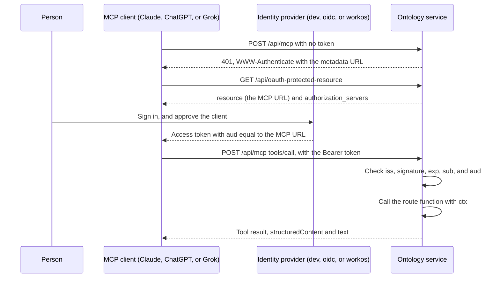

# Ontology MCP

The [Ontology MCP](../../GLOSSARY.md) is the MCP server of the [Ontology service](./ontology-service.md). An agent in Claude, ChatGPT, or Grok uses it to read Objects and apply Actions as the person who signed in. It calls the routes of the Ontology service, so it adds no second engine and no SQL.

## Contract

### Route

- Each environment of an [Ontology service deployment](./deployment.md) can serve the Ontology MCP. Its MCP URL is the base URL of the environment plus `/api/mcp`. The Ontology service makes the MCP URL from `ONTOLOGY_BASE_URL`, not from the host of the request. Our rule.
- An app's own domain and a Vercel deployment URL are not MCP URLs. On each host, the metadata route gives the MCP URL as `resource`, so a client that uses another host sees a `resource` that is not its URL. Source: [RFC 9728](https://www.rfc-editor.org/rfc/rfc9728) (section 3.3, the `resource` check of the client).
- The Ontology MCP is on in an environment when its `ONTOLOGY_MCP` variable is `true`, as [Deployment files](./deployment.md#deployment-files) specifies. When it is off, `/api/mcp` and the metadata route answer `404` with an empty body. Our rule.
- The Ontology MCP serves people only. The MCP route refuses the token of a [service user](../../GLOSSARY.md) with `401`, as [Ontology MCP tokens](./authentication.md#ontology-mcp-tokens) specifies. Our rule.
- The route table has `POST /api/mcp` and `GET /api/mcp`. Each `POST` carries 1 JSON-RPC message, and gets 1 JSON response. The route opens no SSE stream and sends no progress notification. So a `GET` with no token gets the `401` of the token check, and a `GET` that passes the token check gets `405`. Source: [Transports](https://modelcontextprotocol.io/specification/2025-06-18/basic/transports) (Streamable HTTP).
- The route answers with JSON in each protocol revision that it serves, and never with an SSE stream. So the first byte of the answer is the result, as [Long Action runs](#long-action-runs) needs. Our rule.
- The server says that its tool list does not change: its capabilities give `tools.listChanged` as `false`. So a client opens no `subscriptions/listen` stream, which would hold a Vercel Function until its time limit. A `subscriptions/listen` request gets HTTP `404` with the JSON-RPC error `-32601`, as each method that the server does not serve gets. Our rule.
- The route keeps no session state, so each request stands alone. Our rule.
- The route does no check of the `Origin` header. The bearer token is the guard, and the route reads no cookie. Our rule.
- The MCP route does what each OSDK HTTP API v2 route does around the engine: the token check of [Ontology MCP tokens](./authentication.md#ontology-mcp-tokens), the check of the query, the read of the JSON body, the limits of the caller kind `person`, and 1 request log. So a query parameter that is out of scope, or a body that is not JSON, gets HTTP 400 in the OSDK error envelope before the MCP route runs. Each tool call opens the view of its Ontology, with the current Ontology version, and gets a new request context `ctx`. A request with no tool call, such as `initialize` or `tools/list`, loads no Ontology and uses no database. Our rule.

### Tools

- The Ontology MCP lists 8 tools. Each name is plain, with no prefix, because each client shows the server name. Our rule.

| Tool                   | Annotations                                                             | Routes that it calls                             |
| ---------------------- | ----------------------------------------------------------------------- | ------------------------------------------------ |
| `describe_object_type` | `readOnlyHint: true`                                                    | None: the compiled Ontology in `ctx`             |
| `load_objects`         | `readOnlyHint: true`                                                    | `POST .../objectSets/loadObjects`                |
| `aggregate_objects`    | `readOnlyHint: true`                                                    | `POST .../objectSets/aggregate`                  |
| `describe_query`       | `readOnlyHint: true`                                                    | None: the compiled Ontology in `ctx`             |
| `execute_query`        | `readOnlyHint: true`, `idempotentHint: true`                            | `POST .../queries/{queryApiName}/execute`        |
| `get_edit_history`     | `readOnlyHint: true`                                                    | `POST .../objectTypes/{objectType}/editsHistory` |
| `describe_action`      | `readOnlyHint: true`                                                    | None: the compiled Ontology in `ctx`             |
| `apply_action`         | `readOnlyHint: false`, `destructiveHint: true`, `idempotentHint: false` | `POST .../actions/{action}/apply`                |

- Each tool takes an optional `ontology`, the API name of an Ontology of the caller's Organization. The Ontology MCP finds the Ontologies with List Ontologies. With 1 Ontology and no `ontology`, the tool uses it. With more, and no `ontology`, the tool error lists the API names. With none, the tool error says that an admin of the Organization must install one. Our rule, the same as the [CLI](./cli.md#ontology).
- `describe_object_type` with no `objectType` and no `ontology` lists the Ontologies when the Organization has more than 1. Our rule.
- Each tool call opens the view of its Ontology for the caller, so each tool reads and writes only an Ontology that the caller's Organization owns. 1 MCP URL serves each Ontology of the environment. Our rule.

- `describe_object_type`, `describe_query`, and `describe_action` build each answer from the compiled Ontology in the `ctx` of the tool call, as [Seams](./code-layout.md#seams) specifies. OSDK HTTP API v2 has no Link Type description, so no route can give the [business map](../../GLOSSARY.md). Our rule.
- Each call of the 5 other tools names 1 route of the table above, its path parameters, and its body. The handler runs that route with the `ctx` of the tool call. It gives the tool the JSON answer or the error body, as [Seams](./code-layout.md#seams) specifies. Our rule.
- The description of each tool starts with "Call describe_object_type with no name first for a map of the business." Some MCP clients do not surface server instructions to the model, so the tool descriptions carry this advice. Our rule.
- `describe_object_type` with no `objectType` gives the business map. It builds the map from the compiled Ontology of the request on each call, and stores no map. Our rule.
- For each Object Type, the map gives its API name, its description, its primary key, and its title Property. It gives no Properties. Our rule.
- The map gives each Link Type 1 time, with its API name, its description, and its 2 sides. Each side gives its Object Type, its Link side API name, and its cardinality, `ONE` or `MANY`, such as `Deal.engagements` with `MANY` and `Engagement.deal` with `ONE`. Our rule.
- The map puts each Action Type under each Object Type that a rule of the Action Type names, and under each Object Type that an Object parameter of the Action Type takes. It puts an Action Type that names no Object Type in 1 list of other Action Types. A Function rule names no Object Type, so the map puts a function-backed Action Type only under the Object Types of its Object parameters. With no Object parameter, it is in the list of other Action Types. Each entry gives the API name and the first line of the description. Our rule.
- The map puts each [Query Function](../ontology/functions/query-functions.md) under each Object Type that an input of the Query Function takes. It puts a Query Function with no Object input in 1 list of other Query Functions. Each entry gives the API name and the first line of the description. Our rule.
- When the map is longer than 25,000 characters, it gives each Action Type by its API name only. When it is still longer than 25,000 characters, it also leaves out the Link Type descriptions. The map then says that `describe_object_type` and `describe_action` with a name give the detail. It never leaves out an Object Type, a Link Type, or an Action Type. No step shortens an Object Type description or a Query Function line. So after the second step, the map can still be longer than 25,000 characters, and the tool gives it at that length. Our rule.
- `describe_object_type` with an `objectType` gives its API name, its description, its primary key, and its title Property. It gives each Property with its API name, data type, required flag, and description. It gives each Link Type of the Object Type with its Link side API name, its target Object Type, its cardinality, and its description. Our rule.
- Each line of plain words about a Property is 1 item of the `notes` list of its entry. Each line about the Object Type is 1 item of the `notes` list of the answer. An entry with no line has no `notes`. Our rule.
- For each Property with a [value type](../ontology/object-link-types/value-types.md), `describe_object_type` with an `objectType` adds lines under the Property. The first line is `Value type <apiName>, version <version>.`, with `, deprecated` before the period when the value type is deprecated. Then 1 line for each constraint gives `Each value <words>.` with the words of [Constraints](../ontology/object-link-types/value-types.md#constraints). A constraint with a failure message adds ` When it does not: <failure message>` to its line, with the message as a JSON string, so a quote or a line break in it is escaped and the line stays 1 line. Our rule.
- The lines of a Property `status` with a deprecated value type, and of a Property `sku` with 2 constraints:

```text
Value type taskStatus, version 1.1.0, deprecated.
Each value is one of "open", "done". When it does not: "Use open or done."
```

```text
Value type sku, version 1.0.0.
Each value has 6 to 12 characters.
Each value matches the regex [A-Z]{3}-\d+ in full. When it does not: "A SKU is 3 capitals, a dash, and digits."
```

- For an Object Type with a [Uniqueness constraint](../ontology/object-link-types/properties.md#uniqueness-constraints), `describe_object_type` with an `objectType` adds the line `Uniqueness constraints:`. Then it gives 1 line for each rule, in rule name order. It does not show the rule name. Our rule.
- Each line is `- Unique: no 2 <plural display name> have the same <Properties>.` The Properties are the API names of the rule in backticks, in API name order. They are joined with `, `, and with `and` before the last. Our rule.
- When a Property of the rule is optional, the line adds 1 sentence. A rule on 1 Property adds `` An Object with no value in `<Property>` never clashes.`` The Property is in backticks, as in the line above. A larger rule adds ` An Object with no value in 1 of them never clashes.` Our rule.
- The lines of `Invoice`, with a rule on its required `number`, of `Contact`, with a rule on its optional `email`, and of `Membership`, with a rule on its optional `personId` and `roleId`:

```text
Uniqueness constraints:
- Unique: no 2 Invoices have the same `number`.
```

```text
Uniqueness constraints:
- Unique: no 2 Contacts have the same `email`. An Object with no value in `email` never clashes.
```

```text
Uniqueness constraints:
- Unique: no 2 Memberships have the same `personId` and `roleId`. An Object with no value in 1 of them never clashes.
```

- `describe_action` with no `actionType` lists each Action Type: its API name and a one-line description. With an `actionType`, it gives the API name and the description of the Action Type, and each parameter with its ID, type, required flag, and description. Our rule.
- `describe_query` with no `query` lists each Query Function of the caller's view, with its API name and its full description. With a `query`, it gives each input with its type, its required flag, and its description, and the output type. It gives "Decimal" as the type of a Decimal, never `string`. An unknown name, or a Query Function that the caller cannot see, gets the tool error of 404 `QueryNotFound`. Our rule.
- `describe_query` with a `query` agrees with `GET queryTypes/{queryApiName}` on each input, its required flag, and the output type. It says "Decimal" where the Ontology metadata says `string`. Our rule.
- `execute_query` takes `query`, the API name of the Query Function, and `parameters`. It runs the run route of [Run](../ontology/functions/query-functions.md#run), and gives its `{ value }`, or its error as a tool error. So it gives the same value as the run route. Our rule.
- For a struct list parameter, `describe_action` gives the `dataType` of the Ontology metadata as its type: `{ type: "array", subType: { type: "struct", fields } }`. It gives the name, the `fieldType`, and `required` of each field. `apply_action` takes its value as a JSON array of JSON objects. Our rule.
- An answer of `describe_object_type` or `describe_action` has no RID, icon, render hint, or visibility. It gives a status only when the status is not `ACTIVE`. Our rule.
- Each `objectType` argument of a tool, and the `objectType` of each `base` Object Set, also takes a short name. A short name is the end of an API name after its last `.`, such as `Engagement` for `com.example.crm.Engagement`. When exactly 1 Object Type has the short name, the tool uses its API name. When 2 or more have it, the tool gives a tool error that lists their API names. The OSDK HTTP API v2 routes take only the full API name. Our rule.
- `load_objects` takes `objectSet`, `select`, `orderBy`, `pageSize`, and `pageToken`. A Link traversal is a `searchAround` in the Object Set. A lookup by primary key is a filter. Its description tells the agent to use `select`. Our rule.
- `aggregate_objects` takes `objectSet`, `aggregation`, and `groupBy`. Our rule.
- `describe_object_type` with an `objectType` gives each [derived property](../ontology/object-link-types/derived-properties.md) with a line that starts with "Derived:". The line gives the definition in plain words, and says that the value counts only the Objects that the caller can see. An example is "Derived: the sum of `amount` of the Transactions of `transactions`. It counts only the Objects that you can see." When the caller cannot view a hop, the line is "Derived. It reads Objects that you cannot see." Our rule.
- `load_objects` always sends `loadOntologyDefinedDerivedProperties: false`. So with the deployment setting on, a call with no `select` gives no derived value, and a call whose `select` names a derived property gives it. Its description says "A derived Property is returned only when `select` names it." Our rule.
- `load_objects` and `aggregate_objects` take a `withProperties` member in `objectSet`, and pass it to the route with no change. Our rule.
- `get_edit_history` takes `objectType`, `objectPrimaryKey`, `filters`, `sortOrder`, `pageSize`, and `pageToken`. It reads the history of 1 Object Type, or of 1 Object. An Object Type with history off gives an empty page. Our rule.
- The input schema of `get_edit_history` has no `filters.propertyApiNames`, because the engine refuses it. Our rule.
- `apply_action` takes `action`, the Action Type API name, and `parameters`. It always sends `returnEdits: ALL_V2_WITH_DELETIONS`. Our rule.
- So the answer of `apply_action` has no `edits` key when the edits of the Action compile to no edit. It gives `largeScaleEdits` with the edited Object Type when it edits more than 5,000 Objects, as [Action Types](../ontology/action-types/action-types.md#apply) specifies. The tool description says so. Our rule.
- The input schema of each read tool types the top level and the 7 supported Object Set kinds: `base`, `filter`, `union`, `intersect`, `subtract`, `searchAround`, and `withProperties`. It leaves `derivedProperties` open. It leaves `where` open, and gives 1 short example. Our rule.
- `pageSize` is 50 when the call gives none or `null`. A larger `pageSize` becomes 200, or 100 for `get_edit_history`. Each read tool gives the `nextPageToken` of the route. Our rule.
- `apply_action`, `load_objects`, `aggregate_objects`, and `get_edit_history` give each Decimal as the string of the REST answer, never as a JSON number, as [Properties](../ontology/object-link-types/properties.md#base-types) specifies. Our rule.
- Each tool gives its JSON answer as `structuredContent`, and the same JSON as 1 text block. The answer of a tool with a route is the JSON answer of that route. Source: [Tools](https://modelcontextprotocol.io/specification/2025-06-18/server/tools) ("a tool that returns structured content SHOULD also return the serialized JSON in a TextContent block").

### Exposure

- The tools list and accept every Object Type and every Action Type of the Ontology. The Ontology MCP has no opt-in and no allowlist. [Design rules](../ontology/design-rules.md#agents) records the deviation from OSDK. Our rule.
- The business map and the list of `describe_action` give the status of each type whose status is not `ACTIVE`, such as `archiveClient (deprecated)`. The Ontology MCP shows only the types that the permissions of the caller open, as [Access](./authentication.md#access) specifies, and ignores the visibility of an Object Type. Our rule.
- The Ontology service does not read or serve `toolDescription`. Our rule.

### Security

- Only the engine enforces Object security and Ontology permissions, as [Access](./authentication.md#access) specifies. Each tool calls its route with the caller of the MCP request, so the user ID of the call is the `sub` of the token. Our rule.
- The Ontology MCP adds no filter and no check of its own, and has no dry run. Our rule.

### Server instructions

- The `initialize` answer holds these 5 sentences as the server instructions, in this order. Our rule.
  1. "To read data, call `describe_object_type`, then `load_objects` or `aggregate_objects`."
  2. "A derived Property is computed when you read it. Name it in `select`."
  3. "To compute a value, such as a total, call `describe_query`, then `execute_query`."
  4. "To change data, call `describe_action`, then `apply_action`."
  5. "After a timeout or a lost connection, call `get_edit_history` on the Objects before you call `apply_action` again."

### Errors

- Each error of a tool call gives a tool result with `isError: true` and HTTP 200: an error of the caller, a 4xx of the route, and a fault of the Ontology service, a 5xx. Its text holds the error body, with the `errorInstanceId`. So the agent can read the error, and correct the call or tell the person. Source: [Tools](https://modelcontextprotocol.io/specification/2025-11-25/server/tools) ("contain actionable feedback that language models can use to self-correct").
- An apply that fails validation is an error of a tool call too. An `apply_action` answer with `validation.result: "INVALID"` gives `isError: true`, and keeps the route JSON as `structuredContent` and as 1 text block. So an agent that reads only `isError` does not take the apply for a success. The OSDK apply route keeps its HTTP 200, as [Action types](../ontology/action-types/action-types.md#apply) specifies. Source: [Tools](https://modelcontextprotocol.io/specification/2025-11-25/server/tools) ("Business logic errors").
- A write that a value type refuses gives the error of [Checks on write](../ontology/object-link-types/value-types.md#checks-on-write) in the tool error of `apply_action`, with the same `userErrorMessage` and `builderErrorMessage`. Our rule.
- The tool error of `apply_action` for 409 `PropertyValueAlreadyExists` keeps the error body. After the body, it adds 1 sentence. The sentence names the Properties, says that the error does not name the other Object, and says what to do. The sentence reads only the error parameters, so it holds no value. Our rule.
- The sentence is `Another Object of <objectType> has the same <Properties>, and the error does not name it, so use other values or change that Object first.` The Properties are as in the line of [Tools](#tools). Our rule.
- The choice of an Ontology gives these tool errors, as [Tools](#tools) specifies. With more than 1 Ontology and no `ontology`, the error is 400 `OntologyService:OntologyRequired`, with `parameters.ontologies`, the API names. With none, it is 404 `OntologyService:NoOntologyInstalled`, with `parameters: {}`. With an `ontology` that is not an API name of an Ontology of the caller's Organization, it is 404 `OntologyNotFound`, with `parameters.apiName` and `parameters.ontologies`. The text of each also holds 1 sentence that tells the agent what to do, after the error body. Our rule.
- A fault in a tool call stays a fault: it gets an error report and the error fields of the request log, as [Observability](./observability.md#error-reports) specifies. The MCP route gives it no HTTP 500, because a client shows an HTTP 500 to the agent only as a transport error. Our rule.
- The text of a fault of `apply_action` also says that the Action may have applied, and tells the agent to call `get_edit_history` before it applies again. Our rule.
- A fault before the route reads the JSON-RPC message keeps its HTTP status, such as the `500` of a JWKS fetch that fails. Our rule.
- A JSON-RPC message that the MCP SDK refuses, such as an unknown method, gets the JSON-RPC error of the SDK. Our rule.
- [Logs](./observability.md#logs) specifies the request log of each answer.

### Long Action runs

- The MCP route gives each apply a deadline of 50 s after the request arrives, as [Writes](./storage.md#writes) specifies. An apply past its deadline writes nothing, and gets 400 `ActionDeadlineExceeded`, with `parameters: {}`. Our rule.
- Claude Code gives up on a request that has no first response byte after 60 s, with its default settings. The write transaction of an apply ends at its deadline, as [Writes](./storage.md#writes) specifies. So an apply that Claude Code gave up on does not write later, also when Vercel does not abort the request. A `get_edit_history` check after the timeout then sees the final state. Source: [Claude Code MCP](https://code.claude.com/docs/en/mcp) ("Claude Code sets that timer to the greatest of three values: 60 seconds, the tool timeout that applies to the server, and `MCP_TIMEOUT`").
- So an Action whose write does not commit within 50 s fails over the Ontology MCP. The OSDK apply route has a deadline of 120 s. Our rule.
- `apply_action` has no idempotency key. Our rule.

### Known issues

The Ontology service does not fix these issues.

- A fault after a commit that landed. When the database commits but its acknowledgement is lost, the agent gets a fault, but the Action applied. The fault text tells the agent to call `get_edit_history` first. An agent that does not can apply again, and an append, an increment, or a create with a generated key then applies twice. Our rule.
- A history check that sees nothing. The `get_edit_history` check finds no edit when history is off for the Object Type. It also finds none when the agent does not know which Objects the Action changed, as for a function-backed Action or a create with a generated key. The agent can then apply again. Our rule.
- A client that gives up before 50 s. The deadline covers a client that waits 50 s or more, such as Claude Code. The `claude.ai` web app, Claude Desktop, ChatGPT, and Grok document no limit. A client that gives up sooner gets no answer, and its apply can still write. The abort check of [Writes](./storage.md#writes) needs a disconnect signal, and no adapter passes one in v1.0, as [HTTP entry](./code-layout.md#http-entry) says. Our rule.
- The MCP is on, but each call gets `401`. In `workos` mode, when a person removes the Resource Indicator in the WorkOS dashboard, each token fails the `aud` check. The smoke checks still pass. Recreate the Resource Indicator with the exact MCP URL to restore access. Our rule.

### Smoke checks

- After deploying an environment, smoke checks verify the Ontology MCP without a token. Our rule.
- When the MCP is on, a `POST /api/mcp` gets `401` with the `WWW-Authenticate` header of [Ontology MCP tokens](./authentication.md#ontology-mcp-tokens). The metadata route gives `resource` equal to the MCP URL, and `authorization_servers` equal to the configured OAuth issuer. Our rule.
- When the MCP is off, both routes answer `404`. Our rule.
- No CI job calls a tool on a production deployment in `workos` mode, because the MCP route accepts only a person's token. Our rule.

### Client runs

- Interactive verification in MCP clients such as Claude, ChatGPT, and Grok confirms OAuth sign-in, tool discovery, Business map inspection, reads, and Actions against a deployed MCP URL. Our rule.

## Diagram



## Serves

- [Object Sets](../ontology/ontology-sdk/object-sets.md)
- [Aggregations](../ontology/ontology-sdk/aggregations.md)
- [Action Types](../ontology/action-types/action-types.md)
- [Query Functions](../ontology/functions/query-functions.md)
- [Object Edit History](../ontology/object-edits/edit-history.md)

## Related

- [ADR 0011: the Ontology MCP accepts only AuthKit tokens for its own URL](../adr/0011-the-ontology-mcp-accepts-only-authkit-tokens-for-its-own-url.md)
- [Authentication](./authentication.md)
- [Observability](./observability.md)
- [Ontology service deployment](./deployment.md)
- [Testing](./testing.md)
