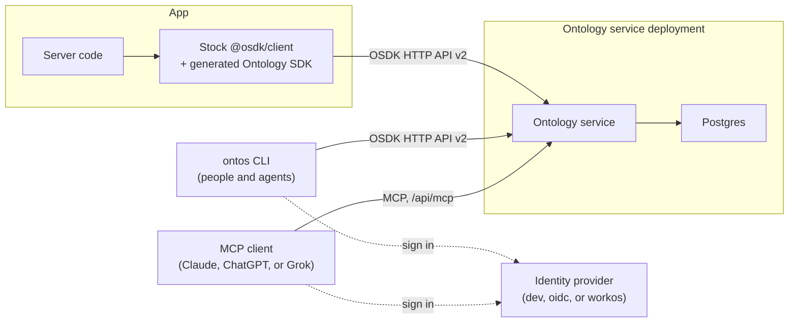

# Ontology service

One Ontology service deployment serves one product, and each Ontology that an Organization installs from it, over the OSDK HTTP API v2. App code and the [CLI](./cli.md) call the service using the stock OSDK client packages. The decision to host the Ontology service is in [ADR 0003](../adr/0003-hosted-ontology-service.md).

## Contract

- One Ontology service deployment serves the OSDK HTTP API v2 for one product, and for each Ontology that an Organization installs from it. Source: Ontology SDK overview.
- Apps call the Ontology service with the stock `@osdk/client` and the generated [Ontology SDK](../ontology/ontology-sdk/ontology-sdk.md). Source: TypeScript OSDK migration.
- For each route that it serves, the Ontology service matches the OSDK HTTP API v2 request, response, and error shapes. [HTTP API](./http-api.md) lists the routes. Our rule.
- The Ontology service also serves the OSDK Admin user routes that [Authentication](./authentication.md#user-ids) lists, so that a reader names the user ID of an Object Edit History entry. Our rule.
- Each environment can also serve the [Ontology MCP](./ontology-mcp.md) at its base URL plus `/api/mcp`, for agents in Claude, ChatGPT, and Grok. Agents in a terminal use the [CLI](./cli.md). Our rule.
- The Ontology service sends no CORS headers, so browser code on another origin cannot call it. Our rule.
- [Authentication](./authentication.md) specifies how each caller proves who it is, and what it can do.
- Each operator hosts its own Ontology service deployment (self-hosted via Docker or Node.js, or serverless on Vercel with Postgres). Our rule.
- One Ontology service deployment serves one app: its product, each Ontology that an Organization installs from it, one Postgres database, and one pinned release in each environment. Our rule.
- The Ontology service serves each Ontology at its own Ontology RID, and only to a member or a service user of its owner Organization, as [Organizations](./authentication.md#organizations) specifies. Our rule.
- The Ontology service is written in TypeScript on Node 24 or newer. Our rule.
- [Code layout](./code-layout.md) specifies the packages and modules of the Ontology service and the CLI in this repo.
- The Ontology service never runs the app's [Ontology-as-code](./ontology-as-code.md). The OSDK tools run it in the app's build. Our rule.
- [Releases](./releases.md) specifies release numbers, the OSDK sets that a release supports, and the conformance tests that each release must pass.
- [Publish](./publish.md) specifies how an app's Ontology reaches an Ontology service deployment. [Ontology service deployment](./deployment.md) specifies where it runs and how CI releases it.

### Permission catalog

- `GET /api/ontology-service/v1/ontologies/{ontologyRid}/permissions` gives the permission catalog of 1 Ontology, for the role screen of a web app. It is not an OSDK HTTP API v2 route, because OSDK HTTP API v2 has no such route. Our rule.
- The answer is `{"data": [{"slug": <slug>, "description": <text>, "requires": [<slug>]}]}`, in the code point order of `slug`. It holds each permission of the grants file of the Ontology's version, and each permission of the Ontology service. Our rule.
- `requires` is the direct list: the permission of an Action Type requires the permission of each Object Type that the Action Type names, other than itself. The list is in the code point order of its slugs, and is empty for a permission that requires none. Our rule.
- The Ontology service computes `requires` at publish and again when a version loads, with the same function and the same index of the version as the grants check. Our rule.
- The answer names no Object Type and no Action Type. So the catalog shows no type to a caller that cannot see it. Our rule.
- Each person and each service user of the owner Organization can read the catalog, with or without a permission. A RID of another Organization gets 404 `OntologyNotFound`, the same as an unknown RID. A GitHub token gets 403 `Default:PermissionDenied`. Our rule.
- The route reads the membership of a person, or the application of a service user, from WorkOS, as [Permissions of a caller](./authentication.md#permissions-of-a-caller) specifies, although the catalog needs no permission. So a person with no active membership gets 403, and the route gets 503 when WorkOS fails and no kept answer is at most 300 seconds old. Our rule.
- An Ontology on a version whose grants file does not parse gets `{"data": []}`. Our rule.
- The description of `ontology:install` is `Install an Ontology of a product in the Organization`. Our rule.

## Diagram

## Serves

- [Ontology SDK](../ontology/ontology-sdk/ontology-sdk.md)
- [Object Sets](../ontology/ontology-sdk/object-sets.md)
- [Aggregations](../ontology/ontology-sdk/aggregations.md)
- [Action Types](../ontology/action-types/action-types.md)
- [Functions](../ontology/functions/functions.md)

## Related

- [ADR 0003: the Ontology runs as a hosted service behind the stock OSDK](../adr/0003-hosted-ontology-service.md)
- [ADR 0002: Ontology logic runs in the Ontology service](../adr/0002-ontology-logic-in-the-ontology-service.md)
- [ADR 0012: People sign in with WorkOS AuthKit in an Organization, and CI only publishes](../adr/0012-people-sign-in-with-workos-authkit-in-an-organization-and-ci-only-publishes.md)
- [Authentication](./authentication.md)
- [CLI](./cli.md)
- [Ontology MCP](./ontology-mcp.md)
- [HTTP API](./http-api.md)
- [Code layout](./code-layout.md)
- [Ontology-as-code](./ontology-as-code.md)
- [Publish](./publish.md)
- [Releases](./releases.md)
- [Storage](./storage.md)
- [Ontology service deployment](./deployment.md)
