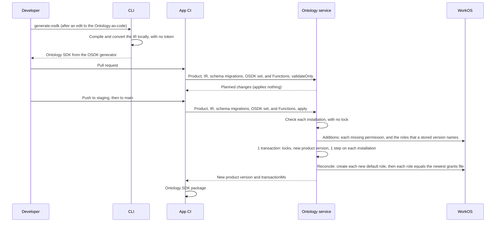

# Publish

Publish is how a new version of an app's product reaches one environment of its [Ontology service deployment](./deployment.md). The app sends its IR. The [Ontology service](./ontology-service.md) stores a product version and upgrades each Ontology of that product to it in 1 Postgres transaction, as [Applying](#applying) specifies. Install is how an Organization gets a new Ontology from a product.

## Contract

### What the app publishes

- The app publishes its IR: the `OntologyIr` file that `@osdk/maker` writes from the [Ontology-as-code](./ontology-as-code.md). It also publishes its [grants file](./ontology-as-code.md#the-grants-file). It publishes nothing else from its Ontology. Source: `@osdk/maker` CLI.
- Each publish names its product: the app name, `ONTOLOGY_APP` of the committed `.env`, as [CLI](./cli.md#targets) specifies. So one Ontology deployment repository publishes one product. Our rule.
- An Ontology service deployment serves 1 product. The first publish of a deployment sets its product. A publish whose `product` differs from the product of the stored product versions gets 400 `Default:InvalidArgument` with `part: "product"`, before the grants check and before any WorkOS step. Our rule.
- The product RID of each product version is the `PRODUCT_RID` of the environment, from the [deployment file](./deployment.md#deployment-files). A publish of a product whose stored versions have another product RID gets 400 `Default:InvalidArgument`. Our rule.
- Each publish also sends the app's [schema migrations](../ontology/object-edits/schema-migrations.md) file, and the app's [Functions](../ontology/functions/functions.md#discovery): the discovered Functions and the Function bundle. Our rule.
- Each publish names the app's [OSDK set](./releases.md#osdk-sets): the exact version of each package in the set. The CLI reads them from the app's installed packages. The Ontology service refuses a set that its release does not list, and the error names the listed sets. Our rule.
- The Ontology service makes the Ontology metadata, in the shape of OSDK `OntologyFullMetadata`, from the IR with its own converter. The upstream `@osdk/generator-converters` converter throws on Create link, Delete link, Function rules, and struct parameters, so Ontos supplies its own converter. Source: `OntologyIrToFullMetadataConverter.ts`.
- The Ontology service checks the IR as [Ontology-as-code](./ontology-as-code.md) specifies, and checks the changes as [Schema migrations](../ontology/object-edits/schema-migrations.md) specifies.

### Route

- The publish route is `POST /api/ontology-service/v1/publish`. It is not an OSDK HTTP API v2 route. Our rule.
- The request holds the product, the IR, the schema migrations file, the OSDK set, the Functions, the grants file, and a `validateOnly` flag. Our rule.
- The Ontology service stores each schema migration with only the fields of its kind. It does not store another field of the file or of a migration. Our rule.
- A `validateOnly` request with no Functions skips the Function checks. Its Ontology metadata shows each function-backed Action with no parameters. A request that applies needs every Function. Our rule.
- In such a request, the Ontology service compiles each function-backed Action with a stand-in Function. Each stand-in Function returns a list of edits, so it is an edit Function, as [Code](../ontology/functions/query-functions.md#code) of Query Functions specifies. Our rule.
- The whole request is at most 4.5 MB. A larger request fails. Source: [Vercel Functions limits](https://vercel.com/docs/functions/limitations) ("The maximum payload size for the request body or the response body of a Vercel Function is 4.5 MB").
- Before it sends a publish, the CLI checks the request size. Above 4.5 MB, it stops and prints the size of each part and of the whole request: the IR, the schema migrations file, the Function bundle, the discovered Functions, and the total. Vercel refuses a larger body before the Ontology service runs, so the CLI gives the clear error. Our rule.
- The response holds the planned changes, each with the schema migration that it uses, and the Ontology metadata that the Ontology service serves after the publish. When the publish applies, the response also holds the new product version. Our rule.
- When the publish applies, the response also holds `transactionMs`: the duration of its transaction in milliseconds, as a whole number. Our rule.
- When the publish names a deprecated OSDK set, the response also holds `warnings`: the text of each warning that the CLI prints, as [Releases](./releases.md#osdk-sets) specifies. Our rule.
- With `validateOnly`, the Ontology service applies nothing. For the publish caller and a pull request check, it runs every check and plans every change. For a person or a service user, it runs the checks that the rules of this page allow them. Our rule.
- The route uses the OSDK error envelope. The error of a failed check names the change and what it needs. Our rule.
- A person can call the route only with `validateOnly`. Only the app's publish workflow can apply a publish. [Authentication](./authentication.md#ci-workflows) specifies the tokens. Our rule.
- The check of a person or a [service user](../../GLOSSARY.md) reads only the installations of the caller's Organization. A person with no Organization has none, so the plan runs with no stored values. So the plan sees no installation of another Organization. The publish caller and a pull request check read each installation of the product. Our rule.

### Grants check

- The grants file is the required field `grants` of the publish body. A missing `grants`, or a `grants` of another shape, gets 400 `Default:InvalidArgument` with `part: "grants"`. Our rule.
- A grants file of v2, with the key `roles`, does not parse. So a publish of it gets this 400. Our rule.
- Each Object Type and Action Type of the IR names 1 permission of `permissions`, and each key of `objectTypes` and `actionTypes` names a type of the IR. Otherwise the publish fails with a problem of the grants check. Our rule.
- A product permission with the prefix `ontology:` is a problem of the grants check. The Ontology service reserves the prefix for its own permissions. Our rule.
- An Object Type, an Action Type, an object security policy, a property security policy, and a submission criterion name only permissions of `permissions` in the grants file. A permission of the Ontology service, with the prefix `ontology:`, in one of them is a problem of the grants check. A rule that names a permission that `permissions` does not have is also a problem. Our rule.
- A default role names only permissions of `permissions` and permissions of the Ontology service. Otherwise the publish fails with a problem of the grants check. Our rule.
- A default role that holds the permission of an Action Type, but not the permission of each Object Type that the Action Type names, is a problem of the grants check. The problem names the role, the Action Type, and each missing permission. Our rule.
- Each [Query Function](../ontology/functions/query-functions.md) names 1 permission of `permissions` in `queryTypes`. Each of these is a problem of the grants check. The problem names the Function. The cases are a Query Function with no `queryTypes` entry, a key that names an edit Function, a key that names no Function, and an entry that names a permission that `permissions` does not have. Our rule.
- A default role that holds the permission of a Query Function, but not the permission of an Object Type that its inputs or output name, is a problem of the grants check. The problem names the role, the Query Function, and each missing permission. Our rule.
- A Query Function with no doc comment, or with an empty first line, is a problem of the grants check, as [Code](../ontology/functions/query-functions.md#code) specifies. The problem names the Function. Our rule.
- The grants check refuses what WorkOS would refuse, so that a bad file fails before the first WorkOS step: a permission slug of more than 48 characters, a description of more than 150 characters, and a default role slug with the prefix `org-`. WorkOS accepts `org-` on an environment role, but each custom role slug must start with `org-` and a custom role cannot reuse the slug of an environment role (for example `org-example`). So a default role with that prefix would take a slug from the custom roles of each Organization. Our rule.
- The grants check also refuses each slug of another form than these, also a slug that needs no WorkOS step, and also with `validateOnly`. So a bad slug fails in the pull request check. Our rule.
  - A permission slug has 1 to 48 characters. Each character is a lowercase letter `a` to `z`, a digit, `-`, `_`, `:`, `.`, or `*`. A slug of dots only, such as `..`, is refused, because the URL of a WorkOS write cannot hold it.
  - A default role slug has 1 to 48 characters. Each character is a lowercase letter `a` to `z`, a digit, `-`, or `_`.
  - The slugs are ASCII, so the count of characters is the same in the Ontology service and in WorkOS. The lowercase rule and the limit of a role slug are stricter than what the research found, so WorkOS accepts each slug that the rule allows.
- A failed check gets 1 400 `Default:InvalidArgument`. Its `parameters` hold `part: "grants"`, and `problems`, with the text of each problem. Our rule.
- A `validateOnly` request with no Functions cannot find the Object Types that a function-backed Action Type names. Its response holds 1 entry in `warnings` that names each such Action Type. Such a request also has no list of Query Functions, so the grants check does not match the key `queryTypes` with them, and 1 more entry in `warnings` says so. It still checks the permission of each entry of `queryTypes`. A publish that applies always runs the whole check. Our rule.
- Only the publish route runs the grants check. A load of a product version parses its grants file and builds its index, as [Code layout](./code-layout.md#modules) specifies, and runs no check. So a later change to a check refuses no stored product version. Our rule.

### Security policies

- Publish compiles the [object security policy](../ontology/object-security-policies.md) of each Object Type of the IR. A policy that compile refuses gets 400 `Default:InvalidArgument`, and the error names the Object Type, the policy, and the feature. Our rule.
- Publish compiles each property security policy of the IR in the same way, with the same error. Our rule.
- A publish fails when a policy reads a Person attribute that `personAttributes` of the grants file does not declare. The failure is a problem of the grants check: 1 400 `Default:InvalidArgument` with `part: "grants"`, as [Grants check](#grants-check) specifies. Our rule.
- A publish fails when a path of `personAttributes` names an Object Type that the IR does not have, a start Property that the Object Type does not have, a start Property that is not a String, or a Link side that is not a side of the Object Type before it. The failure is a problem of the grants check: 1 400 `Default:InvalidArgument` with `part: "grants"`, as [Grants check](#grants-check) specifies. Our rule.
- A `personAttributes` of another shape gets 400 `Default:InvalidArgument` with `part: "grants"`. Our rule.
- A publish that changes only `personAttributes` makes a new version, as a change of the grants file does. Our rule.

### When

- In the app's Ontology deployment repository, a push to the `staging` branch publishes to the staging environment. A push to `main` publishes to the production environment. Our rule.
- Each pull request calls the route with `validateOnly`, against the environment that its target branch publishes to. Our rule.
- The [CLI](./cli.md) sends each call. Our rule.
- A consumer, such as a web app, gets the Ontology after a publish through the [Ontology SDK package](../ontology/ontology-sdk/ontology-sdk.md#ontology-sdk-package). Its `main` branch pins only the version that production serves. Our rule.

### Versions

- Each environment numbers the versions of each product 1, 2, 3, and so on. Our rule.
- A publish makes no new version when the IR, the Ontology metadata, the OSDK set, the Function bundle, and the grants file are the same as in the newest version of the product. So a release that changes the converter takes effect at the next publish, and the newest product version always holds the OSDK set of the last publish. Our rule.
- To compare two IRs, the Ontology service ignores the `linkId` of each generated UUID value, because `@osdk/maker` sets a random `linkId` when the author sets none. Source: `@osdk/maker` `convertMappingValue.ts`.
- The Ontology service keeps each product version: the IR, the Ontology metadata, the schema migrations file, the grants file, the Function bundle, the OSDK set, the user ID of the publisher, and the time. Our rule.
- The Ontology service keeps the reserved API names of each product apart, as [Rollback](#rollback) uses them. Our rule.
- Each Ontology serves the Ontology metadata of its Ontology version, with its own Ontology RID. A new [release](./releases.md) does not change it. Our rule.

### Install

- The install route is `POST /api/ontology-service/v1/ontologies`. It is not an OSDK HTTP API v2 route, because OSDK HTTP API v2 has no call that creates an Ontology. Deviation. Source: `OntologyV2` of `@osdk/foundry.ontologies` 2.87.0, which has only `list`, `get`, `getFullMetadata`, and `loadMetadata`.
- The request holds the API name of the product, and the `apiName` and the `displayName` of the new Ontology. Our rule.
- The `apiName` of the new Ontology has only lowercase letters, digits, and `-`. It starts with a letter, and each `-` is between 2 letters or digits. The length limit of an app name comes from its host name, so it does not apply here. Another `apiName` gets 400 `Default:InvalidArgument` with `part` `apiName`, before any write. The OSDK generator refuses an Ontology API name that starts with `$` (`validateWireOntologyAssumptions` of `@osdk/generator`). Our rule.
- Only a caller that holds the permission `ontology:install` can install, as [Organizations](./authentication.md#organizations) specifies. The token's `org_id` becomes the owner Organization of the new Ontology. Our rule.
- Install makes a new random Ontology RID, `ri.ontology.main.ontology.<UUID version 4>`. In 1 Postgres transaction, it creates the 2 schemas of the Ontology and the tables of the newest version of the product, and adds its registry row, as [Storage](./storage.md#registry) specifies. Our rule.
- The response is the `OntologyV2` of the new Ontology: its `rid`, `apiName`, `displayName`, and `description`. Our rule.
- Install takes the lock of the product versions, as the transaction of a publish does. So it waits for an open publish transaction. After a commit, it starts at the version that the publish stored. After a rollback, it starts at the version before. Our rule.
- An install that commits between the check and the transaction of a publish starts at the version before the publish. The transaction locks its registry row and runs the step on it, as on each other installation. The check did not plan it. It has no data, so the step cannot fail on its data. Our rule.
- An install by an earlier release during a deploy lacks each per-Ontology engine change of the later release until the next cold start, as [Engine changes](./storage.md#engine-changes) specifies.
- A product with no version gets 404 `OntologyService:ProductNotFound`. An `apiName` that another Ontology of the same Organization has gets 409 `OntologyService:ApiNameAlreadyExists`. Our rule.
- The Ontology service has no uninstall, no Ontology delete, and no move of an Ontology to another product. Our rule.

### Rollback

- To roll back, the app publishes an earlier IR again. Our rule.
- That publish passes the same checks as any other publish. It fails when it uses an API name that a later publish deleted, because a deleted name stays reserved for its product. Source: [Design rules](../ontology/design-rules.md#schema-evolution) ("A retired name stays reserved").
- Values that a Drop deleted stay deleted. Our rule.
- Object Edit History that a Drop edit history deleted stays deleted. Our rule.
- When a rollback cannot pass, the app fixes the Ontology with a new publish. Our rule.

### Applying

- Outside an open transaction, every installation of a product is on the newest version of that product. Our rule.
- A publish that applies runs 5 steps in order: the check, the WorkOS additions, the transaction, the WorkOS reconcile, and the answer. Our rule.
- The check takes no lock that a request waits for. It plans the new version against the data of each installation of the product, in number order. When the plan of 1 installation fails, publish stores nothing, and the error names that installation and the change. A `validateOnly` publish stops after the check. Our rule.
- The check runs the [stored-data checks](../ontology/object-edits/schema-migrations.md#stored-data-checks) of each installation. A publish with 2 installations fails when only the second one has a bad value, and the error names the second one with `ontologyRid`. Our rule.
- For the same data, the check and the transaction give the same error: the same status, `errorName`, `ontologyRid`, and `change`. Only the error of the transaction also holds `transactionMs`. The error of a stored-data check also has the same `objectType`, `property`, `valueType`, `badObjects`, and `primaryKeys`. Our rule.
- The WorkOS additions run after the check and before the transaction, as [Default roles in WorkOS](#default-roles-in-workos) specifies.
- The transaction is 1 Postgres transaction. It sets `lock_timeout` to 5 seconds and `transaction_timeout` to 60 seconds, 1 time each, before its first lock. The 60 seconds cover every installation together. Our rule. Source of the settings: [Client connection defaults](https://www.postgresql.org/docs/17/runtime-config-client.html#GUC-TRANSACTION-TIMEOUT) ("Terminate any session that spans longer than the specified amount of time in a transaction").
- `lock_timeout` limits how long the transaction waits to get a lock. During that wait, new reads and writes of that table wait behind the transaction (inference from the Postgres lock rules). It does not limit how long the transaction keeps the lock. `transaction_timeout` needs Postgres 17, which [Ontology service deployment](./deployment.md#projects-and-environments) specifies. The transaction keeps each table lock until it commits, so `transaction_timeout` limits how long reads and writes of the changed tables wait.
- The transaction first takes the lock of the product versions, and reads the newest version again. Then it sets the role defaults, as [Storage](./storage.md#connection) specifies. Our rule.
- When the newest version under the lock of the product versions is newer than the version that the check read, the publish gets 409 `PublishLockTimeout` with `phase: "version"`, `table: "ontology_registry.product_versions"`, and `changed: false`. It stores nothing, and the [CLI](./cli.md#commands) tries again. Our rule.
- Then the transaction locks the registry row of each installation of the product, in number order. It locks each row with its own `SELECT ... FOR UPDATE` statement, so a lock wait names its installation. Our rule.
- An installation whose version under its row lock is not the newest version is a fault. The publish gets 500 `Default:Internal` with the parameter `ontologyRid` of that installation, and stores nothing. The publish does not repair it. Our rule.
- Then the transaction inserts 1 product version, and upgrades each installation to it by 1 step, in number order, as [Upgrade](#upgrade) specifies. Then it commits. Our rule.
- Each step takes a `SHARE` lock on each table that it changes, before its statements. A change with a stored-data check locks its table also when it changes no column. Under the lock, the step runs the stored-data checks of each change again, and runs the statements of a change only when its checks pass. So the check sees each write that committed before the lock. A write that waits for the lock of a publish that commits gets 409 `ObjectChanged`, as [Storage](./storage.md#writes) specifies. Our rule.
- So a write that commits before a publish locks the table is checked by the publish under the lock. When that write leaves 2 Objects that clash on a new [Uniqueness constraint](../ontology/object-link-types/properties.md#uniqueness-constraints), the publish fails. Our rule.
- A Uniqueness constraint of the stored version counts as kept only when its constraint is in the Postgres catalog of the installation. Otherwise the step adds the constraint, with the checks of a new rule, as [Stored-data checks](../ontology/object-edits/schema-migrations.md#stored-data-checks) specifies. Our rule.
- The check and the transaction give the same error for the checks of a Uniqueness constraint too. An upgrade chain where step 1 adds a rule and step 2 moves a Property of the rule ends with the constraint. Our rule.
- Each actor takes its locks in 1 order: the product versions, then registry rows by number, then tables by name. Our rule.
- A failure in the transaction rolls back all of it. No product version is stored, and no installation moves, also when the first, a middle, or the last installation fails. Our rule.
- When a check of a step refuses the data of its installation, the publish gets the error of that check: its status, its `errorName`, and its `parameters`. The transaction adds the parameters `ontologyRid` and `change`, as [Upgrade](#upgrade) specifies. The error names only the first installation that fails. Our rule.
- A Postgres error on a statement or a plan read of a step gives 500 `Default:Internal` with the parameter `postgresCode`, the SQLSTATE of the error. The error also has `ontologyRid`, `change`, and `transactionMs`, as each failure on 1 installation in the transaction. So it differs from the 500 of an installation that is not on the newest version, which has no `change` and no `postgresCode`. This rule has 2 exceptions, and the rules below give their answers: a limit and a fault of the database. A limit is a lock wait (`55P03`), a deadlock (`40P01`), the time limit of the transaction (`25P04`), or a cancel (`57014`). A lock wait and a deadlock get 409 `PublishLockTimeout`. The time limit and a cancel get 400 `PublishTimeExceededLimit`. Our rule.
- A fault of the database is not a failure on the data of an installation. These Postgres errors are faults of the database: class 08 (Connection Exception), 53 (Insufficient Resources), 57 (Operator Intervention) except `57014`, 58 (System Error), and the code `XX000` (internal_error). An error with no code, or with a code that is not a 5-character SQLSTATE, such as `ECONNRESET` of Node, is also a fault of the database. The codes `XX001` (data_corrupted) and `XX002` (index_corrupted) can belong to the tables of 1 installation, so each of them is a failure on that installation. Our rule. Source: [PostgreSQL Error Codes](https://www.postgresql.org/docs/17/errcodes-appendix.html).
- A fault of the database in the transaction rolls back all of it. The publish gets 500 `Default:Internal`, and the error names no installation: it has no `ontologyRid` and no `change`. So it differs from the 500 of an installation that is not on the newest version, which has `ontologyRid`. Our rule.
- Each error of a publish that started its transaction has the parameter `transactionMs`: the duration of the transaction in milliseconds. Our rule.
- The transaction uses Neon's direct connection string, as [Storage](./storage.md#connection) specifies.
- A publish that waits too long for a lock gets 409 `PublishLockTimeout`. A publish that runs too long gets 400 `PublishTimeExceededLimit`. Each error has the parameters `phase`, `table`, and `changed: false`. Our rule.
- When the wait is for the registry row or a table of 1 installation, the `PublishLockTimeout` error also has `ontologyRid` and `change: "lock"`. When the time limit ends in the step of 1 installation, the `PublishTimeExceededLimit` error also has `ontologyRid` and `change: "timeout"`. Our rule.
- While a second connection holds the registry row lock of 1 installation, a publish changes no table of any installation. It gets 409 `PublishLockTimeout` with that `ontologyRid` after its `lock_timeout`. Our rule.
- A publish that Postgres stops in a deadlock also gets 409 `PublishLockTimeout`, because a deadlock is a lock wait that cannot end. Our rule.
- A publish whose transaction fails changes no table and stores no version, so it is safe to run again. The [CLI](./cli.md#commands) tries again after `PublishLockTimeout`. Our rule.
- A publish that makes no new version, as [Versions](#versions) specifies, inserts no product version and runs no step. It runs the WorkOS additions and the [reconcile](#reconcile). Our rule.
- The WorkOS reconcile runs after the transaction ends, by commit or by rollback, as [Reconcile](#reconcile) specifies. Then the publish answers.
- When a publish commits but its response does not reach the CLI, a new run of the same publish makes no new version, as [Versions](#versions) specifies. Our rule.
- The Ontology service does not read the stored versions again after a lost answer of a commit. A rerun of the publish job gives the result. Our rule.
- A re-run of a publish job whose commit is not the head of its branch publishes nothing, as [Publish job](./cli.md#publish-job) specifies. A [rollback](#rollback) is a new commit, so it publishes.
- The [engine-change](./storage.md#engine-changes) catch-up of an Ontology locks the same registry row with `SELECT ... FOR UPDATE`. During an open publish transaction, it waits up to the statement limit of 60 seconds. At that limit, its request gets 503, and the next request tries again. Our rule.
- Each request uses the Ontology version that was current when the request started. A request that started on the earlier version can fail when a publish removes what it uses. A write of such a request whose version read runs after the publish commits gets 409 `ObjectChanged`, as [Storage](./storage.md#writes) specifies. Our rule.
- The design is reviewed again in 2 cases: a production publish takes more than 30 seconds, or a publish fails on the data of 1 installation and a changed schema migrations file cannot solve it. In the second case, an operator publishes an updated schema migrations file, coordinates with an admin of that Organization to repair the data, or restores that installation.
- The lock of the product versions covers the whole table. 1 Ontology service deployment serves 1 product, so the lock blocks no other product.

### Default roles in WorkOS

- Before the transaction, a publish that applies in `workos` mode creates each permission of the grants file that the WorkOS environment does not have, and sets its description. For each default role of the grants file that a stored version names, it creates the role when the WorkOS environment does not have it. It adds to that role each permission that the grants file gives the role and that the role in WorkOS does not hold, also when the permission already exists in the WorkOS environment. These WorkOS additions remove no permission from a role. Our rule.
- A stored version names a default role when the role is a key of `defaultRoles` in the grants file of that version. A grants file that does not parse names no role. When the grants file of the newest stored version does not parse, no stored version names a role. Our rule.
- The WorkOS additions do not create a default role that no stored version names, and add no permission to it. After a commit, the [reconcile](#reconcile) creates the role when the WorkOS environment does not have it, and gives it its permissions. So after a rollback, no step of the publish has changed such a role. The publish has no undo step for the WorkOS additions. Our rule.
- So a default role that no stored version named before a publish gets its permissions only in the reconcile after the commit. When that reconcile fails or does not run, the role can lack its permissions until a rerun of the publish job passes. A role that the WorkOS environment already had can keep its old list until the rerun. On the rerun, the stored version names the role, so the WorkOS additions create it and add its permissions. Our rule.
- The first publish of a product has no stored version, so each of its default roles is such a role. When its reconcile fails after the commit, the publish answers 503 with `reconciled: false`, as [Reconcile](#reconcile) specifies. In a new WorkOS environment, a person can then lack the permission to install, and a caller can see no type, until the rerun passes. Our rule.
- A publish deletes no permission and no role in WorkOS. Our rule.
- A publish that removes a default role that a person of the WorkOS environment still has gets 409 `OntologyService:RoleInUse`, with the parameter `role`, the slug of that role. A `validateOnly` request of the publish caller or of a pull request check gets the same error. Our rule.
- A `validateOnly` publish writes nothing to WorkOS. It reads WorkOS, runs the checks of this section, and gets the same errors as a publish that applies. Its response holds the planned WorkOS additions in `workosSteps`, in their order. It holds no step of the reconcile, so it shows no step for a default role that no stored version names. This is the same for the publish caller and a pull request check. Our rule.
- A person or a service user gets no `RoleInUse` check, because that check reads the memberships of each Organization. When the grants file drops a default role of the newest version, the response holds 1 entry in `warnings`: `The RoleInUse check did not run, because only the publish workflow and a pull request check run it.` The response holds no `workosSteps`, because the steps show the roles of the WorkOS environment. Our rule.
- A [service user](../../GLOSSARY.md) can send a `validateOnly` publish, because [People](./authentication.md#people) lets its token reach the publish route. It gets the same answer as a person. A service user that applies a publish gets 403 `Default:PermissionDenied`, as [Errors](./authentication.md#errors) specifies. Our rule.
- The WorkOS additions run in this order: create each missing permission, set the description of each permission whose description differs, create each missing default role that a stored version names, and add each new permission to such a role. The paths are `POST /authorization/permissions`, `PATCH /authorization/permissions/<slug>`, `POST /authorization/roles`, and `POST /authorization/roles/<slug>/permissions`. Our rule.
- The plan comes from a read of the permissions and the roles of the WorkOS environment, and of the stored versions. So a second run of the same publish, after a first run that applied and passed, plans no step. A create that gets 409 `permission_slug_conflict` or `role_slug_conflict` is a step that already ran. Our rule.
- The WorkOS additions also create each permission of the Ontology service that a default role of the grants file holds, also for a role that no stored version names, with the description that the Ontology service gives it. Our rule.
- The age of a kept WorkOS answer does not apply to publish: each publish reads the permissions and the roles of the WorkOS environment again. Our rule.
- When a WorkOS addition fails, the publish stores no version, and gets 503 `OntologyService:WorkosUnavailable`. A new run of the publish job plans the steps again from WorkOS, so it ends in the same state. Our rule.
- WorkOS has no member filter by role. So the `RoleInUse` check lists each Organization of the WorkOS environment, reads its memberships 100 at a time, and matches the `role` slug of each item. It runs only when the grants file drops a default role of the newest version. Our rule.
- The publish jobs of 1 branch run 1 at a time, as [Managed files](./deployment.md#managed-files) specifies, and only CI applies a publish. So no other publish writes the default roles during the WorkOS additions or the reconcile. Our rule.
- Only that queue keeps 2 publishes of 1 environment apart. The Ontology service has no lock of its own for a whole publish, and the publish job makes no check before it releases the Ontology SDK package. Our rule.
- 2 publishes of 1 environment at one time can leave a default role without a permission of the newest version, or release the Ontology SDK package of an older version. The queue prevents this, except on 1 path: a job is canceled while its request still runs, and the next job starts. No case loses data, and rerunning the publish job repairs each one.
- A change that lets another caller apply a publish, or that removes the queue, must add a lock in the service first.

### Reconcile

- After the transaction of a publish that applies ends, by commit or by rollback, the Ontology service reads the permissions of each default role from WorkOS again. It makes each default role equal to the grants file of the newest stored version: it adds each permission that the role lacks, and removes each permission that the file does not give the role. Our rule.
- The reconcile first creates each default role of the newest grants file that the WorkOS environment does not have, with `POST /authorization/roles`. A create that gets 409 `role_slug_conflict` is a step that already ran. Our rule.
- A default role that the WorkOS environment already has, and that a publish names for the first time, also equals the grants file when the reconcile passes after the commit. The reconcile replaces its full list, so it keeps no permission that the grants file does not give it. Our rule.
- So when the reconcile passes after a commit, no default role holds a permission that the new version dropped. When it passes after a rollback, each default role that a stored version names equals the newest grants file again. After a rollback, no step changed another default role. So no default role then holds a permission that only the WorkOS additions of that publish gave it. Our rule.
- Only the grants file of the newest stored version decides the permissions of a default role. Every installation is on that version, so no installation needs a permission that it dropped. Our rule.
- The reconcile reads the default role names of each stored version. A default role that the newest version does not have, and that an earlier stored version has, gets an empty list. Such a role that the WorkOS environment does not have gets no write. Our rule.
- WorkOS has no path that removes 1 permission from an environment role. So the step writes the new full list of each changed role with `PUT /authorization/roles/<slug>/permissions`. Our rule.
- With no stored version, the reconcile changes nothing. Our rule.
- The reconcile is safe to run again: a second run after a run that passed writes nothing. When the grants file of the newest version does not parse, the reconcile changes nothing. Our rule.
- The reconcile also runs after a publish that makes no new version, and after a WorkOS addition that fails. Our rule.
- When the transaction did not fail and the reconcile fails on WorkOS, the publish answers 503 `OntologyService:WorkosUnavailable`, with the parameters `version`, the newest stored version, and `reconciled: false`. So the answer says that the version is stored and that WorkOS is not reconciled. The publish job exits 1, and releases no Ontology SDK package. Our rule.
- A rerun of the publish job after that 503 stores no new version, runs the reconcile again, and then releases the Ontology SDK package of the newest version. Our rule.
- When the reconcile fails after a rollback, or after a WorkOS addition that failed, the publish answers with the error of the transaction or of the addition. The failure of the reconcile does not replace it. Our rule.
- Between the WorkOS additions of a publish and its reconcile, a member can hold a permission that the stored version does not give their default role. So an added permission is early for the time of 1 publish. When the publish stops, or its reconcile fails, in that time, the permission can stay until a later publish runs its reconcile.

### Upgrade

- An upgrade moves 1 installation from its version to the newest version of its product. Only 2 actors upgrade an installation: the transaction of a publish, as [Applying](#applying) specifies, and the switch of a restore, as [Restore](./storage.md#restore) specifies. Our rule.
- The Ontology service has no route that upgrades. `POST /api/ontology-service/v1/upgrade` gets 404, as each unknown path does. Our rule.
- The Ontology service has no hold: no installation stays on an earlier version. The column `held` of the [registry](./storage.md#registry) stays, and no code reads or writes it. Our rule.
- Publish and restore share 1 chain of steps. In a publish, the chain of each installation has 1 step. Only a restore runs a chain of more than 1 step. Our rule.
- The owner of each transaction sets its limits, and the chain sets none. Our rule.
- For each version above the installation's version, in order, the chain runs 1 step, planned with `planStep` from the stored IR and the stored schema migrations of that version. Each step sees what the earlier steps of its transaction left. So a copy that is 2 versions old ends with the same tables and values as an installation that took each version in its own publish. Our rule.
- After its last step, the chain raises the version of the registry row to the newest version. When a step fails, the chain stops, and its transaction rolls back. Our rule.
- Each step compiles its version with `compileOntology`. A step checks no OSDK set, because no installation serves a version inside its chain. A version that this release cannot compile fails the chain, with `change` `compile`. Our rule.
- Each step runs the column limit check of [Object Types](../ontology/object-link-types/object-types.md#parts) on the tables of its installation. Our rule.
- A step creates the text search index of each Property that becomes Searchable, and drops the index of each Property that stops being Searchable. A step also creates the policy index of each String array Property that an object security policy starts to read. It drops the policy index when no object security policy reads the Property. [Storage](./storage.md#indexes) specifies each index. Writes to that table wait until the index is built. Our rule.
- When a step fails on the data of its installation, `change` is the text of the table change of that step that failed, and `errorName` and `parameters` are those of the check or the Postgres error. Our rule.
- When a check of a step refuses the stored version and names no table change, such as 2 Properties with the same column name, `change` is `check`, and `errorName` and `parameters` are those of the check. Our rule.
- A step reads the tables of its installation to plan its table changes. A Postgres error on such a plan read has the same classification as an error on a statement of the step. When it is a failure on the installation, `change` is `check`, and `errorName` and `parameters` are those of the Postgres error. Our rule.
- A dropped column stays in the column limit, so only a rebuild of the table by hand gives back the columns. The Ontology service has no tool for that.

## Diagram

[The publish model](./diagrams/publish-model.html) draws the states of a publish in 1 transaction, an install, and a restore. It gives the rules that TLC model-checked, the 3 flaws that it found, and the decision on each flaw. [ADR 0015](../adr/0015-a-publish-upgrades-every-installation-of-a-product-in-1-transaction.md) records the design.

[Default roles in WorkOS](./diagrams/default-roles-model.html) draws the model of the design before ADR 0015, with the removal step and the upgrade of each installation. Its bug paths about a held or behind installation do not apply to this design.

## Serves

- [Object Types](../ontology/object-link-types/object-types.md)
- [Properties](../ontology/object-link-types/properties.md)
- [Link Types](../ontology/object-link-types/link-types.md)
- [Action Types](../ontology/action-types/action-types.md)
- [Schema migrations](../ontology/object-edits/schema-migrations.md)
- [Object Edit History](../ontology/object-edits/edit-history.md)
- [Functions](../ontology/functions/functions.md)
- [Ontology SDK](../ontology/ontology-sdk/ontology-sdk.md)

## Related

- [Ontology-as-code](./ontology-as-code.md)
- [Storage](./storage.md)
- [Authentication](./authentication.md)
- [Ontology service deployment](./deployment.md)
- [CLI](./cli.md)
- [Releases](./releases.md)
