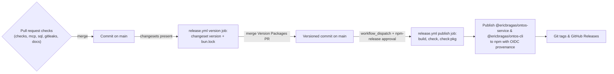

# Releases

A release is one version of the [Ontology service](./ontology-service.md) code and the 2 [packages](#packages) of that version. Each [Ontology service deployment](./deployment.md) pins an exact release version and upgrades on purpose.

## Contract

### Release numbers

- A release is a Git tag `vX.Y.Z` of this repo, where `X.Y.Z` is a semantic version. Source: [Semantic Versioning 2.0.0](https://semver.org/).
- A release increments the major version when an app must change before its Ontology service deployment can take the release. Examples: a change to the publish route contract, a supported concept that the Ontology service no longer accepts, the removal of an OSDK set, or a change to the [CLI contract](#public-contract). Source: [Semantic Versioning 2.0.0](https://semver.org/).
- A release increments the minor version when it adds something that no app must change for, such as a concept, an [OSDK set](#osdk-sets), or a route. Source: [Semantic Versioning 2.0.0](https://semver.org/).
- A release increments the patch version when it only fixes behavior. Source: [Semantic Versioning 2.0.0](https://semver.org/).
- A pre-release is a Git tag `vX.Y.Z-rc.N` with `N >= 1`. Source: [Semantic Versioning 2.0.0](https://semver.org/).
- The first stable public release is `v1.0.0`. Our rule.
- A maintainer publishes `v1.0.0` once all CI checks, MCP tests, SQL tests, and package verification (`publint` and `attw`) pass on `main`. Our rule.
- The [CLI](./cli.md) and the service package ship from this repo with each release, with the same version, as [Packages](#packages) specifies. Our rule.

### Public contract

- The public contract of 1.x is the list in this section. A release that changes an item so that an app must change is a major release, as [Release numbers](#release-numbers) specifies. Our rule.
- The CLI: its commands, arguments, and flags ([Commands](./cli.md#commands)). Its JSON on stdout, its JSON errors on stderr, and its exit codes ([Output](./cli.md#output)). The environment variables and files that it reads ([Inputs](./cli.md#inputs), [Targets](./cli.md#targets), [Sign-in](./cli.md#sign-in)). Its library entry `run(args, io?)` ([Library entry](./cli.md#library-entry)).
- The deployment file: its keys and the form of each value ([Deployment files](./deployment.md#deployment-files)).
- The routes, with their requests, answers, and errors: the OSDK HTTP API v2 routes ([HTTP API](./http-api.md#routes)), the token compatibility route `POST /multipass/api/oauth2/token` ([The token route](./authentication.md#the-token-route)), and the 5 routes under `/api/ontology-service/v1/` ([Publish](./publish.md#route), [Install](./publish.md#install), [Organizations](./authentication.md#organizations), [Targets](./cli.md#targets), [Permission catalog](./ontology-service.md#permission-catalog)).
- An Ontology service deployment serves 1 product, as [What the app publishes](./publish.md#what-the-app-publishes) specifies.
- The grants file: its keys and the form of each value ([The grants file](./ontology-as-code.md#the-grants-file)), and the permissions of the Ontology service, such as `ontology:install`.
- The environment variables that a deployment reads ([Deployment files](./deployment.md#deployment-files)).
- The Ontology SDK package name and its `production` tag ([Ontology SDK package](../ontology/ontology-sdk/ontology-sdk.md#ontology-sdk-package)).
- The OSDK sets of the release ([OSDK sets](#osdk-sets)), and the Node engine range `>=24` of both packages.
- The concepts that a publish accepts ([Ontology-as-code](./ontology-as-code.md)), and the [out-of-scope list](./out-of-scope.md).
- The test entry `@ericbragas/ontos-service/testing`: `startLocalService`, its options, and its result ([Local service](./testing.md#local-service)).
- These parts are internal, and any release can change them: private modules inside `packages/service/src/` not re-exported by `package.json` `exports`, the internal files of `packages/cli` not exposed by the root export or `ontos` binary ([Library entry](./cli.md#library-entry)), and the tests and `tools/` of this repo. Our rule.
- A minor release adds to the contract: a command, a flag, an output field, a deployment file key, a route, or an OSDK set. An app that does not use the addition works with no change. Our rule.
- A deprecated item works in each later 1.x release. Its use gives a warning. Only a later major release removes it. Our rule.
- Only the newest major version gets fixes. Once a new major version ships, earlier major versions stop receiving fixes. Our rule.
- Within a major version, a CLI reads each deployment file that a later CLI of the same major version wrote, as [Deployment files](./deployment.md#deployment-files) specifies. Our rule.

### Pre-releases

- Stable releases publish under the `latest` dist-tag by default. A pre-release `X.Y.Z-rc.N` uses Changesets pre-release mode (`bun x changeset pre enter next`) and publishes under the `next` dist-tag. Our rule.
- Each release, pre-release or stable, must pass the full CI suite on `main` (`checks`, `mcp`, `sql`, `gitleaks`, and `docs`) before publish. Our rule.
- Before a major release, maintainers run the conformance suite across every listed OSDK set and verify package exports with `bun run check:pkg`. Our rule.

### Release workflow

- Releases use [Changesets](https://github.com/changesets/changesets) configured in `.changeset/config.json` with fixed versioning across `@ericbragas/ontos-service` and `@ericbragas/ontos-cli` so both packages always ship the same version. Our rule.
- `.github/workflows/release.yml` runs on pushes to `main` (and manual `workflow_dispatch`) with SHA-pinned GitHub Actions. When pending `.changeset/*.md` files exist, the `version` job runs `bun x changeset version && bun install --lockfile-only` via `changesets/action@v2` and opens or updates a version pull request (`chore(release): version packages`) that bumps `package.json` versions, syncs `bun.lock`, and updates `CHANGELOG.md`. Our rule.
- Normal commits to `main` with no pending changesets do not trigger a publish. After the version pull request merges to `main`, a maintainer triggers `.github/workflows/release.yml` via `workflow_dispatch` (gated by the `npm-release` GitHub environment). The `publish` job runs `bun run build`, `bun run check`, and `bun run check:pkg`, then publishes `@ericbragas/ontos-service` and `@ericbragas/ontos-cli` to public npmjs using npm trusted publishing (OIDC with `--provenance` and `id-token: write` scoped strictly to the publish job) and creates GitHub Releases. Our rule.
- Only the `release` workflow publishes packages to npm or creates release tags. Our rule.

### Packages

- This repo publishes 2 public npm packages under Apache-2.0: `@ericbragas/ontos-service` and `@ericbragas/ontos-cli`. Both declare `"publishConfig": { "access": "public" }`. Our rule.
- `@ericbragas/ontos-cli` ships the bundled `dist/ontos.js` binary (`ontos`), `dist/ontos.d.ts` declarations, `package.json`, `LICENSE`, and `NOTICE`. Our rule.
- `@ericbragas/ontos-service` ships compiled ESM bundles and declarations in `dist/` (`.`, `./client-config`, `./publish`, `./convert`, `./testing`, plus standalone server `dist/node.js` and worker `dist/worker.js`), `osdk-sets.json`, `package.json`, `LICENSE`, and `NOTICE`. Both packages are verified by `publint` and `attw --pack --profile esm-only` (`bun run check:pkg`). Our rule.
- Pre-releases publish under the `next` dist-tag, and stable releases publish under the `latest` dist-tag. Source: [npm-publish](https://docs.npmjs.com/cli/v11/commands/npm-publish#tag).
- Each app pins the exact version of `@ericbragas/ontos-cli` and, when using `@ericbragas/ontos-service/testing` or `ontos dev`, the matching version of `@ericbragas/ontos-service`. Our rule.
- [Code layout](./code-layout.md#packages) specifies the 2 packages in this repo.

### OSDK sets

- An OSDK set is one exact version of each of `@osdk/maker`, `@osdk/maker-experimental`, `@osdk/client`, `@osdk/cli`, and `@osdk/functions`. Our rule.
- Each OSDK set also names, in `platformPackages`, the exact version of `@osdk/foundry.ontologies` that its `@osdk/client` depends on, plus the version of `@osdk/foundry.admin` that depends on the same `@osdk/foundry.core` as that `@osdk/client`. App server code calls routes that the stock client does not call, such as Object Edit History and the user routes, through them. The publish check and the cold-start check compare only the 5 packages above. Our rule.
- Each release lists the OSDK sets that it supports, in `packages/service/osdk-sets.json`. The Ontology service reads it at publish and in the cold-start check, and the conformance tests read it. Our rule.
- An app pins the exact versions of one OSDK set that the release of its Ontology service deployment lists. Our rule.
- Each [publish](./publish.md) names the app's OSDK set. The Ontology service refuses a set that its release does not list. The error names the listed sets. Our rule.
- An entry of `osdk-sets.json` can hold `"deprecated": true`. A publish with a deprecated set succeeds, and the CLI prints a warning that names the set and the sets that are not deprecated. Our rule.
- The first entry of `osdk-sets.json` is not deprecated, because `ontos init` seeds a new app with the packages of the first OSDK set. Our rule.
- A release in major version X, stable or pre-release, keeps each OSDK set of each earlier stable release of X, deprecated or not. A pre-release promises no OSDK set. Only a new major version removes a set of a stable release. Our rule.
- After the first release of a new major version, only that major version gets fixes. Our rule.
- When a release does not list the OSDK set of the product version of an installation, the cold-start check fails, as [Compatibility with earlier releases](#compatibility-with-earlier-releases) specifies. Our rule.

### Release checks

- CI runs the unit, MCP, SQL conformance, secret scanning, and docs checks on every pull request and push to `main`. [Testing](./testing.md#conformance-tests) specifies them. Our rule.
- The conformance tests run the stock `@osdk/client` of each listed OSDK set against the Ontology service built from the commit on PostgreSQL 17. They publish test Ontologies, run queries, and apply Actions. Our rule.
- Smoke checks on a deployed service verify:
  - `GET /api/ontology-service/v1/client-config` returns `200` without a token.
  - `GET /api/v2/ontologies` returns `401` without a token (confirming cold-start checks passed instead of returning `503`).
  - `GET /src/handler/index.ts` returns `404` (confirming source files are never served).
  - MCP endpoints pass the [smoke checks](./ontology-mcp.md#smoke-checks) when `ONTOLOGY_MCP=true`.

### Compatibility with earlier releases

- A release changes the database only with engine changes that add, so an earlier release can read the tables of a later release. [Storage](./storage.md#engine-changes) specifies engine changes.
- A rollback to an earlier release does not undo publishes. An earlier release can serve an environment only when it supports the newest product version of that environment: its OSDK set, and each concept that its IR uses. Our rule.
- An environment with no product version and no Ontology passes the cold-start check, so the first publish and smoke checks work. A new Ontology of a product with no version cannot be installed, as [Install](./publish.md#install) specifies. Our rule.
- A stored product version whose grants file does not parse passes the cold-start check and serves no types until a valid grants file is published, as [Access](./authentication.md#access) specifies. Our rule.
- At cold start, the Ontology service checks that it supports the newest version of each installed product, which is the Ontology version of each Ontology, as [Applying](./publish.md#applying) specifies. It checks the stored IR of each such product version as [Ontology-as-code](./ontology-as-code.md) specifies, and checks that its release lists the stored OSDK set. When a check fails, the Ontology service answers each request with HTTP status 503. Our rule.
- A release does not change the Ontology metadata that an environment serves. Only a publish changes it. [Publish](./publish.md#versions) specifies it.

## Diagram

Each pull request runs the full CI suite (`checks`, `mcp`, `sql`, `gitleaks`, `docs`) before merging to `main`. Changesets tracks version bumps in `.changeset/*.md` and opens a version PR on `main`. After that version PR merges, a maintainer triggers the `release` workflow via `workflow_dispatch` to publish `@ericbragas/ontos-service` and `@ericbragas/ontos-cli` with npm OIDC trusted publishing.

## Serves

- [Ontology SDK](../ontology/ontology-sdk/ontology-sdk.md)

## Related

- [Ontology service deployment](./deployment.md)
- [ADR 0006: Each app owns its Ontology service deployment](../adr/0006-each-app-owns-its-ontology-service-deployment.md)
- [Ontology service](./ontology-service.md)
- [Publish](./publish.md)
- [Storage](./storage.md)
- [Ontology-as-code](./ontology-as-code.md)
- [CLI](./cli.md)
- [Code layout](./code-layout.md)
