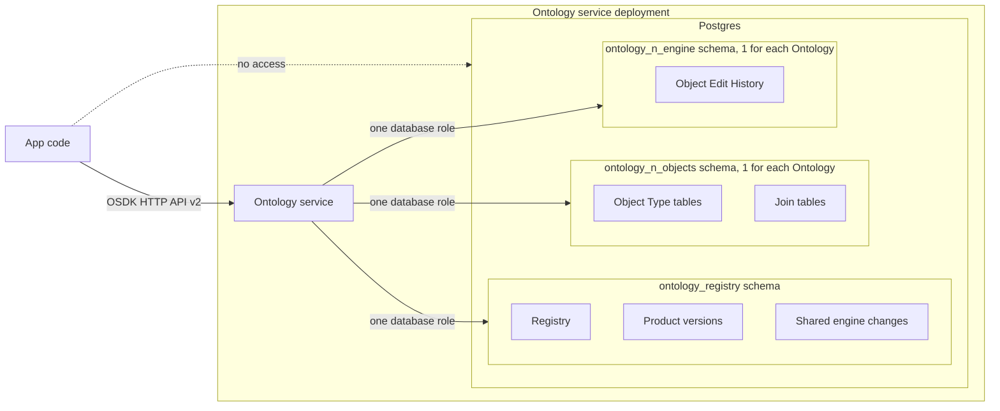
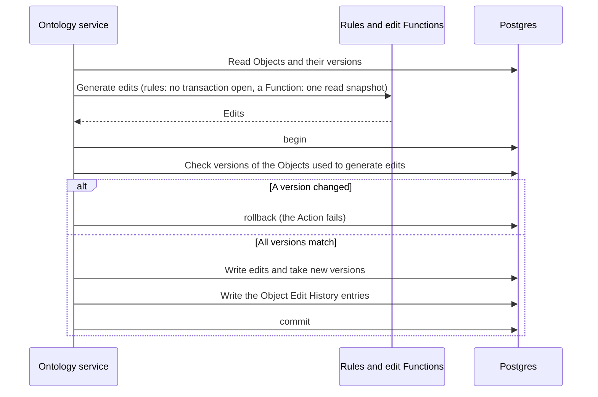

# Storage

Storage is how the [Ontology service](./ontology-service.md) keeps Objects, Links, edits, and history in the Postgres database of its Ontology service deployment. The Ontology service creates the tables, and it reads and writes them. The decision to keep all Ontology logic in the Ontology service is in [ADR 0002](../adr/0002-ontology-logic-in-the-ontology-service.md).

## Contract

### Ownership

- The Ontology service owns the database of its Ontology service deployment. No app connects to it. Our rule.
- The Ontology service owns the table of each Object Type. An app does not map an Object Type onto a table that it owns. Source: Create an object type (an Object Type with no backing datasource, whose Properties Actions fill).
- Data enters an Object Type table only through Actions. Source: Action types overview.
- The Ontology service holds all Ontology logic: Action rules, submission criteria, edit Functions, and Object Set filters. Postgres stores the data, and enforces primary keys, `not null`, column types, and the constraint of each [Uniqueness constraint](../ontology/object-link-types/properties.md#uniqueness-constraints). Our rule.
- Storage uses one Postgres extension, `pg_trgm`, for the text search index. An engine change creates it. `pg_trgm` is a trusted extension, so the role of the Ontology service needs only the `CREATE` privilege on its database to create it. Sources: [pg_trgm](https://www.postgresql.org/docs/17/pgtrgm.html) ("it can be installed by non-superusers who have `CREATE` privilege on the current database"), [Neon extensions](https://neon.com/docs/extensions/pg-extensions) (`pg_trgm` 1.6).
- An engine change creates `pg_trgm` in `ontology_registry`, and each text index uses `ontology_registry.gin_trgm_ops`. Our rule.

### Schema and access

- The shared schema `ontology_registry` holds the [registry](#registry), the table of product versions, and the table of applied shared engine changes. Nothing else is shared between Ontologies. Our rule.
- Each Ontology has 2 schemas: its Object schema, with its Object Type tables and join tables, and its engine schema, with its engine tables, such as the table of Object Edit History. So no Object Type or Link Type can have the same table name as an engine table. Our rule.
- [Install](./publish.md#install) names the Object schema of a new Ontology `ontology_<n>_objects`, and its engine schema `ontology_<n>_engine`, where `<n>` is the number of its registry row. The names come from the registry, not from the Ontology RID. Our rule.
- A [restore](#restore) gives an Ontology 2 new schemas, `ontology_<n>_objects_<stamp>` and `ontology_<n>_engine_<stamp>`, where `<stamp>` is the time at which the script starts, in UTC, as `YYYYMMDDHHMMSS`. The registry row then names them. Our rule.
- No schema is named `ontology` or `ontology_service`. The Ontology service never reads or writes a schema with those names, so the schemas of an earlier layout stay as they are. Our rule.
- The Ontology service connects as one database role. Only that role can use its schemas. Our rule.
- Row-level security is on for every table in each of its schemas. Its only policy lets the role of the Ontology service read and write all rows. Our rule.
- Row-level security does not apply to the role of the Ontology service on Neon. That role creates each table, so it owns it, and no table has `FORCE ROW LEVEL SECURITY`. A table owner bypasses row security unless the table forces it. So the policy above never filters a row for that role. Source: [Row security policies](https://www.postgresql.org/docs/17/ddl-rowsecurity.html) ("Table owners normally bypass row security as well, though a table owner can choose to be subject to row security with ALTER TABLE ... FORCE ROW LEVEL SECURITY").
- Each time column in each of its schemas is `timestamptz`. The Ontology service writes each time in UTC. Our rule.

### Registry

- The registry has 1 row for each Ontology: its number, its Ontology RID, its API name, its display name, its 2 schema names, its product, its Ontology version, its owner Organization, and the count of its per-Ontology engine changes. Our rule.
- The shared engine change `0006-installation-hold` added `held boolean NOT NULL DEFAULT false` to the registry. The column stays, because an engine change only adds. No code reads or writes it, so the Ontology service treats a row with `held = true` as each other row. Our rule.
- The registry stores no failure of a publish and no step of an [upgrade](./publish.md#upgrade). Our rule.
- The table of product versions has 1 row for each product version: the product, the version, the IR, the Ontology metadata, the schema migrations, the OSDK set, the Functions, the grants file, the publisher, and the time. Our rule.
- [Install](./publish.md#install) creates the 2 schemas of a new Ontology and their tables, and adds its registry row, in 1 transaction. Our rule.
- Each request reads the schema names of its Ontology from the registry row of its Ontology RID. Our rule.

### Remap

- The remap gives each installation of a production Organization to its [Mirror Organization](../../GLOSSARY.md) in a staging database, as [Projects and environments](./deployment.md#projects-and-environments) specifies.
- The remap entry of the service package reads `DATABASE_URL_DIRECT`, `WORKOS_API_KEY`, and `NEON_BRANCH_ID` from the environment. When 1 of them is missing, it exits 1 before any call, and its error names each missing variable. Our rule.
- The entry reads each distinct owner Organization of the registry. For each one, it sends 1 `GET /organizations/external_id/<owner>` to the WorkOS environment of the key. A 200 gives the Mirror Organization of that owner, and a 404 means that the owner has no Mirror Organization. Our rule.
- A registry row whose owner is the empty text counts as a row with no owner: the entry sends no GET for it, and the remap does not change it. Our rule.
- Any other WorkOS answer stops the entry before the remap transaction, with exit code 1. Its error names the owner and the HTTP status, and the registry does not change. Our rule.
- The remap is 1 transaction on the direct PostgreSQL connection. It first takes the lock of install, `lockProductVersions`. So it never runs during an install or another remap, and 2 remaps at once end in the rows of 1 remap. Our rule.
- In its transaction, the remap runs `set_config('lock_timeout', '90s', true)` and `set_config('statement_timeout', '120s', true)` as their own statements, before it takes the lock. When the 90 seconds end, the remap changes nothing, prints 1 line on stderr with the `errorName` `PublishLockTimeout`, and exits 1. A repeat is safe. Our rule.
- A deadlock in the remap transaction ends it as the end of the lock wait does: the remap changes nothing, the entry prints 1 line on stderr with the errorName PublishLockTimeout, and exits 1. A repeat is safe. Our rule.
- The entry connects only to the database of its `DATABASE_URL_DIRECT`. Our rule.
- The entry reads `NEON_BRANCH_ID` from the environment: the ID of the target staging branch. Inside the remap transaction, it reads `current_setting('neon.branch_id', true)`. When the setting is missing or differs from `NEON_BRANCH_ID`, the entry exits 1 with 1 line on stderr, and writes nothing. So a connection string of another branch, such as production, fails closed. Our rule.
- On Neon, `neon.branch_id` is a `PGC_POSTMASTER` parameter set to the branch ID, so a session cannot override it; on plain Postgres, a session could pass `PGOPTIONS='-c neon.branch_id=<id>'`.
- In that transaction, the remap sets `organization` to the Mirror Organization on each row whose owner has one. It changes no other column, and no row whose owner has no Mirror Organization or has no owner. Our rule.
- The remap of a row whose owner is already a Mirror Organization changes nothing, because no Mirror Organization has a Mirror Organization. So a second remap changes no row. Our rule.
- The registry has no unique index on the owner and the API name. So the remap keeps a row on its owner when its Mirror Organization already has an Ontology of that API name, and calls the row a clash. It changes the other rows, and commits. Our rule.
- The entry prints 1 JSON object on stdout: `remapped`, a list of `{ontologyRid, apiName, from, to}` for each changed row, and `clashes`, a list of `{ontologyRid, apiName, organization, mirror}` for each clash. Each list is in the order of the registry number. Our rule.
- The entry exits 1 when `clashes` is not empty, and 0 otherwise. Our rule.

### Restore

- An operator restores 1 Ontology of production with `node tools/ops/restore-ontology.ts restore <rid>`. A restore of the whole database puts back each other Ontology too. Our rule.
- `restore` reads `DATABASE_URL_DIRECT` of production, and `RESTORE_SOURCE_URL`, the direct connection string of a point-in-time PostgreSQL copy or branch at the restore time, from the environment. It connects to both as the role `ontology_service`. When 1 of them is missing, it exits 1 before any call, and its error names each missing variable. Our rule.
- When `restore` cannot connect to 1 of its 2 databases, its 1 line on stderr starts with `The production connection failed.` or `The source connection failed.` Then it gives the fixed line of the error code. It holds no URL, no host, and no message text. Our rule.
- `drop` reads only `DATABASE_URL_DIRECT`. When it is missing, `drop` exits 1 before any call, and its error names it. Our rule.
- `restore` is a dry run by default, and writes nothing. Our rule.
- A write of `restore` needs `--write` and `--confirm-rid <rid>`, with the RID of the command. Our rule.
- An unknown flag, an unknown RID in either database, 1 write flag alone, or a `--confirm-rid` with another RID exits 1, and writes nothing. Our rule.
- `restore` prints 1 JSON line on stdout: `ontologyRid`, `from` and `to`, each with `objectSchema`, `engineSchema`, `version`, and `engineChangeCount`, `copyVersion`, and `orphans`. `from` is the live row, and `to` is the row after the switch. The `version` of `to` is the newest version of the product, and `copyVersion` is the version of the source row. Each refusal of the script is 1 text line on stderr. Our rule.
- When `restore` or `drop` fails with an error, it prints 1 fixed line on stderr, and exits 1. The line holds no field of the error but the code, because a field can hold the database URL with its password. It holds a code or a class name only when that is 1 word of at most 64 letters, digits, or underscores. Our rule.
- The line gives the error code and the fixed hint of each code that `tools/ops/args.ts` lists. For an error with no code, it gives the class name of the error. The error of `pg` for a server with no SSL also gets the SSL hint. A code that is not 1 word gets 1 fixed line with no code. A thrown value with no usable class gets 1 fixed line with no class. Our rule.
- A write copies the 2 schemas of the Ontology in the source branch into the 2 new schemas of [Schema and access](#schema-and-access), with each table, column, primary key, `NOT NULL` constraint, unique constraint, default, index, row-level security policy, and row. Each unique constraint keeps `DEFERRABLE INITIALLY DEFERRED`. It runs as the role `ontology_service`, which is not a superuser. Our rule.
- `restore` runs `set_config('statement_timeout', '10min', true)` as its own statement at the start of 2 transactions: its copy transaction on production, and its read-only snapshot of the source branch. On production, the limit covers each statement of the copy, such as the index build of a large table. On the source, the read of each table is 1 statement that stays open while its rows are written to production, so the limit covers the copy of each table. So the copy can pass the 60 second role default of [Connection](#connection). Each limit ends with its transaction. Our rule.
- Before any write, `restore` lists each schema of the form `ontology_<n>_objects_<stamp>` or `ontology_<n>_engine_<stamp>` for the `<n>` of the row that no registry row names. It prints them in the `orphans` field of its JSON line, and continues. Each stamp is the start time of a run, so each new name is new, and such a schema never blocks a restore. An operator removes it with `drop`. Our rule.
- When a schema with a new name exists and a registry row names it, `restore` exits 1, names the schema, and writes nothing. So a copy never writes into a live schema. Our rule.
- Before any write, `restore` compares 3 records with the lists of its own checkout: the applied shared engine changes of the production database, the count of per-Ontology engine changes of the registry row of the RID in the production database, and the same count of the row of the RID in the source branch. The shared changes must be the same set as the shared list. The count of the production row must equal the length of the per-Ontology list, and the count of the source row must not be above it. Otherwise it exits 1, names each difference, and writes nothing. So `restore` runs only from a checkout of the newest release whose engine changes the database has. An earlier release removes no engine change, as [Engine changes](#engine-changes) specifies. So after a rollback, that checkout is of the later release, not of the release that production runs. Our rule.
- Under the row lock, before it changes the row, the switch compares 2 records with its checkout again. They are the applied shared engine changes of the production database, and the count of per-Ontology engine changes of the live row. A cold start of a newer release during the copy can change either. A cold start raises the count under the same row lock, so the switch reads the current count. No row lock covers the shared changes, so the switch reads the set that committed before its read. When either record differs, `restore` exits 1 and names each difference. It switches nothing, and says to run `restore` again with the checkout of the release that made the change. So the switch never lowers the count that a newer release set. Our rule.
- Under the row lock, before it changes the row, the switch checks that both new schemas exist. When 1 is missing, it exits 1, names it, and changes nothing. Our rule.
- `restore` checks that the production database has the version of the source row in the product versions of the product of the row. It checks before any write, and again under the row lock. When the version is missing, `restore` exits 1, names the version, and changes nothing. Our rule.
- `restore` checks that the source row has the number of the live row. It checks before any write, and again under the row lock. When the numbers differ, `restore` exits 1, names both numbers, and changes nothing. Our rule.
- `restore` checks that the role of its production connection owns the Object schema of the live row. It checks before any write, and again under the row lock. When it does not, `restore` exits 1, names both roles, and changes nothing. Our rule.
- Then the switch is 1 transaction. It locks the registry row with `lockInstallation`, and reads the newest version of the product in a statement after that lock. It applies to the new schemas each per-Ontology engine change above the count of the source row. Then it runs the chain of [Upgrade](./publish.md#upgrade) on the new schemas, from the version of the source row to the newest version. Then it sets the row: the 2 new schema names, the newest version, and the number of per-Ontology engine changes of the release. Our rule.
- So a restore brings the data of 1 installation back, and upgrades it to the newest version in the same step. A copy on the newest version switches with no step. A copy that is 1 version old or 2 versions old ends on the newest version, and each step runs 1 time on the copied schemas. Our rule.
- When a step of the chain fails, the restore fails. The transaction rolls back, the row keeps its old schemas and its old version, and requests still read the old schemas. Our rule.
- After a failed step, the script exits 1 with 1 line on stderr: `The upgrade from version <version> failed at version <failedVersion> on "<change>" with <errorName>, so the row did not switch.` `<change>` and `<errorName>` are those that a publish gives for the same failed step, as [Upgrade](./publish.md#upgrade) specifies. The line ends with the schemas that the copy left, as each refusal of the switch does. It holds no parameter of the error, because a parameter can hold a stored value. Our rule.
- A fault of the database in the chain, as [Applying](./publish.md#applying) defines it, is not a failed step. The script prints its fixed error line, and the row does not switch. Our rule.
- The switch takes no lock of the product versions. A publish that stores a newer version must lock this row first. So no publish commits between the read of the newest version and the commit of the switch. Our rule.
- A publish that starts during a switch waits for the row lock. After its `lock_timeout`, it gets 409 `PublishLockTimeout`, and the CLI tries again. A switch that starts during the transaction of a publish waits for it, and then upgrades the copy to the version that the publish stored. Our rule.
- The tables of the chain are in the copied schemas, which no registry row names before the commit. So the table locks of the chain wait for no request.
- In its transaction, the switch runs `set_config('lock_timeout', '90s', true)` and `set_config('statement_timeout', '120s', true)` as their own statements, before the row lock. When the 90 seconds end, the script switches nothing, prints its JSON line with the `errorName` `PublishLockTimeout`, and exits 1. A repeat of the command is safe. Our rule.
- Each exit of `restore` after the copy starts names the 2 new schemas. An error of the copy ends its 1 line on stderr with `The copy may have left the schemas <object> and <engine>.` The server can commit the copy after the connection ends, so the schemas can exist. When the lock wait of the switch ends, its JSON line holds them in `left`. A refusal of the switch ends its 1 line on stderr with `The copy left the schemas <object> and <engine>.` The server can also commit the switch after the connection ends. So after an error of the switch, the script waits for the row lock on a new connection, and reads the row. Then its 1 line on stderr ends with `The row switched to the schemas <object> and <engine>.` or `The row did not switch. The copy left the schemas <object> and <engine>.` When that read fails, the line ends with `The script could not read the registry row, so the row may have switched to the schemas <object> and <engine>.` The schemas that the copy left stay until `drop` removes them, and the next run lists them in `orphans`. Our rule.
- The old schemas stay after the switch. An operator drops 1 of them with `node tools/ops/restore-ontology.ts drop <schema>`. Our rule.
- `drop` is a dry run by default, and writes nothing. It prints 1 JSON line on stdout: `schema`, and `dropped`, which is `true` only after a write. Each refusal is 1 text line on stderr. Our rule.
- `drop` of a schema that does not exist exits 1 with 1 line on stderr that names it, and writes nothing. Our rule.
- A write of `drop` needs `--write` and `--confirm-schema <schema>`, with the schema of the command. An unknown flag, 1 write flag alone, or a `--confirm-schema` with another schema exits 1, and drops nothing. Our rule.
- `drop` reads `<n>` from the schema name. In 1 transaction, it locks the registry row of number `<n>` with `SELECT ... FOR UPDATE`, checks the schema, and drops it. So a `drop` never runs between the check of a switch and its commit. Our rule.
- In its transaction, `drop` runs `set_config('lock_timeout', '90s', true)` and `set_config('statement_timeout', '120s', true)` as their own statements, before the row lock, as the switch does. When the 90 seconds end, `drop` drops nothing, prints its JSON line with `dropped` `false` and the `errorName` `PublishLockTimeout`, and exits 1. A repeat of the command is safe. Our rule.
- `drop` refuses a schema that a registry row names, and a schema whose name is not `ontology_<n>_objects`, `ontology_<n>_engine`, or one of them with `_<stamp>`. Each refusal exits 1, and drops nothing. Our rule.
- A restore goes back to the time of the source branch. So each write to the Ontology after that time is not in the restored Ontology, also an apply that commits to the old schemas during the copy. The old schemas keep each such write until `drop`.
- A request reads the schema names of its Ontology from the registry row, as [Registry](#registry) specifies. So a request that starts before the switch reads the old schemas, and a request that starts after it reads the new ones.
- A request that starts during the copy reads the old schemas, because the registry row names them until the switch commits. So no request reads the schemas of a copy that has no switch yet. Our rule.
- A publish that waits for the row lock of the switch reads the new schema names under that lock. So no step of a publish runs on the old schemas after the switch. Our rule.

### Connection

- The Ontology service connects with Neon's pooled connection string, which runs PgBouncer in transaction mode. Source: [Connection pooling](https://neon.com/docs/connect/connection-pooling).
- Each Vercel Function instance creates one `pg` pool with `max: 10` at module scope, and registers it with `attachDatabasePool`. When the pool of Neon's pooler is full, a client waits for up to 120 seconds (`query_wait_timeout=120`). Sources: [Connection pooling with Functions](https://vercel.com/kb/guide/connection-pooling-with-functions), [Connection pooling](https://neon.com/docs/connect/connection-pooling) ("Maximum time (seconds) a query waits for a connection from the pool").
- Each connection requires SSL. Our rule.
- The Ontology service connects with `sslmode=verify-full`, which checks the certificate and the host name. It replaces the `sslmode` value `prefer`, `require`, or `verify-ca` of a connection string with `verify-full`, the mode that `pg` 8 already uses for them. So `pg` writes no SSL deprecation warning. A test database on this computer keeps its connection string. Source: `pg-connection-string` 2.14.1 `index.js` ("If you want the current behavior, explicitly use 'sslmode=verify-full'").
- The Ontology service keeps no session state: no `SET` outside a transaction, and no SQL-level `PREPARE`. Source: [Connection pooling](https://neon.com/docs/connect/connection-pooling) (transaction mode limits).
- Publish uses Neon's direct connection string, not the pooled one. Source: [Connection pooling](https://neon.com/docs/connect/connection-pooling).
- The role of the Ontology service has the role-level defaults `statement_timeout = 60s` and `idle_in_transaction_session_timeout = 90s`. Our rule. Each publish that applies sets them on Neon's direct connection, with `ALTER ROLE CURRENT_USER SET statement_timeout = '60s'` and `ALTER ROLE CURRENT_USER SET idle_in_transaction_session_timeout = '90s'`. A `validateOnly` publish does not set them. A role can set its own defaults, so publish needs no other privilege. Source: [ALTER ROLE](https://www.postgresql.org/docs/17/sql-alterrole.html) ("Ordinary roles can only set defaults for themselves").
- The role of the Ontology service has the role-level default `jit = off`. Our rule. Each publish that applies sets it on Neon's direct connection, with `ALTER ROLE CURRENT_USER SET jit = off`, next to the 2 timeouts. A `validateOnly` publish does not set it. An object set read runs with no transaction, so a setting for 1 read is not possible. With JIT on, Postgres compiles a wide derived read for far longer than the read takes: 10 values in each of 32 layers took 292 s with JIT and 0.7 s without it.
- The role of the Ontology service has no `transaction_timeout` default, because a value of the transaction cannot change a timer that already runs. Each publish that applies runs `ALTER ROLE CURRENT_USER RESET transaction_timeout`. A `validateOnly` publish does not. Our rule.
- Each publish sets the values of the release that runs it, so a later release changes them at its next publish. A role default applies to each new session, so a changed value reaches pooled requests when the pooler opens new server connections. A role-level setting persists on the pooled connection, and a `SET` outside a transaction does not. Sources: [ALTER ROLE](https://www.postgresql.org/docs/17/sql-alterrole.html) ("Whenever the role subsequently starts a new session, the specified value becomes the session default"), [Connection pooling](https://neon.com/docs/connect/connection-pooling) ("Set at the role level (persists across transactions)").
- 90 seconds is above the 60 second time limit of a [Function](../ontology/functions/functions.md#runtime) run. The read snapshot of a run stays open for the run, as [Writes](#writes) specifies, so the idle limit does not end it. Our rule.
- [Ontology service deployment](./deployment.md) specifies the Neon project and its branches.

### Table changes

- The Ontology service creates and changes its tables. No app changes the database directly. Our rule.
- The Ontology service also creates its own tables: the registry, the table of product versions, and the table of applied shared engine changes in the shared schema, and the table of [Object Edit History](../ontology/object-edits/edit-history.md) in the engine schema of each Ontology. Our rule.
- [Applying](./publish.md#applying) and [Upgrade](./publish.md#upgrade) specify how a new product version changes the tables of each Ontology.
- [Schema migrations](../ontology/object-edits/schema-migrations.md) specifies what happens to stored values.
- A Move renames the column of the old Property to the name of the new Property, because both have the same base type. A rename keeps the values and leaves no dropped column. Our rule.
- 2 API names can have the same column, such as `customerID` and `customerId`. A Move between them keeps the column and its values. Our rule.
- A Drop of a Property, and the Drop of the old Property in a base type change, drop its column. A dropped column stays in the 1,600 column limit. Sources: [ALTER TABLE](https://www.postgresql.org/docs/17/sql-altertable.html) ("The `DROP COLUMN` form does not physically remove the column"), [PostgreSQL limits](https://www.postgresql.org/docs/17/limits.html).
- [Object Types](../ontology/object-link-types/object-types.md#parts) specifies the column limit check at publish.

### Engine changes

- An engine change is a change that a [release](./releases.md) makes to the database, such as a new column in the table of product versions, or in each Object table. A publish makes the changes that come from an Ontology. Our rule.
- An engine change only adds: a table, a nullable column, a column with a non-volatile default, an index, or the `pg_trgm` extension. Stored JSON gets only optional fields. An engine change never drops, renames, or changes the type of a table, column, or field. Our rule.
- A release never changes the table layout of a concept that an earlier release supports. It only adds the layout of a new concept. Our rule.
- So an earlier release can read the tables of a later release. A release ignores the engine changes that it does not know. [Releases](./releases.md#compatibility-with-earlier-releases) specifies when an earlier release can serve the current Ontology version. Our rule.
- The engine changes of a release are 2 ordered lists in the Ontology service code: the shared list, for the shared schema, and the per-Ontology list, for the 2 schemas of each Ontology. Each engine change has an ID and its SQL. [Code layout](./code-layout.md#modules) specifies the file. Our rule.
- The table `ontology_registry.engine_changes` holds the ID of each shared engine change that the database has. Our rule.
- The registry row of each Ontology counts the per-Ontology engine changes that its schemas have. Install sets the count to the length of the per-Ontology list of its release. Our rule.
- A release never changes the ID or the SQL of an engine change that an earlier release has. A correction is a new engine change with a new ID. Our rule.
- At cold start, before its first work that uses the database, the Ontology service applies each shared engine change of its release that the database does not have, in list order. It holds a Postgres advisory lock while it applies them, and uses the direct connection. Our rule.
- A route of access kind `ontology`, `organization`, or `publish` runs the cold start before the route runs. The MCP route runs it in each tool call, before the first read of the database. Our rule.
- The routes of access kind `token`, `public`, and `users`, an MCP request with no tool call, and a path with no route answer with no cold start, because they use no database. So an MCP client that connects wakes no database. Our rule.
- The Ontology service applies each shared engine change and writes its ID in one transaction. It ignores each ID in the table that its list does not have, because a later release wrote it. Our rule.
- Then 1 query finds each registry row whose count is below the length of the per-Ontology list. For each such Ontology, 1 transaction applies the missing per-Ontology changes in list order, and raises its count. A release with a shorter list changes nothing. A cold start that fails resumes from the counts. Our rule.
- Only a cold start applies missing per-Ontology engine changes. During a deploy, a server of the earlier release can install an Ontology after a server of the later release ran its cold start. That install sets the count of the Ontology to the length of the shorter list. A server does not run its cold start again after it succeeds. So the Ontology lacks the per-Ontology engine changes of the later release until the next cold start of a server of the later release. This is a known limitation.
- When the changes of 1 Ontology fail, the cold start goes on with each other Ontology. Then it fails with 1 error that names each Ontology that failed. Our rule.
- An engine change never rewrites or backfills a table, because it runs in a cold start. A nullable column or a column with a non-volatile default needs no rewrite. A volatile default or a type change rewrites the table. Source: [ALTER TABLE](https://www.postgresql.org/docs/17/sql-altertable.html) ("Adding a column with a volatile DEFAULT or changing the type of an existing column will require the entire table and its indexes to be rewritten").
- When the Ontology service cannot apply its engine changes, it answers each request that runs the cold start with HTTP status 503 `OntologyService:EngineChangesFailed`. A tool call gets that error as its tool error. Our rule.

### Names

- A table name is the snake_case form of the part of the Object Type API name after the API namespace. `com.example.crm.WorkOrder` becomes the table `work_order` in the Object schema of the Ontology. Each Object schema holds the Ontology of 1 product, and each product has one API namespace, so the prefix adds no information. Our rule.
- A column name is the snake_case form of the Property API name. `startDate` becomes `start_date`. Our rule.
- A join table name is the snake_case form of the Link Type API name. Our rule.
- PostgreSQL truncates each name to 63 bytes. Source: [Lexical structure](https://www.postgresql.org/docs/current/sql-syntax-lexical.html) ("the maximum identifier length is 63 bytes").
- The Ontology service refuses an Ontology where two API names have the same snake_case form in one scope, after truncation. Our rule.

### Objects

- The primary key Property of an Object Type is the primary key of its table. The table has no other key column. Source: Create an object type.
- Each Property is one column. Our rule.
- A required Property column is `not null`. Source: Required properties.
- An array Property is a Postgres array column. Our rule.
- [Properties](../ontology/object-link-types/properties.md#value-rules-on-write) specifies the value checks that the Ontology service does before it writes.
- Storage adds no Organization or tenant column, because each Ontology has its own schemas and exactly 1 owner Organization. Our rule.
- Each table has one hidden version column. The Ontology SDK does not show it, and the Ontology service reserves its name. Our rule.
- The version column is named `__version`. No column name from a Property API name can start with `_`, because a Property API name starts with a lowercase letter. Our rule.
- An Action that deletes an Object deletes its row. Our rule.

### Base type columns

Each [base type](../ontology/object-link-types/properties.md#base-types) maps to one Postgres type. Our rule.

| Base type               | Postgres type                                                                                                                                                                                                                        |
| ----------------------- | ------------------------------------------------------------------------------------------------------------------------------------------------------------------------------------------------------------------------------------ |
| String                  | `text`                                                                                                                                                                                                                               |
| Boolean                 | `boolean`                                                                                                                                                                                                                            |
| Integer                 | `integer`                                                                                                                                                                                                                            |
| Double                  | `double precision`                                                                                                                                                                                                                   |
| Decimal                 | `numeric(precision, scale)`, from the Property's declared precision and scale. The column holds the value padded to the scale, as [Value rules on write](../ontology/object-link-types/properties.md#value-rules-on-write) specifies |
| Date                    | `date`                                                                                                                                                                                                                               |
| Timestamp               | `timestamptz`, in UTC                                                                                                                                                                                                                |
| An array of a base type | An array of that base type's Postgres type, such as `text[]`                                                                                                                                                                         |
| Struct                  | `jsonb`, in the JSON form that [Properties](../ontology/object-link-types/properties.md#structs) gives                                                                                                                               |

- A Decimal struct field value is a JSON string in the `jsonb` of its struct, padded to the scale of the field, such as `{ "unitPrice": "12.5000" }`. Our rule.
- A struct column is `jsonb` with the default `'{}'::jsonb`. A struct that no edit set holds `{}`. A struct set to null holds SQL `NULL`, and a read gives no key for it. Our rule.

### Links

- A one-to-many Link Type uses a foreign key Property on the many side: a column that holds the primary key of the other Object. Source: Create a link type.
- A many-to-many Link Type uses a generated join table. The join table has one column for each side's primary key. Its primary key is the pair. Source: Create a link type ("Generate join table").
- The 2 columns of a join table are `a_<snake_case of side A's primary key>` and `b_<snake_case of side B's primary key>`, from the A and B sides of the Link Type in the IR. So the names never clash, also on a self-link or when both primary keys have the same name. Our rule.
- Link columns have no Postgres foreign key constraint. A Link to a missing Object resolves to no Object. Our rule.
- When an Action deletes an Object, the Ontology service deletes the Object's join table rows in the same transaction. Our rule.

### Indexes

- The Ontology service indexes each foreign key Property column and each join table column. Our rule.
- The Ontology service gives each [Searchable](../ontology/object-link-types/properties.md#searchable) String Property that is not an array a GIN index with the `gin_trgm_ops` operator class. The index makes the text search filter fast. Source: [pg_trgm](https://www.postgresql.org/docs/17/pgtrgm.html) (these indexes "support trigram-based index searches for `LIKE`, `ILIKE`, `~`, `~*` and `=` queries"). The filter gives `~` only the letters of each word, and checks the word edges with `regexp_like`, which pg_trgm does not read. pg_trgm reads each `~` expression to plan and to scan, and the wide Unicode brackets of the word edges cost about 3 ms each time. Our rule.
- The Ontology service gives each String array Property that an [object security policy](../ontology/object-security-policies.md) reads a GIN index on the expression `coalesce(array_remove("<column>", NULL), '{}')`, with the default operator class of `text[]`. This is the expression that the policy compares, so Postgres can use the index for each policy operator. Our rule. Sources: [Indexes on Expressions](https://www.postgresql.org/docs/17/indexes-expressional.html) ("the system sees the query as just WHERE indexedcolumn = 'constant'"), [GIN Indexes](https://www.postgresql.org/docs/17/gin.html) (Table 64.3: `array_ops` indexes `&&`, `@>`, `<@`, and `=`).
- Each [Uniqueness constraint](../ontology/object-link-types/properties.md#uniqueness-constraints) has 1 table constraint, `CONSTRAINT "<name>" UNIQUE ("<column>", ...) DEFERRABLE INITIALLY DEFERRED`, with the columns in the API name order of its Properties. Postgres makes 1 unique index with the same name. Our rule.
- The constraint is deferred, so a swap of 2 values in 1 write passes. A row with no value in 1 of its columns never clashes. Source: facts F2 and F5 of the design sketch, proved on Postgres 17.
- Each index of an Object schema is 1 of the indexes of this section. Our rule.
- Each index that a publish creates in an Object schema has the name `<kind>_<table>_<part>`, cut to 54 bytes, then `_` and the first 8 hex digits of the SHA-1 of `<kind>:<table>:<part>`. So the full name fits the 63-byte limit of Postgres. The kinds are `pk` (the primary key), `fk`, `join`, `trgm`, `policy`, and `unique`. The part is the column name, or for `unique` the rule name. So a Move keeps the name of a unique constraint, and 2 Object Types with 1 rule name get 2 names. Our rule.
- A primary key name has no column part: `pk_<table>`, with the hash of `pk:<table>`. So no index takes the default name of Postgres, such as `account_pkey`, which the table name of another Object Type can match. Our rule.

### Writes

- A rule-backed Action reads its Objects and runs its rules with no transaction open. Our rule.
- A function-backed Action runs its [Function](../ontology/functions/functions.md) in one read-only `REPEATABLE READ` transaction, so that all its reads see one snapshot. The transaction stays open for the run. Source: Manage published functions ("Function-backed actions automatically use one ontology snapshot for all read requests in a single run").
- Just before it opens each write transaction of an Action, the Ontology service checks the request. It checks again when the transaction has its database connection, before its first lock. When the client aborted the request, and the platform passed a disconnect signal, the Action writes nothing, and gets 400 `ActionRequestAborted` with `parameters: {}`. The check covers the OSDK apply route and the [Ontology MCP](./ontology-mcp.md#long-action-runs). No adapter passes that signal in v1.0, as [HTTP entry](./code-layout.md#http-entry) says. So in v1.0, an apply that the client drops runs to its end, and only its deadline stops its write. Our rule.
- Each apply has a deadline: 120 seconds after the request arrives on the OSDK apply route, and 50 seconds on the [Ontology MCP](./ontology-mcp.md#long-action-runs). No setting changes it. A `VALIDATE_ONLY` apply has no deadline, because it opens no write transaction. Our rule.
- At the same check, an apply with no time left before its deadline writes nothing, and gets 400 `ActionDeadlineExceeded` with `parameters: {}`. Our rule.
- The first statement of the write transaction is `SELECT set_config('transaction_timeout', $1, true), set_config('statement_timeout', '0', true)`. Its value is the time that remains at the second check, in whole milliseconds, such as `5000ms`. So the deadline is the only time limit of a statement in the write, and the role default of [Connection](#connection) does not end a lock wait before it. Our rule.
- Postgres ends a session whose transaction runs longer than `transaction_timeout`. Source: [Client Connection Defaults](https://www.postgresql.org/docs/17/runtime-config-client.html) ("Terminate any session that spans longer than the specified amount of time in a transaction.").
- When the limit ends, Postgres ends the session of the write transaction with code `25P04`, and rolls the transaction back. The limit covers each row lock wait, each edit statement, the insert of the Object Edit History entries, and the work of `COMMIT` before the commit record. The Action writes nothing, and gets 400 `ActionDeadlineExceeded` with `parameters: {}`. The pool drops the connection. Our rule.
- Postgres counts the limit from the statement that sets it. So a write can end later than its deadline by the time that this statement takes to reach Postgres. Our rule.
- When the write transaction fails before the Ontology service sends `COMMIT`, and the error is not an OSDK error, the service runs the check again. A request past its deadline then gets 400 `ActionDeadlineExceeded`. Nothing committed, because `COMMIT` did not run. Our rule.
- A `COMMIT` that Postgres answers with code `25P04` committed nothing, and gets 400 `ActionDeadlineExceeded`. Each other failure of `COMMIT` gets 500, because the commit may have landed. Our rule.
- Each attempt of a rule-backed Action runs both checks, and its write transaction gets the time that remains then. An attempt past the deadline gets 400 `ActionDeadlineExceeded`, not 409 `ObjectChanged`. Our rule.
- `ActionDeadlineExceeded` means that the Action wrote nothing. No commit starts later than the deadline plus the time that the limit statement takes to reach Postgres. The deadline limits only the write. Each step before the write keeps its own limit, so the answer of an apply can come later than its deadline, up to the `maxDuration` of [Deployment](./deployment.md). Our rule.
- A caller of the OSDK apply route that got no answer waits 150 seconds after it sent the request. Then it reads the Objects or their Object Edit History. It repeats only an apply that did not write, or an apply that is safe to repeat. Our rule.
- Through a connection pooler, the limit ends a row lock wait at the deadline, and a pooled session starts with a `transaction_timeout` of `0`. Our rule.
- 2 races stay. An abort that comes after the second check does not stop the write. A commit record that Postgres writes before the limit ends stays: the Action applied, and the call gets its answer when the commit ends. Our rule.
- Then the Ontology service opens one write transaction. It checks the version of each Object that the Action writes. It compares each version with the version that the Action loaded. For a function-backed Action, [Edit Functions](../ontology/functions/edit-functions.md#version-check) gives the version to compare. Source: Consistency and isolation ("Fails if another action changed an object this action **wrote**").
- The check is at the Object level. A change to any Property of a checked Object, or a delete of it, fails the check. Source: Consistency and isolation ("This applies even if the actions write to different properties of that object").
- For a rule-backed Action, the check covers each Object that a [rule](../ontology/action-types/rules.md) modifies or deletes. Source: Consistency and isolation.
- For a function-backed Action, [Edit Functions](../ontology/functions/edit-functions.md#version-check) specifies the Objects that the check covers.
- The check does not cover an Object that the Action only reads. Source: Consistency and isolation ("Objects the action only _reads_ do not contribute to conflict failures").
- So a rule-backed Action does not check an Object parameter that only a [rule value](../ontology/action-types/rules.md#values) or the [submission criteria](../ontology/action-types/submission-criteria.md) read. An example is the source Object of a copied Property. Our rule.
- When a checked version changed, the write transaction writes nothing. The Ontology service then runs a rule-backed Action again from the start, up to 5 attempts in total. Each attempt loads the parameters again, checks the submission criteria, runs the rules, and checks the versions. Source: Consistency and isolation ("Each retry re-executes the action from scratch using the action's configured isolation level, up to five attempts").
- The Ontology service does not run a function-backed Action again, because a Function can interact with external systems. Source: Consistency and isolation ("while actions with external system calls are not").
- When the last attempt fails, the Action fails with 409 `ObjectChanged`. [HTTP API](./http-api.md#errors) gives the error body. Source: Consistency and isolation ("If every attempt fails, the error is returned to the caller").
- So concurrent rule-backed Actions whose rule values come only from parameters usually all apply. A retry writes the same edits, and the last Action to commit wins. An Action that fails the check in all 5 attempts still gets 409 `ObjectChanged`. A retry can also fail the submission criteria, because it checks them against the changed Object. Our rule.
- When a rule-backed modify and a rule-backed delete of one Object overlap, the Action that fails the check runs again. A modify then finds no Object and fails with 404 `ObjectNotFound`. A delete then deletes the modified Object. A function-backed Action that fails the check gets 409 `ObjectChanged`, because it does not run again. A deleted Object never exists again. Our rule.
- The write transaction also locks each source and target Object of a many-to-many Link that the Action adds or deletes, unless the Action creates that Object. The lock checks the version that the Action loaded, as the check of a modified Object does. The version check of an overlapping modify or delete of a locked Object waits until the write commits. 2 Link edits of the same Object do not wait for each other. The modify then applies. The delete then also deletes the new Link. When the Object no longer exists at the lock, or its version changed, the write fails as a changed version fails. So no join table row to a deleted Object remains, and no Link edit writes on an Object that the Action did not load. Our rule.
- The write transaction writes the edits and the Object Edit History entries. All of them commit, or none of them commit. Our rule.
- The write transaction runs in `READ COMMITTED`, so each statement sees the rows that committed before the statement started. Source: [Transaction isolation](https://www.postgresql.org/docs/17/transaction-iso.html) ("sees only data committed before the query began").
- After its last statement that writes an Object table, the write transaction reads the Ontology version of its installation from the [registry](#registry) row, with no lock. No statement that writes follows this read before `COMMIT`. Only the `SET CONSTRAINTS ALL IMMEDIATE` statement of a uniqueness constraint can follow it. Our rule.
- When that version is not the version of the view of the request, the write transaction writes nothing, and the Action gets 409 `ObjectChanged` with `parameters: {}`. [Apply](../ontology/action-types/action-types.md#apply) specifies that a rule-backed Action does not run again after it. Our rule.
- A publish holds a `SHARE` lock on each table that it changes until its commit, as [Applying](./publish.md#applying) specifies. An edit statement takes `ROW EXCLUSIVE`, and `SHARE` conflicts with it. So a write and a publish that change 1 table run in 1 of 3 orders. Source: [Explicit locking](https://www.postgresql.org/docs/17/explicit-locking.html) (`SHARE`: "This mode protects a table against concurrent data changes"). Our rule for the answers.

| Order                                                      | What happens                                                                                                                                                                                    | Answer                                                                                                                                                       |
| ---------------------------------------------------------- | ----------------------------------------------------------------------------------------------------------------------------------------------------------------------------------------------- | ------------------------------------------------------------------------------------------------------------------------------------------------------------ |
| The publish locks the table first                          | The edit statement waits for the lock. The publish commits. The version read then sees the new version.                                                                                         | The write gets 409 `ObjectChanged` and writes nothing.                                                                                                       |
| The write locks the table first                            | The lock of the publish waits for the write. The version read sees the old version, and the write commits. The publish then checks the stored data under its lock, with the value of the write. | A value that the new version refuses fails the publish, as [Stored-data checks](../ontology/object-edits/schema-migrations.md#stored-data-checks) specifies. |
| The publish committed before the write transaction started | The version read sees the new version.                                                                                                                                                          | The write gets 409 `ObjectChanged` and writes nothing.                                                                                                       |

- A write that changes only tables that the publish does not lock does not wait for the publish. When its version read runs before the publish commits, it commits with the earlier view, because the publish changed no rule of those tables. Our rule.
- These 3 orders hold also for a publish that adds, changes, or removes a [Uniqueness constraint](../ontology/object-link-types/properties.md#uniqueness-constraints). So a write whose edit waits for the lock of such a publish gets 409 `ObjectChanged`, and writes nothing. Our rule.
- A create inserts its row with `ON CONFLICT ("<primary key column>") DO NOTHING`. Each such insert into an Object table names the primary key column as its conflict target. Postgres refuses `ON CONFLICT DO NOTHING` with no target on a table with a deferrable constraint. Our rule.
- A test over the SQL builders fails on an `INSERT ... ON CONFLICT DO NOTHING` into an Object table with no conflict target. Its message names the primary key target. Our rule.
- A create of a primary key that exists inserts no row. It gets 409 `ObjectAlreadyExists`, and the Action writes nothing, also on a table with a deferrable constraint. Our rule.
- A write with a create or a modify of an Object Type with a Uniqueness constraint runs `SET CONSTRAINTS ALL IMMEDIATE`. It runs after the version read, and before `COMMIT`. A write with no such edit does not run it. Our rule.
- So a clash fails inside the transaction, not at `COMMIT`. The version read comes first. So a write with an earlier view gets 409 `ObjectChanged`, not a 409 that names the old Properties of a changed rule. Our rule.
- `SET CONSTRAINTS` gives the Postgres code `23505` for a clash. On the constraint of a rule of the view, the Action gets 409 `PropertyValueAlreadyExists`, as [Uniqueness constraints](../ontology/object-link-types/properties.md#uniqueness-constraints) specifies. Our rule.
- On an Object table with a constraint that no rule of the view has, `23505` gives 409 `ObjectChanged`, because a publish changed the rules. Each other `23505` is a fault, with 500. No answer holds the Postgres message or its DETAIL, which holds the value. Our rule.
- 2 writes that create 1 value at the same time: the second waits at `SET CONSTRAINTS` until the first ends. When the first commits, the second gets 409 `PropertyValueAlreadyExists`. When the first rolls back, the second commits. Our rule.
- A move of a value from 1 Object to another, against a create of that value, never leaves 2 copies. 1 of the 2 writes gets 409 `PropertyValueAlreadyExists`, by commit order. Our rule.
- 2 writes that each write 2 values of a rule in crossed order wait for each other. Postgres ends 1 of them with a deadlock, `40P01`, and that write fails as a changed version fails. A rule-backed Action then runs again, and gets 409 `PropertyValueAlreadyExists` or commits. A function-backed Action gets 409 `ObjectChanged`. Our rule.
- The race model checks these orders with TLA+. It fails when `SET CONSTRAINTS` runs before the version read.
- The writer, the Object Edit History, and the `returnEdits` answer take only checked edits. A checked edit passed the [value rules on write](../ontology/object-link-types/properties.md#value-rules-on-write), and holds each Decimal padded to its scale. Our rule.
- Each create and each modify gives each Object that it edits a new version: a random non-negative 63-bit number in the `bigint` version column. Our rule.
- The Ontology service compares versions only for equality, in the version check and in the lock of a Link end. Nothing orders versions. Our rule.
- No answer, page token, or Object Edit History entry holds a version. Our rule.
- A step of an upgrade that sets a stored value of an Object with an `UPDATE` gives that Object a new version. An Object whose stored values the step does not change keeps its version. So the check of an Action that loaded the Object before the step fails. Our rule.
- A step that drops or renames a column rewrites no row, so it changes no version: a Delete Property, the Drop of a base type change, and a Move. Our rule.
- A version does not come from the transaction ID counter or the cluster. So a restore, a staging reset, or a move to a new cluster needs no change to the versions. A write repeats a given earlier version with a probability of 2^-63. This holds also for a row from before this rule. It also holds for an Object that is deleted and created again with the same primary key. Our rule.

### Object Edit History

- One table, `edit_history` in the engine schema of each Ontology, holds the entries of all Object Types of that Ontology. Each row is one entry. Its columns are `object_type`, `primary_key`, `created_at`, and `entry`. `created_at` is the time of the entry. `entry` holds the other fields of the entry as JSON, the Property values included. Our rule.
- This layout is an engine internal that the API does not show. It is the simplest layout today, and it can change without a deviation. Our rule.
- The writer builds the entries of an Action from the stored values of the rows that it locks, inside the write transaction. So an entry holds each stored value, also a value that a property security policy hides from the person. Our rule.
- A read of the history joins each entry to the current row of its Object, on `object_type` and `primary_key`. With no current row, it builds the row from the latest delete entry of the Object. A policy reads only String and String array Properties, so the read converts only those 2 forms from the JSON of that entry to their column types. Our rule.
- [Object Edit History](../ontology/object-edits/edit-history.md) specifies the entries.

## Diagram

[The publish model](./diagrams/publish-model.html) has a restore action: the copy into new schemas, and the switch with its chain. TLC model-checked it. Between transactions, each installation is on the newest version, no step runs twice, and a restore is all or nothing. The SQL tests of [Restore](#restore) carry these rules on Postgres.

[The write path model](./diagrams/write-model.html) draws the answer of a write whose transaction fails at each step, with 2 Actions that edit 1 Object. TLC model-checked it, and each of its rules holds.

Tables, roles, and access:

Apply an Action:

## Serves

- [Object Types](../ontology/object-link-types/object-types.md)
- [Properties](../ontology/object-link-types/properties.md)
- [Link Types](../ontology/object-link-types/link-types.md)
- [Action Types](../ontology/action-types/action-types.md)
- [Object Edit History](../ontology/object-edits/edit-history.md)

## Related

- [ADR 0002: Ontology logic runs in the Ontology service](../adr/0002-ontology-logic-in-the-ontology-service.md)
- [Ontology service](./ontology-service.md)
- [Publish](./publish.md)
- [Ontology service deployment](./deployment.md)
- [Schema migrations](../ontology/object-edits/schema-migrations.md)
