# Testing

Testing proves that the [Ontology service](./ontology-service.md) and the [CLI](./cli.md) follow their specifications and interoperate with stock `@osdk/*` packages and MCP clients against PostgreSQL 17. It also covers how an app developer tests local changes to an app's Ontology.

## Contract

### Test kinds

| Kind             | Checks                                                                                                                | Runs against                                                                                                           |
| ---------------- | --------------------------------------------------------------------------------------------------------------------- | ---------------------------------------------------------------------------------------------------------------------- |
| Unit test        | Pure compilers, planners, validators, and CLI modules with no database                                                | In-process Vitest (`unit` project)                                                                                     |
| SQL test         | Engine routes, transactions, migrations, security policies, Function workers, and restore operations                  | The service on the test PostgreSQL 17 container (`sql` project)                                                        |
| Conformance test | Served OSDK HTTP API v2 routes through the stock `@osdk/client` and generated Ontology SDKs                           | The service from `node.ts` on the test PostgreSQL 17 container                                                         |
| CLI test         | Every `ontos` command and library entry (`run(args, io?)`)                                                            | SQL CLI tests run against `node.ts` on PostgreSQL 17; unit CLI tests use a temporary directory and MSW/in-memory stubs |
| MCP test         | Every rule of the [Ontology MCP](./ontology-mcp.md), through the stock MCP TypeScript SDK client over Streamable HTTP | The service from `node.ts` on the test PostgreSQL 17 container (`mcp` project)                                         |
| Smoke test       | Deployed service health, auth enforcement, and MCP discovery, read only                                               | 1 environment of an Ontology service deployment, as [Releases](./releases.md#release-checks) specifies                 |

- All tests use Vitest. Our rule.
- This repository builds and runs all tests self-contained with no external service checkout or external cloud accounts. The reference test Ontologies live in `packages/service/twin/` and `examples/quickstart/`. Our rule.
- One test checks each OSDK HTTP API v2 route in the route table against `PLATFORM_API_IR` from `@osdk/docs-spec-platform`, as [Code layout](./code-layout.md#osdk-code) specifies.
- Tests that build or pack the CLI or the service share 1 build per run from a root global setup (`test/sharedBuild.ts`). Our rule.
- The restore SQL tests are split across 4 files (`tools/ops/restore-ontology-*.sql.test.ts`), so no SQL file dominates a SQL run. Our rule.

### Postgres

- Each test that touches a database uses PostgreSQL 17 (`mirror.gcr.io/library/postgres:17-alpine`), locally and in CI. Our rule.
- The test Postgres container of the SQL, MCP, and conformance suites runs with `fsync=off`, `synchronous_commit=off`, and its data directory on `tmpfs` while keeping the same PostgreSQL 17 engine behavior. Our rule.
- The test container builds 1 template database per run after `applyEngineChanges`. Each SQL test database clones a pre-migrated template with `CREATE DATABASE ... TEMPLATE`, except when a test needs an empty database or another encoding. Our rule.
- The tests connect with the same `pg` driver as production, as [Storage](./storage.md) specifies. Our rule.
- Each conformance run starts from an empty database. Our rule.

### Conformance tests

- A conformance test sends requests through a generated Ontology SDK and the stock `@osdk/client` against the live Ontos service on PostgreSQL 17, as app code does. Our rule.
- The [twin](../../GLOSSARY.md) in `packages/service/twin/` provides the reference test Ontologies, compiled IRs, seed data, and Function bundles for end-to-end verification. Our rule.
- Every conformance assertion uses explicit expected values derived from the OSDK HTTP API v2 specifications and Ontos contract rules. Our rule.
- When a request has no `orderBy`, tests compare Objects without depending on unspecified row order, as [Object Sets](../ontology/ontology-sdk/object-sets.md#order) specifies. Requests with `orderBy`, or aggregations with metric `direction`, assert exact order. Our rule.
- Conformance tests verify that every failed Action writes nothing, as [Action Types](../ontology/action-types/action-types.md#apply) specifies. Our rule.
- Conformance tests include a Function that exceeds its time limit and a Function that exceeds its heap limit. Each expects the Action to fail and write nothing, as [Functions](../ontology/functions/functions.md#runtime) specifies. Our rule.

### Policy twin

- The policy twin is a test Ontology of a jobsite product. It has a `CrewMember` Object Type with a `userId` Property, a many-to-many Link Type from Crew to Jobsite, and the [Person attribute](../ontology/object-security-policies.md#person-attributes) `jobsiteIds`. `Jobsite` and `DailyLog` have an object security policy on `jobsiteIds`, and 1 financial Property has a property security policy for the permission of the default role `admin`. Our rule.
- Its tests sign in as 2 crew members and an `admin`. Each person sees only their Objects in loads, aggregations, Search Around, Object Edit History, and the Ontology MCP, and a crew member reads the financial Property as null. A `user` parameter refuses a User ID that is not a member. Our rule.

### MCP tests

- An MCP test calls `/api/mcp` with the stock MCP TypeScript SDK client, as an MCP client does. No test calls a tool handler directly. Our rule.
- Each expected value of an MCP test is explicit, and each test name cites its spec section. Our rule.
- The MCP tests run on every pull request in the `mcp` CI job. Our rule.
- The test token issuers include a local JWKS issuer for AuthKit/OIDC audience testing. Our rule.
- MCP tests verify multiple MCP protocol revisions (including `2025-11-25` and `2026-07-28`) over Streamable HTTP JSON responses. Our rule.

### Test names

- A test that proves a spec rule names its section by its section ID, `<doc>#<anchor>`, such as `service/storage#writes`. `<doc>` is the path of the spec under `docs/`, or `GLOSSARY`, with no `.md`. `<anchor>` is the GitHub anchor of a heading. Our rule.
- CI checks that each section ID in a test name is a heading of its spec, with `tools/docs/spec-sections.ts`. Each test job writes a Vitest JSON report and passes it to `tools/docs/spec-sections.ts`. Our rule.

### Test rules

- `bun run lint` runs 32 of 34 rules of the `@interfere/landmines` Oxlint plugin as errors with zero allowlist debt, alongside `anti-slop` and `fallible` checks. See [Linting and static checks](../linting.md) for the complete rule list and rationale. Our rule.
- `strict-msw` requires `onUnhandledRequest: 'error'` on each MSW server of a test. Answer each request to a host outside the repo with MSW, and let any other request fail the test. Our rule.
- The repo pins `msw` at exactly 2.15.0. MSW 3 renames `onUnhandledRequest` to `onUnhandledFrame`, and the old key then only warns, so `strict-msw` would pass while a request reaches the real network. Move to MSW 3 only with the new key. Our rule.
- `no-fixed-sleep` refuses a fixed real-time sleep in a test, a hook, or a callback that runs while the test waits. Await the event, or use fake timers. Our rule.
- `no-flake-masking` refuses a test retry and a raised timeout in a test. Await the event, or move slow shared setup into `beforeAll`. Our rule.
- `no-unsignaled-poll` refuses `vi.waitFor` and `expect.poll` on a spy or a request log. Await a promise that the event resolves. Our rule.
- `no-test-doubles` refuses a test that replaces the behavior of a dependency, such as `vi.mock`, a `vi.spyOn` or `vi.fn` with an implementation, and a fake of `fetch` or of a global. Run the real code on the test Postgres, and use MSW for HTTP to a host outside the repo. A call-through spy that only observes is allowed. Our rule.
- `colocated-tests` requires each test file beside the code file that it tests. `test-file-names` requires the test names of [Code layout: Tests](./code-layout.md#tests). `package-exports` refuses a wildcard source export in a `package.json`. Our rule.
- `no-comments` runs at `error`, allowing functional directives (`oxlint-disable`, `@ts-expect-error`), single-line `// WARNING:`, `// SAFETY:`, and `// D1:` markers, and TSDoc on public package entrypoints. Our rule.
- `no-explicit-return-types` stays `off`, because `Fallible<T, E>` and `AsyncFallible<T, E>` generators require explicit return types so TypeScript tracks the exact yielded failure union. Our rule.

### CI

- `.github/workflows/ci.yml` runs on every pull request, push to `main`, and `merge_group` with SHA-pinned GitHub Actions. Our rule.
- The `checks` job runs `bun run build`, `bun run check` (`format:check`, `lint`, `typecheck`, `lint:dropped`, `knip`, and unit tests), `bun run check:pkg` (`publint` and `attw`), and `tools/docs/spec-sections.ts` on the unit test report. Our rule.
- The `mcp` job runs `bun run test:mcp` against PostgreSQL 17 in Docker and validates its spec sections with `tools/docs/spec-sections.ts`. Our rule.
- The `sql` job runs `bun run test:sql` against PostgreSQL 17 in Docker and validates its spec sections with `tools/docs/spec-sections.ts`. Our rule.
- The `gitleaks` job runs `gitleaks` against the repository, and the `docker` job builds the `Dockerfile` image. Our rule.
- Every workflow job that needs `node_modules` restores Bun and `node_modules` caches through `.github/actions/deps` and runs `bun install --frozen-lockfile` on a cache miss. Our rule.
- Dependabot opens weekly npm and GitHub Actions updates targeting `main`, grouping `@opentelemetry/*`, major updates (`other-major`), and minor/patch updates (`other`) separately. Our rule.
- Every Vitest run checks the running Node major version against `.nvmrc` in `vitest.config.ts` before any worker or Postgres container starts. Our rule.
- [Releases](./releases.md#release-checks) specifies how releases are checked and published.

### Local service

- The service package exports 1 test entry, `@ericbragas/ontos-service/testing`, with 1 function, `startLocalService`. An app calls it to run the tests of its own Ontology logic on 1 computer. Our rule.
- `startLocalService({ app, cli, folder, role, postgres })` starts 1 Ontology service in the process of the caller, on a free port of 127.0.0.1, and gives `{ url, token, stop }`. `cli` is the `run` of the CLI ([Library entry](./cli.md#library-entry)). `folder` is the app folder, and its default is the current folder. Our rule.
- The service trusts only a test token issuer of the start, and reads an in-process identity stub. No setting of a deployment can do this, as [Tokens](./authentication.md#tokens) specifies. Our rule.
- The start publishes the app with `ontos publish --app <app> --env staging --url <url> --skip-sdk-package`, through `cli`, with a GitHub OIDC token of the test issuer. The service uses the staging settings of the deployment file. Then the start installs the app for 1 test Organization. Our rule.
- `token` is a test token of 1 person, `ci+<app>@example.com`, with the role `role` in that Organization, for 12 hours. The default role is `admin`. A start fails when the grants file holds no such role. Our rule.
- Each start makes its own Postgres role and database. With `postgres`, the superuser URL of a Postgres on this computer, they are on that Postgres, and `stop` drops them. With no `postgres`, they are in a new Postgres container of the image `mirror.gcr.io/library/postgres:17-alpine`, and `stop` removes it. The first such start on a computer pulls that image from the network. So 2 starts can run at the same time, also in 1 process. Our rule.
- While a local service runs, each `fetch` of the process goes only to `127.0.0.1`, `localhost`, or `[::1]`, and a call to another host fails. A start refuses a `postgres` URL of another host, also one that a `host` parameter names. A start that fails stops what it started, and throws its own error. Our rule.
- After `stop`, the process holds no server, pool, or worker of the local service, so it can end. `stop` runs each of its steps, also after a step fails, and then throws the error. Our rule.
- A process that ends before `stop`, such as on Ctrl+C during a start, leaves its container. Remove it with `docker rm -f` and its name, which starts with `ontology-local-`. Our rule.
- A local run does not check real external identity provider sign-in, GitHub OIDC trust, hosting adapters, or external SDK registry publishing. A staging environment checks those integrations. Our rule.

### App developer loop

- An app developer can test locally with `ontos dev` against PostgreSQL 17, or against a staging deployment. Our rule.
- Automated tests of an app's Ontology logic run on 1 computer through `@ericbragas/ontos-service/testing` (`startLocalService`), with an isolated PostgreSQL database per run. Our rule.
- After a change to Ontology-as-code or a Function, the developer runs `ontos generate-osdk` to write the Ontology SDK locally, and `ontos validate` (with `--local` or against a target URL) to verify schema migrations and grants, as [Ontology SDK](../ontology/ontology-sdk/ontology-sdk.md) and [CLI](./cli.md) specify. Our rule.
- An Ontology change reaches a deployed environment when CI runs `ontos publish`, as [Publish](./publish.md#when) specifies.

## Diagram

```mermaid
flowchart LR
  subgraph CI["CI on every PR and push to main"]
    U["checks<br/>build, lint, typecheck,<br/>knip, check:pkg, unit"]
    M["mcp<br/>MCP SDK client tests"]
    S["sql<br/>engine, CLI, and<br/>@osdk/client tests"]
    G["gitleaks & docker<br/>secrets, image build"]
  end
  M --> N["Service from node.ts"]
  S --> N
  S --> P["PostgreSQL 17 container"]
  N --> P
```

## Serves

- [Object Sets](../ontology/ontology-sdk/object-sets.md)
- [Aggregations](../ontology/ontology-sdk/aggregations.md)
- [Action Types](../ontology/action-types/action-types.md)
- [Functions](../ontology/functions/functions.md)
- [Ontology SDK](../ontology/ontology-sdk/ontology-sdk.md)

## Related

- [Releases](./releases.md)
- [Code layout](./code-layout.md)
- [CLI](./cli.md)
- [HTTP API](./http-api.md)
